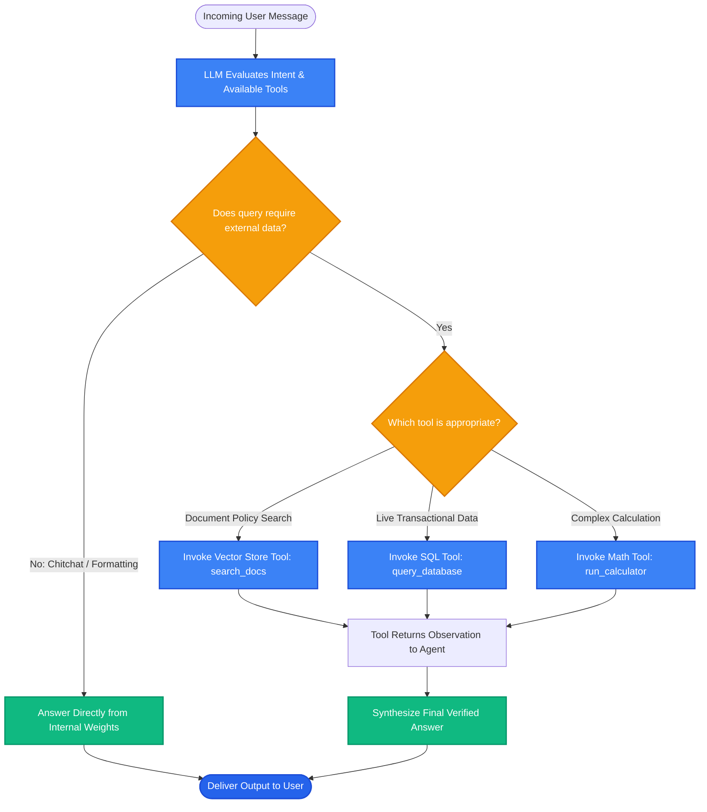

# Lesson 1: Tool-Using Retrieval Agents (Agentic RAG)

Man, welcome to Phase 12! In traditional RAG pipelines, retrieval is a hardcoded, unconditional step: every user message triggers an embedding call and a database search, even if the user just said *"Hello!"* or *"What is 25 * 40?"*

In **Agentic RAG**, we treat the retriever as a **Tool**. The LLM decides *whether* to retrieve, *which* database to search, and *when* to answer directly. Let's learn how retrieval agents work.


---

### Step 1: Why Do We Need This?

In a standard static RAG pipeline:
```
User Query ──► ALWAYS Embed ──► ALWAYS Search Vector DB ──► Send to LLM
```

This rigid, linear flow breaks in real-world applications:
1. **Unnecessary Database Calls:** If a user says *"Good morning!"* or *"Rewrite this email politely"*, the static pipeline still runs an expensive vector search, grabs 5 random chunks, and stuffs them into the prompt.
2. **Wrong Tool for the Job:** If a user asks *"Calculate our Q3 profit margin: revenue is $450k and expenses are $320k"*, vector search cannot help. The LLM needs a **calculator** or a **code interpreter**, not a text database.
3. **Multi-Source Confusion:** If your company has three separate databases (HR policies, GitHub code, and live customer orders), a static pipeline doesn't know which one to search.

We need an intelligent system that evaluates the user's intent first and dynamically chooses the right tool.

---

### Step 2: What Is It?

An **Agentic Retrieval System** turns the LLM into a decision-making agent equipped with a toolbox:
- **Tool 1: `search_company_policies`** (Vector store for HR & guidelines)
- **Tool 2: `check_order_status`** (SQL database for live customer orders)
- **Tool 3: `calculator`** (Python interpreter for exact math)

When a question arrives, the LLM analyzes it:
- If it's general chitchat -> **Answer directly** (0ms database latency).
- If it asks about company rules -> **Call `search_company_policies`**.
- If it asks about a shipping tracking ID -> **Call `check_order_status`**.

#### The Everyday Analogy: The Reflexive Clerk vs The Skilled Assistant
- **Standard RAG is a reflexive clerk:** No matter what you ask, they automatically run to the same backroom shelf, pull down a heavy encyclopedia, and slam it onto the counter. If you ask for the time, they still pull down the encyclopedia!
- **Agentic RAG is a skilled personal assistant:** They look at your question first. If they know the answer, they reply immediately. If you need a calculation, they open a calculator. If you need a contract, they walk to the filing cabinet and pull the exact file.

---

### Step 3: Real-World Example

Imagine an enterprise customer portal bot:

- **Turn 1 (Chitchat):**
  - User: *"Hi, who are you?"*
  - Agent decision: No tool needed.
  - Agent response: *"Hello! I am your SkillVault enterprise assistant. How can I help you today?"* (Saved vector search cost and latency!)

- **Turn 2 (Policy Retrieval):**
  - User: *"What is the policy for expense reimbursements?"*
  - Agent decision: Call `search_company_policies(query="expense reimbursement rules")`.
  - Agent response: *"Expenses must be submitted within 30 days via the Finance portal."*

- **Turn 3 (Live Order API):**
  - User: *"What is the status of invoice #INV-9821?"*
  - Agent decision: Call `query_sql_database(table="invoices", id="INV-9821")`.
  - Agent response: *"Invoice #INV-9821 was marked as PAID on October 14th."*

One unified agent handles conversational chitchat, static documents, and live transactional databases effortlessly.

---

### Step 4: How Does It Work?

Here is the Agentic Retrieval decision loop:

```
[User Question]
       │
[LLM Evaluates Query + Available Tool Schemas]
       │
{Does the query require external data?}
   ├── No  ──► Answer Directly (0 database overhead)
   └── Yes ──► Which tool is best?
                 ├── Needs Document Facts ──► Call search_vector_db(query)
                 ├── Needs Live SQL Data  ──► Call search_sql_db(id)
                 └── Needs Precise Math   ──► Call run_python_calculator(expr)
                               │
                       [Tool Executes]
                               │
                       [Tool Output Returned to LLM]
                               │
                [LLM Synthesizes Verified Answer]
```

---

### Step 5: Code Example

Here is a Python demonstration showing how an agent dynamically chooses between direct answers and calling a retrieval tool:

```python
"""
Tool-Using Retrieval Agent Pattern
"""

from typing import Dict, Any

# 1. Define our Retrieval Tool
def search_knowledge_base(query: str) -> str:
    """Searches company policy documentation."""
    docs = {
        "refund": "Refunds are processed within 14 days of return receipt.",
        "shipping": "Standard domestic shipping takes 3 to 5 business days."
    }
    for k, v in docs.items():
        if k in query.lower():
            return v
    return "No matching policy documents found."

# 2. Simulated Agent Decision Router
def agent_router(user_input: str) -> Dict[str, Any]:
    """
    Decides whether to answer directly or call the retrieval tool.
    In production, this decision is made via LLM Tool Calling (function calling).
    """
    # Simple rule-based simulation of LLM intent detection
    chitchat_keywords = ["hello", "hi", "who are you", "thanks", "bye"]
    if any(w in user_input.lower() for w in chitchat_keywords):
        return {
            "action": "DIRECT_ANSWER",
            "response": "Hello! I am your SkillVault assistant. Ask me anything about our policies!"
        }

    policy_keywords = ["refund", "return", "shipping", "delivery", "policy"]
    if any(w in user_input.lower() for w in policy_keywords):
        return {
            "action": "TOOL_CALL",
            "tool_name": "search_knowledge_base",
            "tool_arg": user_input
        }

    return {"action": "DIRECT_ANSWER", "response": "I can only help with customer policies."}

def run_agentic_rag(user_prompt: str):
    print(f"User Prompt: '{user_prompt}'")
    decision = agent_router(user_prompt)

    if decision["action"] == "DIRECT_ANSWER":
        print(f"Agent Action: Answered Directly (0 DB calls)")
        print(f"Final Answer: {decision['response']}\n")
    elif decision["action"] == "TOOL_CALL":
        print(f"Agent Action: Decided to call tool '{decision['tool_name']}'")
        tool_result = search_knowledge_base(decision["tool_arg"])
        print(f"Tool Output: '{tool_result}'")
        print(f"Final Answer: According to our records: {tool_result}\n")

if __name__ == "__main__":
    run_agentic_rag("Hi there!")
    run_agentic_rag("What is your refund timeline?")
```

---

### Step 6: How Is It Used in Production?

| Agent Challenge | What Fails | The Production Fix | Real Impact |
| :--- | :--- | :--- | :--- |
| **Tool Halting Loops** | Agent keeps calling the retriever repeatedly when no answer exists | Set `max_iterations = 3` and add clear fallback instructions | Prevents infinite loop billing spikes |
| **Ambiguous Tool Descriptions** | Two tools have similar descriptions, confusing the LLM on which to pick | Write clear, distinct tool docstrings: *"Use this ONLY for HR policies, not customer orders"* | 100% reliable tool selection |
| **High First-Token Latency** | Letting the agent run multiple tool turns sequentially adds 3-4 seconds | Use fast models for routing (`gpt-4o-mini`) and parallel tool calling | Keeps response times under 1.5 seconds |
| **Security of Tool Execution** | Giving the agent access to write/delete tools without confirmation | Restrict retrieval agents to read-only tools; require human-in-the-loop for mutations | Prevents unintended data deletion |

---

### Step 7: Quick Revision

- **Conditional Retrieval:** The agent retrieves data only when necessary, eliminating wasted vector searches for chitchat and formatting.
- **Multiple Tool Support:** Combines vector databases, SQL tables, APIs, and calculators in one interface.
- **Tool Descriptions Matter:** The LLM decides which tool to call based solely on the tool's name and description docstring.
- **Always Set Iteration Limits:** Protect against runaway loops with `max_iterations = 3`.
- **Interview Answer:** *"Agentic RAG decouples retrieval from rigid, linear pipelines by exposing the retriever as a tool to an LLM agent. The model dynamically evaluates query intent, deciding whether to answer directly, perform semantic search, query a relational database, or execute multi-tool reasoning."*

---

### Step 8: Final Flow Diagram



---

### Step 9: Quiz

Test your understanding of tool-using retrieval agents. Submit your answers as `1-A, 2-B, 3-C, 4-D`:

**1. What is the fundamental difference between standard static RAG and Agentic RAG?**
- A) Static RAG uses Python, while Agentic RAG uses C++.
- B) Standard static RAG always retrieves unconditionally on every message, while Agentic RAG dynamically decides whether and when to retrieve using tools.
- C) Static RAG does not use language models.
- D) Agentic RAG only works on mobile phones.

**2. How does an LLM agent know which tool to call for a given user query?**
- A) It guesses randomly.
- B) It inspects the tool names, function signatures, and text descriptions (docstrings) provided in the prompt.
- C) It sends an email to the developer.
- D) It checks the computer's serial number.

**3. What happens if a user simply says *"Hello, hope you are having a nice day"* to an Agentic RAG system?**
- A) The agent executes three vector database searches.
- B) The agent recognizes chitchat, bypasses the database tools completely, and replies directly to save latency and cost.
- C) The application crashes.
- D) The database shuts down.

**4. Why is it critical to set a `max_iterations` limit on an agentic retrieval loop in production?**
- A) To prevent the agent from getting stuck in an infinite loop of repeated tool calls if a document cannot be found.
- B) Because Python can only loop 5 times before running out of memory.
- C) To make the font size smaller.
- D) It is required by law.

*(Submit your answers to check your progress!)*
