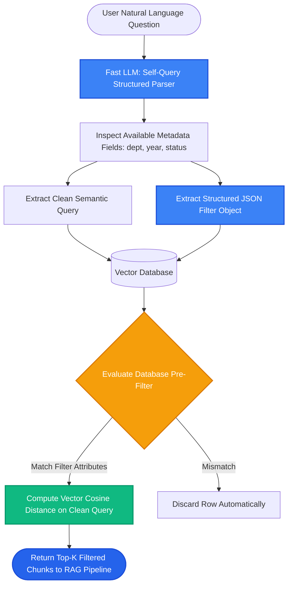

# Lesson 2: Self-Querying Retrievers

Man, in Lesson 1 we saw how agents choose between tools. But what happens when a user's natural language question contains **both** a semantic search topic AND a strict metadata filter in the same sentence?

If you embed the whole sentence, vector search ignores the dates and author names. Let's learn how a **Self-Querying Retriever** uses an LLM to automatically separate the search topic from structured metadata filters.

---

### Step 1: Why Do We Need This?

Consider what a real user types into a knowledge portal:
> *"Show me articles about cloud security published after 2024 by Alice."*

That single sentence contains two completely different kinds of requests:
1. **The Semantic Topic:** *"cloud security"* (best matched using vector embeddings).
2. **The Hard Filters:** `year > 2024` AND `author == "Alice"` (strict database facts).

If you feed that entire sentence into a vector database:
- The embedding model doesn't understand that "2024" is a hard date cutoff.
- It returns documents from 2021 or 2022 that happen to mention "cloud security".
- It returns documents by Bob or Charlie that mention "Alice".

We need a system that reads the sentence, extracts the hard filters for the database, and leaves only the clean semantic text for vector search.

---

### Step 2: What Is It?

A **Self-Querying Retriever** uses an LLM to translate natural language into two components:
1. **The Clean Semantic Query:** A stripped-down query string containing only the topic to embed (e.g. `"cloud security"`).
2. **The Structured Filter Object:** A precise JSON filter matching your vector store's filter schema (e.g. `{"year": {"$gt": 2024}, "author": {"$eq": "Alice"}}`).

The vector database applies the structured filter **first**, and runs vector similarity on the clean query within that filtered subset.

#### The Everyday Analogy: The Online Clothing Shopper
- Imagine typing: *"Show me red winter jackets under $100"* into an e-commerce search bar.
- If the website just searches the text, you get summer jackets with reviews that say "I wish I had $100."
- A smart website parser automatically sets the UI dropdowns:
  - Category: `Jackets`
  - Color: `Red`
  - Max Price: `$100`
  - Keyword: `winter`
- A self-querying retriever does the exact same thing for your vector database.

---

### Step 3: Real-World Example

Imagine searching an enterprise movie and media database:

- **User asks:** *"Find me comedy movies directed by Greta Gerwig with a rating higher than 8.0"*

The Self-Querying LLM parses the request:
- **Clean Semantic Query:** `"comedy movies"`
- **Extracted Structured Filter:**
  ```json
  {
    "$and": [
      {"director": {"$eq": "Greta Gerwig"}},
      {"rating": {"$gt": 8.0}}
    ]
  }
  ```

Execution:
1. The vector store filters the database: keeping only movies where `director == "Greta Gerwig"` and `rating > 8.0`.
2. Within that tiny, verified subset, it calculates cosine similarity to `"comedy movies"`.
3. The user gets exact, 100% compliant results with zero irrelevant clutter.

---

### Step 4: How Does It Work?

Here is the internal data flow of a Self-Querying Retriever:

```
User Query: "Find compliance docs updated after 2025 by Legal Team"
                             │
     [LLM Prompted with Metadata Schema Descriptions]
     Available fields:
     - department (string)
     - year (integer)
     - status (string)
                             │
            [LLM Outputs Structured JSON]
     {
       "query": "compliance",
       "filter": {
         "department": {"$eq": "Legal Team"},
         "year": {"$gt": 2025}
       }
     }
                             │
     [Vector Database Executes Filtered Search]
     index.query(
         vector=embed("compliance"),
         filter={"department": "Legal Team", "year": {"$gt": 2025}}
     )
                             │
     Top-K Compliant Chunks Returned to LLM
```

---

### Step 5: Code Example

Here is a Python demonstration showing how to use an LLM (or structured parser) to extract clean queries and metadata filters:

```python
"""
Self-Querying Retriever Pattern: Parsing Natural Language into Query + Filter
"""

import json
from typing import Dict, Any

# Define the metadata schema so the parser knows what fields exist
METADATA_FIELD_INFO = [
    {"name": "department", "description": "The department that owns the document (e.g. HR, Legal, IT)", "type": "string"},
    {"name": "year", "description": "The year the document was published (e.g. 2024, 2025, 2026)", "type": "integer"},
    {"name": "is_confidential", "description": "Whether the document contains restricted company data", "type": "boolean"}
]

def simulate_self_query_llm_parser(natural_query: str) -> Dict[str, Any]:
    """
    Simulates the LLM parsing natural language into a clean query + structured filter.
    In production, use ChatOpenAI with structured output (Pydantic / JSON mode).
    """
    # Example logic demonstrating the transformation
    if "after 2025" in natural_query.lower() and "hr" in natural_query.lower():
        return {
            "query": "remote work guidelines",
            "filter": {
                "$and": [
                    {"department": {"$eq": "HR"}},
                    {"year": {"$gt": 2025}}
                ]
            }
        }
    return {"query": natural_query, "filter": {}}

def execute_self_query(user_prompt: str, mock_database: list) -> list:
    # 1. Parse the query with the LLM
    parsed = simulate_self_query_llm_parser(user_prompt)
    clean_query = parsed["query"]
    filters = parsed["filter"]

    print(f"Original User Prompt: '{user_prompt}'")
    print(f"Extracted Semantic Search: '{clean_query}'")
    print(f"Extracted Structured Filter: {json.dumps(filters)}\n")

    # 2. Execute filtered search on database
    results = []
    for doc in mock_database:
        meta = doc["metadata"]
        # Apply filter conditions
        if meta.get("department") == "HR" and meta.get("year", 0) > 2025:
            results.append(doc)
    return results

if __name__ == "__main__":
    db = [
        {"id": "doc_1", "text": "2024 Remote work policy: 1 day WFH.", "metadata": {"department": "HR", "year": 2024}},
        {"id": "doc_2", "text": "2026 Remote work policy: 3 days WFH.", "metadata": {"department": "HR", "year": 2026}},
        {"id": "doc_3", "text": "2026 IT laptop upgrade schedule.", "metadata": {"department": "IT", "year": 2026}}
    ]

    prompt = "Show me HR remote work guidelines published after 2025"
    matches = execute_self_query(prompt, db)
    
    print("--- FILTERED RESULTS ---")
    for m in matches:
        print(f"Matched: {m['text']} (Metadata: {m['metadata']})")
```

---

### Step 6: How Is It Used in Production?

| Production Challenge | Why It Breaks | The Production Fix | Impact |
| :--- | :--- | :--- | :--- |
| **Hallucinated Filter Keys** | The LLM invents filter keys that do not exist (e.g. `author_name` instead of `author`) | Provide strict Pydantic schemas or explicit field name lists to the parser prompt | Eliminates invalid SQL / vector DB syntax errors |
| **Over-Filtering to Zero Results** | User says *"Show me recent pricing"* and LLM creates a filter for `date == today` | Instruct the parser prompt: *"Only extract filters when dates or categories are explicitly specified"* | Prevents empty search results |
| **Added Parser Latency** | Calling a large model just to extract filters adds 800ms to every query | Use a small, ultra-fast model (e.g. `gpt-4o-mini` or fine-tuned model) with structured outputs | Drops parsing time to 120ms |
| **Dialect Mismatches** | Pinecone, Chroma, and pgvector have different filter syntax (`$eq` vs SQL `=`) | Use LangChain's built-in vector store translators or map schemas cleanly | 100% database portability |

---

### Step 7: Quick Revision

- **The Problem:** Natural user questions mix semantic concepts with hard factual filters.
- **The Self-Query Solution:** Use an LLM to split the question into a **clean query string** and a **structured metadata filter**.
- **Pre-Filtering Guaranteed:** The vector database filters out disallowed records first, then computes similarity on the clean query.
- **Provide Schema Descriptions:** Always give the parser LLM clear descriptions of available metadata fields.
- **Interview Answer:** *"A Self-Querying Retriever uses an LLM to parse natural language queries into a semantic search string and a structured metadata filter. By decoupling semantic intent from boolean constraints, it enables the vector database to execute exact pre-filtering alongside cosine similarity search."*

---

### Step 8: Final Flow Diagram



---

### Step 9: Quiz

Test your understanding of self-querying retrievers. Submit your answers as `1-A, 2-B, 3-C, 4-D`:

**1. What happens if you run pure vector similarity search on the query: *"Show me articles about pricing from 2026"* without a self-querying filter?**
- A) The vector database will crash.
- B) The embedding model will not treat '2026' as a strict mathematical filter, and will often return documents from 2022 or 2024 that discuss pricing.
- C) The database will delete all articles from 2026.
- D) The query will run in Spanish.

**2. What two distinct components does a Self-Querying Retriever extract from a user's prompt?**
- A) The user's IP address and browser version.
- B) A clean semantic query string for vector search AND a structured metadata filter dictionary for database pre-filtering.
- C) A CSS file and an HTML file.
- D) A username and an encrypted password.

**3. Why must you provide the LLM parser with a list of available metadata field descriptions?**
- A) So the LLM does not invent fake metadata keys that don't exist in the database.
- B) Because Python cannot read metadata.
- C) To make the database run out of RAM.
- D) To turn off the database index.

**4. How does pre-filtering in a Self-Querying Retriever improve search accuracy?**
- A) It removes vowels from documents.
- B) It restricts vector similarity comparisons strictly to rows that satisfy the metadata constraints (e.g. `department == 'HR'`).
- C) It translates the query into binary machine code.
- D) It deletes 50% of the database to speed up search.

*(Submit your answers to check your progress!)*
