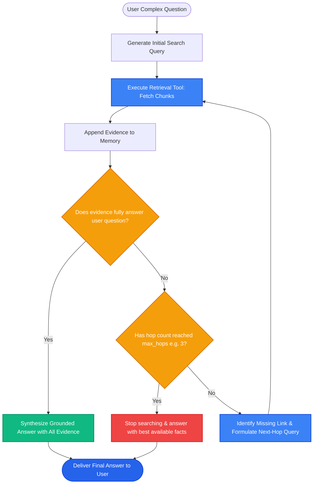

# Lesson 3: Multi-Step and Iterative Retrieval

Man, in Lessons 1 and 2 we saw how agents choose tools and parse filters. But what happens when a user asks a complex question that cannot be answered in a single search step?

Some questions require **multi-hop reasoning**, where the answer to the first question gives you the clue to search for the second. Let's learn how **Multi-Step and Iterative Retrieval (Corrective RAG)** solves this.

---

### Step 1: Why Do We Need This?

Consider a complex enterprise question:
> *"Did the company that acquired our payment vendor in 2024 update their privacy terms?"*

Think about what must happen to answer this:
1. You first have to find out: *Who is our payment vendor?* (e.g., PayFlow).
2. Next, you have to find out: *Who acquired PayFlow in 2024?* (e.g., GlobalStripe Corp).
3. Finally, you have to search for: *GlobalStripe Corp privacy terms update.*

In a standard single-step RAG system:
- You execute one search on the entire sentence: *"Did the company that acquired our payment vendor in 2024 update their privacy terms?"*
- The vector database fails completely because none of your documents contain that long, convoluted phrase!
- The system returns irrelevant chunks and tells the user: *"I don't know."*

Single-step RAG breaks whenever answering a question requires following a trail of breadcrumbs across multiple documents.

---

### Step 2: What Is It?

**Multi-Step (Iterative) Retrieval** is an agentic pattern where the AI executes a sequence of search steps, using the information found in Step 1 to formulate the search query for Step 2.

At each step, a **Self-Reflective Grader** asks:
1. *Do I have enough evidence to answer the user's complete question?*
2. If **Yes** -> Stop searching and generate the final answer.
3. If **No** -> Identify the missing clue, write a new targeted search query, and retrieve again!

#### The Everyday Analogy: The Detective Following Clues
- Imagine a detective investigating a crime scene.
- A bad detective looks in one room once. If the stolen diamonds aren't on the living room table, they give up and say "Case closed, nothing found."
- A good detective finds a receipt in the living room for a storage locker. They don't stop! They drive to the storage locker, open it with the key from the receipt, and find the diamonds.
- Iterative RAG follows the clues from document to document until the complete case is solved.

---

### Step 3: Real-World Example

Let's trace a multi-step financial compliance question:

- **User asks:** *"Is the founder of the company that built our database born in North America?"*

Iterative Execution:
- **Iteration 1:**
  - Agent queries: *"What database is used in our stack?"*
  - Document found: *"Our primary transactional engine is PostgreSQL."*
- **Iteration 2:**
  - Agent reasons: *I need to know who created PostgreSQL.*
  - Agent queries: *"Who created PostgreSQL?"*
  - Document found: *"PostgreSQL was created by computer scientist Michael Stonebraker at UC Berkeley."*
- **Iteration 3:**
  - Agent reasons: *I need to know where Michael Stonebraker was born.*
  - Agent queries: *"Where was Michael Stonebraker born?"*
  - Document found: *"Michael Stonebraker was born in Milton, New Hampshire, USA."*
- **Stop & Synthesize:**
  - Agent reasons: *I now have all necessary facts. New Hampshire is in North America.*
  - **Final Answer:** *"Yes. Our database is PostgreSQL, created by Michael Stonebraker, who was born in New Hampshire, USA (North America)."*

Single-step RAG could never solve this, but Iterative RAG solves it smoothly in 3 logical steps!

---

### Step 4: How Does It Work?

Here is the Multi-Step Reasoning loop (often implemented using LangGraph or agent loops):

```
[User Question]
       │
[Agent State: Question + Clues Gathered = []]
       │
┌──────▼────────────────────────────────────────────────────────┐
│ 1. LLM Evaluation: Do we have enough information to answer?    │
└──────┬────────────────────────────────────────────────────────┘
       ├── Yes ──► [Synthesize Final Answer with All Citations] ──► DONE!
       │
       └── No  ──► Identify Missing Fact
                     │
                   Generate Next-Hop Query (e.g. "Who founded X?")
                     │
                   [Execute Vector / Web Search Tool]
                     │
                   Append New Chunks to Clues Gathered
                     │
                   Increment iteration_count
                     │
                   {iteration_count < max_hops (e.g. 4)?}
                     ├── Yes ──► Loop back to Step 1!
                     └── No  ──► Stop and answer with best available data
```

---

### Step 5: Code Example

Here is a Python demonstration showing an iterative retrieval loop with reflection:

```python
"""
Iterative Multi-Step Retrieval Pattern
"""

from typing import List, Dict

# Mock knowledge base across separate documents
KNOWLEDGE_STORE = {
    "our stack": "Our core API services run on FastAPI and store user sessions in Redis.",
    "redis creator": "Redis was created by Italian developer Salvatore Sanfilippo (antirez).",
    "salvatore birth": "Salvatore Sanfilippo was born in Sicily, Italy."
}

def mock_search_tool(query: str) -> str:
    for k, v in KNOWLEDGE_STORE.items():
        if k in query.lower():
            return v
    return "No matching records found."

def iterative_rag_agent(user_question: str, max_hops: int = 3) -> str:
    collected_evidence = []
    current_search_query = "our stack"  # Step 1 starting clue

    for hop in range(1, max_hops + 1):
        print(f"--- HOP {hop}: Searching for '{current_search_query}' ---")
        retrieved_fact = mock_search_tool(current_search_query)
        collected_evidence.append(retrieved_fact)
        print(f"Fact Discovered: {retrieved_fact}")

        # In production, an LLM evaluates whether the full question is answered
        if "Sicily, Italy" in retrieved_fact:
            print("Evaluator: All necessary clues gathered! Stopping search.")
            break
        elif "Redis" in retrieved_fact:
            # Determine next hop query
            current_search_query = "redis creator"
        elif "Salvatore" in retrieved_fact:
            current_search_query = "salvatore birth"

    # Final Synthesis
    all_context = "\n".join(collected_evidence)
    return (
        f"Final Synthesized Answer for '{user_question}':\n"
        f"Based on the trail of evidence:\n{all_context}\n"
        "Conclusion: The creator of our session database (Redis) was born in Italy (Europe)."
    )

if __name__ == "__main__":
    question = "Was the creator of our session cache database born in Europe?"
    answer = iterative_rag_agent(question)
    print("\n" + answer)
```

---

### Step 6: How Is It Used in Production?

| Architecture Concern | What Breaks | The Production Fix | Impact |
| :--- | :--- | :--- | :--- |
| **Runaway Query Loops** | The agent gets stuck in an infinite loop searching for an obscure fact | Enforce a hard ceiling: `max_hops = 3` or `max_hops = 4` | Prevents infinite billing loops |
| **Accumulated Context Window Bloat** | Storing 20 retrieved chunks across 4 hops fills the context window | Summarize intermediate clues after each hop rather than storing raw text | Keeps prompt tokens small |
| **Compounding Search Errors** | Hop 1 retrieves a false or misleading fact, sending hops 2 and 3 down the wrong path | Use a **Corrective RAG (CRAG)** grader to grade chunk relevance before proceeding | Keeps the reasoning on track |
| **High Sequential Latency** | 4 sequential LLM calls take 5-8 seconds | Only trigger multi-step routing for complex, multi-hop queries; use standard RAG for simple ones | Preserves fast sub-second speeds for 90% of queries |

---

### Step 7: Quick Revision

- **Multi-Hop Reasoning:** Complex questions cannot be answered in one retrieval step; clues from step 1 inform step 2.
- **The Search-Reflect Loop:** Retrieve -> Evaluate evidence -> Identify missing fact -> Generate next-hop query -> Repeat.
- **Corrective RAG (CRAG):** Evaluates whether retrieved chunks are actually helpful before using them.
- **Hard Guardrails:** Always enforce a `max_hops = 3` limit to guarantee latency and cost boundaries.
- **Interview Answer:** *"Multi-step and iterative retrieval uses an agentic loop to resolve multi-hop queries that span disjoint documents. By reflecting on intermediate evidence after each retrieval step, the agent autonomously generates subsequent queries to follow the trail of facts before synthesizing a unified response."*

---

### Step 8: Final Flow Diagram



---

### Step 9: Quiz

Test your understanding of multi-step and iterative retrieval. Submit your answers as `1-A, 2-B, 3-C, 4-D`:

**1. When is Multi-Step Iterative Retrieval strictly necessary over standard single-step RAG?**
- A) When the user asks a multi-hop question where the answer requires following clues across multiple separate documents.
- B) Only when searching for images.
- C) Whenever the user types in uppercase letters.
- D) It is never necessary.

**2. What role does the 'Evaluator / Reflection' step play after each retrieval hop?**
- A) It deletes the database index.
- B) It evaluates whether the evidence gathered so far is sufficient to answer the prompt, or if a subsequent search hop is needed.
- C) It translates the text into another language.
- D) It restarts the computer.

**3. What is the danger of running an iterative agent without a `max_hops` limit?**
- A) The agent could get stuck in an endless loop of searching for missing facts, running up huge API bills and causing timeouts.
- B) The database will delete its files.
- C) Python will uninstall itself.
- D) The monitor will turn black.

**4. What is 'Corrective RAG' (CRAG)?**
- A) A pattern where an evaluator checks the quality and relevance of retrieved documents, correcting or re-querying if the initial retrieval is weak or off-topic.
- B) A spellchecker for English grammar.
- C) A tool that deletes bad code.
- D) An automatic refund system.

*(Submit your answers to check your progress!)*
