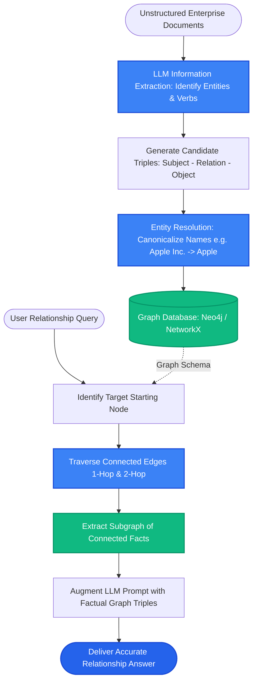

# Lesson 1: Knowledge Graph Basics for Retrieval (GraphRAG)

Man, welcome to Phase 13! Vector search is amazing for matching topics, but it has a blind spot: **relationship questions**.

If a user asks: *"Who reports to the person who manages the Sydney office?"*, vector search fails because no single document is "about" that question. The facts are split across multiple people and departments.

Let's explore **Knowledge Graphs** and how GraphRAG turns unstructured documents into connected webs of entities and relationships.

---

### Step 1: Why Do We Need This?

Vector databases store chunks of text independently. They know that "Sydney" and "Australia" are related words, but they do NOT know exact structural relationships:
- If Doc A says: *"Marcus Vance is the General Manager of the Sydney branch."*
- And Doc B says: *"Sarah and Liam are direct reports to Marcus Vance."*

When a user asks: *"Who works under the leader of the Sydney branch?"*:
- Pure vector search finds Doc A (matches "Sydney branch") and Doc B (matches "works under").
- But the vector retriever has **no structural brain** to connect that the "leader" in Doc A is the exact same Marcus Vance in Doc B!
- Worse, if you ask global questions like *"What are the top 3 supply chain risks across all our 50 global factories?"*, vector search only fetches 4 local factory chunks and misses the big picture.

We need a data structure that explicitly tracks **Entities** (people, places, products) and the **Relationships** connecting them: a **Knowledge Graph**.

---

### Step 2: What Is It?

A **Knowledge Graph** represents information as a network of **Nodes** and **Edges**:
- **Nodes (Entities):** The nouns—people, companies, cities, technologies (e.g., `Priya`, `Sydney Office`, `PostgreSQL`).
- **Edges (Relationships):** The verbs connecting nodes (e.g., `MANAGES`, `LOCATED_IN`, `BUILT_BY`).
- **Triples:** The atomic unit of knowledge: `(Subject) ──[Predicate]──► (Object)`.

```
(Priya) ──[MANAGES]──► (Sydney Office)
   ▲
   │ [REPORTS_TO]
(Liam)
```

#### The Everyday Analogy: Index Cards vs A Family Tree
- **A Vector Store is a box of index cards:** You have piles of cards sorted by topics ("vacation", "pricing", "engineering"). If you want cards about "vacation", you grab the pile.
- **A Knowledge Graph is a family tree on a wall:** You don't have topic piles. Instead, you have people with lines connecting parents, children, and cousins.
- If someone asks *"Who is my grandmother's brother's daughter?"*, you don't search a pile of words—you **trace the lines** on the wall!

---

### Step 3: Real-World Example

Imagine searching an enterprise pharmaceutical research database:

- **Unstructured Text:**
  - Doc 1: *"Drug-A is an inhibitor of Protein-X."*
  - Doc 2: *"Overexpression of Protein-X is linked to Glioblastoma tumors."*
  - Doc 3: *"Drug-A causes severe cardiac toxicity when combined with Statin-B."*

When an oncologist queries: *"Can we prescribe Drug-A to a glioblastoma patient taking Statin-B?"*
- A standard vector search retrieves pieces of Doc 1 and Doc 2, and might miss the warning in Doc 3.
- A **Knowledge Graph** links:
  `Drug-A` ──[INHIBITS]──► `Protein-X` ──[CAUSES]──► `Glioblastoma`
  `Drug-A` ──[TOXIC_INTERACTION_WITH]──► `Statin-B`
- The system instantly flags the fatal drug interaction and saves a patient's life!

---

### Step 4: How Does It Work?

Here is how an LLM extracts knowledge graph triples from raw document text:

```
[Raw Document Text]
"Sarah Jenkins joined Acme Corp as Head of Security in 2024."
                          │
            [LLM Information Extraction Prompt]
            Extract entities and relationships as JSON triples:
                          │
            [Structured Triples Output]
[
  {"subject": "Sarah Jenkins", "relation": "WORKS_AT", "object": "Acme Corp"},
  {"subject": "Sarah Jenkins", "relation": "HAS_ROLE", "object": "Head of Security"},
  {"subject": "Acme Corp",     "relation": "HIRED",    "object": "Sarah Jenkins", "year": 2024}
]
                          │
         [Inserted into Graph Database (Neo4j / NetworkX)]
```

#### Directed Graph Traversal:
Because edges have direction (`Priya` -> `MANAGES` -> `Sydney Office`), an AI can hop across multiple nodes:
1. Find node: `Sydney Office`.
2. Follow reverse edge `[MANAGES]`: Lands on `Priya`.
3. Follow reverse edge `[REPORTS_TO]`: Lands on `Liam` and `Sarah`.
4. Answer: *"Liam and Sarah report to the person who manages the Sydney office."*

---

### Step 5: Code Example

Here is a clean Python script using `networkx` to build and traverse a knowledge graph:

```python
"""
Knowledge Graph Construction and Multi-Hop Traversal
Requires: pip install networkx
"""

import networkx as nx

def run_knowledge_graph_demo():
    # 1. Create a directed graph
    G = nx.DiGraph()

    # 2. Add extracted triples (Entity -> Relation -> Entity)
    triples = [
        ("Priya Sharma", "MANAGES", "Sydney Office"),
        ("Liam O'Connor", "REPORTS_TO", "Priya Sharma"),
        ("Sarah Chen", "REPORTS_TO", "Priya Sharma"),
        ("Sydney Office", "LOCATED_IN", "Australia")
    ]

    for subj, rel, obj in triples:
        G.add_edge(subj, obj, relation=rel)

    print("Knowledge Graph constructed with nodes:", list(G.nodes()))

    # 3. Multi-Hop Query: "Who reports to the person who manages the Sydney Office?"
    target_office = "Sydney Office"
    
    # Step 1: Find who manages the office (reverse lookup on MANAGES)
    managers = [u for u, v, d in G.in_edges(target_office, data=True) if d["relation"] == "MANAGES"]
    manager = managers[0]
    print(f"\nStep 1: Found Manager of {target_office} -> {manager}")

    # Step 2: Find who reports to that manager (reverse lookup on REPORTS_TO)
    team_members = [u for u, v, d in G.in_edges(manager, data=True) if d["relation"] == "REPORTS_TO"]
    print(f"Step 2: Found Direct Reports -> {team_members}")

    print(f"\nFinal Answer: {', '.join(team_members)} report to {manager}, who manages the {target_office}.")

if __name__ == "__main__":
    run_knowledge_graph_demo()
```

---

### Step 6: How Is It Used in Production?

| GraphRAG Concern | What Fails | The Production Fix | Real Impact |
| :--- | :--- | :--- | :--- |
| **Entity Resolution Drift** | The LLM creates 3 different nodes: *"Apple"*, *"Apple Inc."*, and *"Apple Computer"* | Implement Entity Resolution to canonicalize entity names before insertion | Merges duplicate nodes into one |
| **Extraction Extraction Cost** | Calling GPT-4 to extract triples from 50,000 pages costs $15,000 | Use fine-tuned small models (e.g. `GLiNER` or Llama-3-8B) for entity-relation extraction | 85% cost reduction |
| **Graph Density Explosion** | Connecting every common noun creates millions of useless edges | Define a strict ontology schema (e.g., only extract: Person, Company, Product, Location) | Keeps graph clean and fast |
| **Hybrid Graph + Vector Search** | Relying on graph alone misses fuzzy descriptive text | Use GraphRAG (combine vector search to find starting nodes + graph traversal for relationships) | The ultimate search precision |

---

### Step 7: Quick Revision

- **Vector Store = Topic Search; Knowledge Graph = Relationship Search.**
- **Nodes & Edges:** Entities are nodes; relationships are directed edges.
- **Triples:** Information is stored as `(Subject, Relation, Object)`.
- **Entity Resolution:** Merges variations like "Google" and "Google LLC" into a single canonical node.
- **Interview Answer:** *"Knowledge Graphs represent factual connections as directed entity-relationship triples. While vector search excels at thematic semantic matching, GraphRAG enables deterministic multi-hop traversal to answer relationship-heavy queries that span disjoint documents."*

---

### Step 8: Final Flow Diagram



---

### Step 9: Quiz

Test your understanding of knowledge graphs for retrieval. Submit your answers as `1-A, 2-B, 3-C, 4-D`:

**1. Why does pure vector search struggle with a query like: *"Who manages the person who approved our cloud budget?"*?**
- A) Vector databases do not allow the word 'cloud'.
- B) Answering requires multi-hop relational chaining between specific named entities across separate records, which vector similarity cannot track.
- C) Cloud budgets cannot be embedded.
- D) Graph databases only work in Python 2.

**2. What is a 'Triple' in knowledge graph architecture?**
- A) A document with three pages.
- B) A fundamental unit of knowledge composed of `(Subject, Relation/Predicate, Object)`.
- C) Three database servers running in a cluster.
- D) An embedding vector with only 3 dimensions.

**3. What is the role of 'Entity Resolution' in building an enterprise knowledge graph?**
- A) Deleting all entities to save space.
- B) Recognizing that *"Google"*, *"Google LLC"*, and *"Google Inc."* refer to the exact same real-world entity and merging them into one node.
- C) Translating entity names into foreign languages.
- D) Encrypting company names.

**4. How does GraphRAG combine the benefits of vector databases and knowledge graphs?**
- A) It uses vector search to identify relevant starting nodes or text, then traverses graph edges to discover connected facts across documents.
- B) It replaces all text with images.
- C) It eliminates the need for an LLM.
- D) It only works when offline.

*(Submit your answers to check your progress!)*
