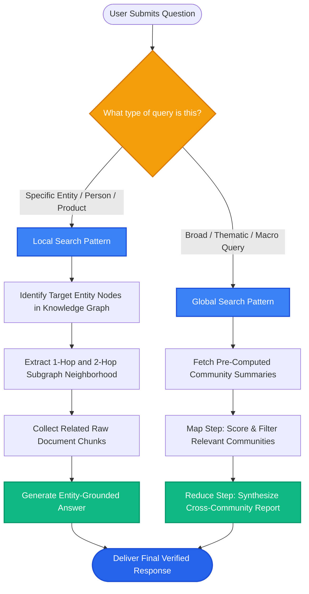

# Lesson 2: GraphRAG Retrieval Patterns (Local vs Global Search)

Man, in Lesson 1 we saw how to build a knowledge graph. Now the question is: **how do you search a knowledge graph during a RAG query?**

Microsoft's GraphRAG framework introduced two game-changing retrieval patterns: **Local Search** (for entity-specific questions) and **Global Search** (for answering big-picture questions about an entire dataset).

Let's explore both patterns and how they upgrade standard RAG.

---

### Step 1: Why Do We Need This?

Standard vector search has a massive architectural flaw: **it cannot answer holistic, dataset-wide questions**.

Try asking a traditional RAG system loaded with 5,000 internal documents this question:
> *"What are the top 5 operational risks across our entire supply chain?"*

Look at how standard RAG fails:
1. Vector search embeds the question *"top 5 operational risks"*.
2. It fetches 4 random chunks that mention the word "risk".
3. The LLM reads those 4 local chunks and pretends they represent the entire company!
4. The remaining 4,996 documents are completely ignored. The answer is hopelessly narrow and incomplete.

Standard RAG can answer local lookups (*"What is the return policy for laptops?"*), but it completely fails at corpus-level sensemaking (*"What are the overarching themes in our customer feedback?"*).

GraphRAG solves this by grouping the graph into **communities** and summarizing them hierarchically.

---

### Step 2: What Is It?

GraphRAG supports two complementary retrieval patterns:

1. **Local Search (Entity-Centric):**
   - Best for narrow questions about specific people, products, or concepts.
   - Example: *"What projects is Sarah Chen working on, and who are her collaborators?"*
   - It finds the `Sarah Chen` node, gathers her direct 1-hop and 2-hop neighboring nodes, retrieves the raw document chunks tied to those edges, and answers.

2. **Global Search (Dataset-Centric / Macro):**
   - Best for high-level thematic questions across the whole document collection.
   - Example: *"What are the recurring complaints about our mobile app over the last 12 months?"*
   - Uses graph algorithms (like Leiden clustering) to group related nodes into **Communities**, generates pre-computed summaries for each community, and combines those summaries into a comprehensive macro-answer.

#### The Everyday Analogy: The City Street Map vs The Satellite Photo
- **Local Search is a street-level GPS:** You zoom into corner of 5th Avenue and Main Street to see which coffee shops are next door.
- **Global Search is a weather satellite view:** You zoom out to see the entire hurricane moving across the continent. You don't see individual coffee shops, but you understand the massive pattern affecting the whole state.

---

### Step 3: Real-World Example

Imagine analyzing 10,000 patient feedback surveys from a national hospital network:

- **Query A (Needs Local Search):**
  - *"How many complaints did Dr. Gregory receive regarding bedside manner in the Seattle clinic?"*
  - Local search zooms in on node `Dr. Gregory` and node `Seattle Clinic`, traverses the complaint edges, and gives exact dates and facts.

- **Query B (Needs Global Search):**
  - *"What are the systemic issues causing nurse burnout across all hospital branches?"*
  - Global search scans the pre-computed **Community Summaries** across HR, Scheduling, Emergency, and Intensive Care clusters.
  - It synthesizes findings from all 10,000 surveys to report: 1) 12-hour shift overruns, 2) charting software bugs, 3) understaffed night shifts.

---

### Step 4: How Does It Work?

Here is the GraphRAG indexing and global search workflow:

```
[INGESTION: Community Detection & Pre-Summarization]
Raw Documents ──► Extract Graph Triples ──► Build Complete Knowledge Graph
                                                    │
                                [Leiden Community Clustering Algorithm]
                                Groups graph into high-density topic clusters
                                                    │
                                 Cluster 1          Cluster 2          Cluster 3
                               (Billing Team)     (Mobile App)      (Cloud Infra)
                                                    │
                                [Pre-Generate Community Summaries]
                                LLM writes a 1-page summary for each cluster

[QUERY: Global Search Execution]
User Macro Question: "What are the major pain points across the company?"
                                                    │
              [Map Step: Parallel Community Evaluations]
              Score each Community Summary for relevance to the question
                                                    │
              [Reduce Step: Executive Synthesis]
              LLM synthesizes the top community summaries into a unified report
```

---

### Step 5: Code Example

Here is a Python demonstration showing Local Subgraph Extraction vs Global Community Search:

```python
"""
GraphRAG Retrieval Patterns: Local Subgraph Extraction & Community Summary
Requires: pip install networkx
"""

import networkx as nx
from typing import List, Dict

# Build a sample graph representing an engineering organization
G = nx.Graph()

# Community 1: Frontend Team
G.add_edge("Alice", "React_App", relation="develops")
G.add_edge("Bob", "React_App", relation="maintains")
G.add_edge("React_App", "TailwindCSS", relation="uses")

# Community 2: Backend Team
G.add_edge("Charlie", "Postgres_DB", relation="manages")
G.add_edge("Diana", "Payment_API", relation="builds")
G.add_edge("Payment_API", "Postgres_DB", relation="queries")

# Bridge between teams
G.add_edge("React_App", "Payment_API", relation="calls")

def local_search(graph: nx.Graph, entity: str, depth: int = 1) -> List[str]:
    """Finds the local 1-hop or 2-hop neighborhood around an entity."""
    if entity not in graph:
        return [f"Entity '{entity}' not found in knowledge graph."]

    neighborhood_edges = []
    # Get 1-hop neighbors
    for neighbor in graph.neighbors(entity):
        rel = graph.get_edge_data(entity, neighbor).get("relation", "connected_to")
        neighborhood_edges.append(f"({entity}) --[{rel}]--> ({neighbor})")

    return neighborhood_edges

def global_search_simulation(community_summaries: Dict[str, str], macro_query: str) -> str:
    """Combines high-level community summaries to answer broad questions."""
    synthesis = "Global GraphRAG Executive Synthesis:\n"
    for comm_name, summary in community_summaries.items():
        synthesis += f"\n[Community: {comm_name}]\n{summary}\n"
    return synthesis

if __name__ == "__main__":
    # 1. Local Search Demo
    print("--- 1. LOCAL SEARCH (Around 'React_App') ---")
    local_facts = local_search(G, "React_App")
    for fact in local_facts:
        print(f"  {fact}")

    # 2. Global Search Demo
    mock_community_summaries = {
        "Frontend_Cluster": "Focuses on React UI performance, component design, and API integrations with payment services.",
        "Backend_Cluster": "Focuses on PostgreSQL connection pooling, database reliability, and payment transaction APIs."
    }
    print("\n--- 2. GLOBAL SEARCH (Broad Architectural Overview) ---")
    report = global_search_simulation(mock_community_summaries, "What are the main technology domains?")
    print(report)
```

---

### Step 6: How Is It Used in Production?

| Architecture Concern | What Breaks | The Production Fix | Real Impact |
| :--- | :--- | :--- | :--- |
| **High Ingestion Cost** | Pre-generating summaries for 500 communities with GPT-4 costs hundreds of dollars | Use hierarchical clustering (Level 0, Level 1) and summarize only higher-level communities | Cuts pre-computation cost by 75% |
| **Outdated Graph Summaries** | Adding 10 new documents invalidates pre-computed community summaries | Run incremental graph clustering and re-summarize only affected sub-communities | Enables real-time updates |
| **Local Search Context Bloat** | Expanding 3 hops in a dense graph retrieves 2,000 nodes, overwhelming prompt tokens | Cap local search at 1 or 2 hops with degree centrality filtering | Keeps prompt context under 1,500 tokens |
| **Combining Graph with Vectors** | Using only Graph misses nuanced unstructured passages | Always implement Hybrid GraphRAG (retrieve text chunks alongside graph facts) | Maximum accuracy and detail |

---

### Step 7: Quick Revision

- **Local Search:** Entity-centric. Traverses 1-hop and 2-hop neighbors around specific people, places, or products.
- **Global Search:** Dataset-centric. Groups the graph into communities (via Leiden algorithm) and synthesizes pre-computed summaries.
- **Solves the 'Big Picture' Problem:** Global Search enables answering corpus-wide questions that vector search cannot answer.
- **Hybrid GraphRAG:** Combines vector search on raw chunks with graph traversal on structured entities.
- **Interview Answer:** *"GraphRAG distinguishes between Local Search for entity-level multi-hop questions and Global Search for corpus-wide sensemaking. Global Search leverages hierarchical community clustering algorithms like Leiden to pre-generate modular summaries, allowing systems to answer thematic questions across millions of documents without exhausting context windows."*

---

### Step 8: Final Flow Diagram



---

### Step 9: Quiz

Test your understanding of GraphRAG retrieval patterns. Submit your answers as `1-A, 2-B, 3-C, 4-D`:

**1. What major limitation of standard vector search does GraphRAG's Global Search solve?**
- A) Vector search is too fast.
- B) Standard vector search cannot answer broad, corpus-wide thematic questions across thousands of documents because it only samples a few local chunks.
- C) Vector databases cannot store English text.
- D) GraphRAG makes databases run without electricity.

**2. In GraphRAG, what algorithm is commonly used to cluster connected nodes into communities?**
- A) The Leiden (or Louvain) community detection algorithm.
- B) QuickSort.
- C) Binary Search.
- D) Dijkstra's shortest path.

**3. When should you choose Local Search over Global Search?**
- A) When the user asks a specific question centered on a named entity (e.g. *"What are the dependencies of Module X?"*).
- B) When you want to summarize all 10,000 files in the company.
- C) Only when searching for video files.
- D) When the internet is disconnected.

**4. How does the 'Map-Reduce' step operate during a Global Search query?**
- A) It deletes the database files.
- B) It evaluates relevant community summaries in parallel (Map), and then synthesizes them into an executive overview report (Reduce).
- C) It translates documents into C++.
- D) It formats the hard drive.

*(Submit your answers to check your progress!)*
