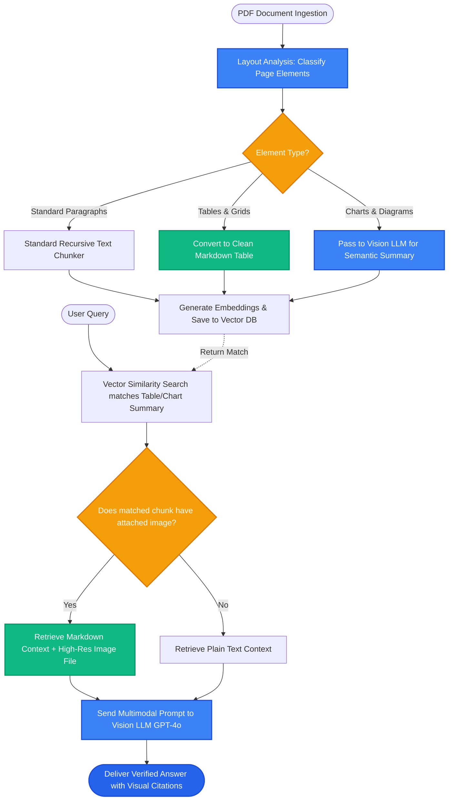

# Lesson 3: Multimodal RAG (Images, Tables, and Diagrams)

Man, in Lessons 1 and 2 we explored knowledge graphs. But in real-world enterprise documents, some of the most critical facts are **never written in plain paragraphs**.

They live inside complex financial balance sheets, architectural flowcharts, medical scans, and infographics. If your RAG system only extracts plain text, it throws away half your company's knowledge!

Let's explore **Multimodal RAG** and learn how modern AI systems process images and tables with zero information loss.

---

### Step 1: Why Do We Need This?

Consider what happens when standard text loaders process complex PDFs:
1. **The Table Scramble Disaster:** A financial report has a 5-column revenue table. Standard text parsers read horizontally across columns, turning:
   ```
   Q1 | 2024 | $45M
   Q1 | 2025 | $60M
   ```
   into the jumbled string: `"Q1 Q1 2024 2025 $45M $60M"`. The numbers are completely detached from their quarters and years!
2. **The Invisible Diagram Problem:** An engineering document has a system architecture diagram showing that the web app connects to Redis for session caching. There is no accompanying paragraph. A standard text loader extracts an empty page.
3. **OCR Misreadings:** Low-resolution scanned receipts or invoices turn numbers like `$1,000` into `$-l,ooo`.

We need a system that can **see**, understand, and retrieve visual and tabular information natively: **Multimodal RAG**.

---

### Step 2: What Is It?

**Multimodal RAG** is an architecture that indexes, searches, and reasons across both **text** and **visual assets** (images, charts, tables, and screenshots).

There are two primary production architectures for Multimodal RAG:

1. **Vision-to-Text Summarization (The Production Standard):**
   - During ingestion, a Vision-Language Model (VLM like GPT-4o or Claude 3.5 Sonnet) inspects every table, chart, and diagram.
   - It generates a rich, detailed textual summary describing the numbers, axes, and takeaways.
   - The system embeds and indexes that **summary text** in your vector database, with a metadata link pointing to the original image file.
   - At query time, you retrieve the summary and pass the **actual high-resolution image** to the final multimodal LLM!

2. **Visual Document Retrieval (e.g. ColPali):**
   - Instead of running messy OCR, the system takes high-resolution screenshots of each PDF page.
   - A vision transformer model embeds the visual layout of the entire page into a multi-vector index.

#### The Everyday Analogy: The Museum Audio Guide
- Imagine visiting an art museum with famous paintings.
- An **audio guide narrator** walks through the gallery, studies each painting, and writes a detailed card explaining what is happening on the canvas.
- When you ask the front desk: *"Where can I see paintings of shipwrecks at sunset?"*, they check the description cards, take you directly to the painting, and let you look at the real artwork with your own eyes.

---

### Step 3: Real-World Example

Imagine searching quarterly financial reports for a Fortune 500 company:

- **User asks:** *"What was the year-over-year revenue growth in the Cloud Computing division between 2024 and 2025?"*
- **The Information:** Stored strictly inside a 10-row financial table on page 42 of an investor deck.
- **Multimodal Pipeline in Action:**
  1. During ingestion, the table was extracted as clean Markdown:
     ```markdown
     | Division | 2024 Revenue | 2025 Revenue | YoY Growth |
     | :--- | :--- | :--- | :--- |
     | Consumer Hardware | $12.4B | $11.8B | -4.8% |
     | Cloud Computing   | $8.2B  | $11.5B | +40.2% |
     ```
  2. The VLM generated a summary: *"Cloud Computing revenue grew from $8.2B in 2024 to $11.5B in 2025, representing a 40.2% YoY increase."*
  3. Vector search matches the user's question to the summary.
  4. The LLM receives the exact Markdown table + summary and answers: *"Cloud Computing experienced a 40.2% YoY growth, expanding from $8.2B to $11.5B."*

100% accurate, with zero hallucination.

---

### Step 4: How Does It Work?

Here is the Vision-to-Text Summarization workflow:

```
[INGESTION: Extract & Summarize]
Raw PDF / Document
  ├── Plain Text Paragraphs ──► Standard Chunking ──────────────┐
  │                                                              │
  └── Visual Tables & Charts                                     │
             │                                                   │
  [Vision LLM: GPT-4o / Claude]                                  │
  "Describe this chart, noting all data points and trends:"      │
             │                                                   │
  Rich Descriptive Text + Markdown Table                         │
             │                                                   │
             └───────────────────────┬───────────────────────────┘
                                     ▼
                    [Standard Embedding Model]
                                     │
                    [Vector Database (Vectors + Image Links)]

[QUERY: Multi-Modal Generation]
User Question: "What was Q3 cloud growth?"
                     │
Vector Search matches Table Summary
                     │
Retrieve BOTH: Table Markdown Text + Original High-Res Image File
                     │
Pass Image & Text into Vision LLM ──► Verified, Grounded Answer!
```

---

### Step 5: Code Example

Here is a Python script showing how to process and structure visual table chunks for multimodal RAG:

```python
"""
Multimodal Document Representation Pattern
"""

from dataclasses import dataclass
from typing import Optional, Dict, Any

@dataclass
class MultimodalChunk:
    text_content: str               # Searchable textual representation or VLM summary
    chunk_type: str                 # "text", "table", or "image"
    image_path: Optional[str] = None # Path to original image/chart file
    metadata: Dict[str, Any] = None

def create_table_chunk(table_markdown: str, table_image_file: str, page_num: int) -> MultimodalChunk:
    """
    Packages a structured table with its visual source link.
    """
    return MultimodalChunk(
        text_content=table_markdown,
        chunk_type="table",
        image_path=table_image_file,
        metadata={
            "source_page": page_num,
            "has_visual": True,
            "format": "markdown_table"
        }
    )

def simulate_multimodal_rag_prompt(query: str, retrieved_chunk: MultimodalChunk) -> str:
    """
    Builds the multimodal prompt sent to a vision model (e.g. GPT-4o).
    """
    prompt = (
        f"You are an expert analyst. Answer the user's question using the provided context.\n\n"
        f"[Context Type: {retrieved_chunk.chunk_type.upper()}]\n"
        f"{retrieved_chunk.text_content}\n\n"
    )
    if retrieved_chunk.image_path:
        prompt += f"[Attached Image Asset: {retrieved_chunk.image_path}]\n"
        
    prompt += f"\nUser Question: {query}\nAnswer:"
    return prompt

if __name__ == "__main__":
    sample_table = (
        "| Product | Q3 Sales | Q4 Sales | Growth |\n"
        "| :--- | :--- | :--- | :--- | \n"
        "| Pro Plan | $120,000 | $180,000 | +50% |\n"
        "| Enterprise | $450,000 | $520,000 | +15% |"
    )

    chunk = create_table_chunk(sample_table, "charts/q4_sales_matrix.png", page_num=12)
    
    final_prompt = simulate_multimodal_rag_prompt("What was the sales growth for the Pro Plan?", chunk)
    print("--- AUGMENTED MULTIMODAL PROMPT ---")
    print(final_prompt)
```

---

### Step 6: How Is It Used in Production?

| Multimodal Concern | What Breaks | The Production Fix | Real Impact |
| :--- | :--- | :--- | :--- |
| **High VLM Ingestion Costs** | Passing every single page of a 10,000-page archive to GPT-4o Vision costs thousands | Use layout analyzers (`LayoutParser` / `YOLO`) to only call vision models on pages containing images or tables | Reduces vision API costs by 80% |
| **Markdown Table Truncation** | Standard character chunkers slice right through middle of markdown table rows | Use specialized table-aware text splitters that preserve complete tables as single chunks | 100% row/column data integrity |
| **Blurry Scans & Diagrams** | Low-resolution images cause vision models to hallucinate numbers | Enforce minimum image resolution (300 DPI) during document rendering | Eliminates OCR number misreads |
| **Sending Images to Text-Only Models** | Passing image assets to a cheaper text-only model crashes the API | Check model capabilities in your orchestration layer before attaching image payloads | Zero API schema crashes |

---

### Step 7: Quick Revision

- **Tables and Diagrams Hold Core Facts:** Plain text extraction often scrambles tables and skips images entirely.
- **Vision-to-Text Ingestion:** Use a Vision LLM to generate searchable text summaries of images/charts, while storing the raw image file path in metadata.
- **Table Preservation:** Always convert tables into clean **Markdown** or **HTML** tables; never split a table across chunks.
- **Visual Verification:** Pass both the table text and the original image file to the final multimodal LLM for maximum generation fidelity.
- **Interview Answer:** *"Multimodal RAG extracts and represents visual information like charts, diagrams, and tables using Vision-Language Models. By generating structured markdown tables and descriptive semantic summaries at ingestion time while linking back to source image files, systems enable search over visual assets and deliver multimodal context to vision-capable LLMs."*

---

### Step 8: Final Flow Diagram



---

### Step 9: Quiz

Test your understanding of Multimodal RAG. Submit your answers as `1-A, 2-B, 3-C, 4-D`:

**1. What happens if you extract tables from a PDF using a naive plain text reader?**
- A) The tables are automatically converted into SQL databases.
- B) The reader reads horizontally across columns, scrambling numbers, dates, and headers into an unreadable, jumbled mess.
- C) The file size becomes negative.
- D) The table is deleted from the PDF.

**2. In the Vision-to-Text summarization pattern for Multimodal RAG, how are images indexed into a vector database?**
- A) A Vision LLM generates a detailed descriptive summary of the image/chart, which is then embedded as text and stored with a pointer to the original image file.
- B) The image is converted into an MP3 audio file.
- C) The image pixels are rounded to the nearest integer.
- D) Images cannot be indexed in vector databases.

**3. Why should tables be kept intact as complete chunks rather than sliced by standard character splitters?**
- A) Splitting a table across multiple chunks destroys the column headers and severs the relationship between rows and numbers.
- B) Markdown tables are illegal to split in Python.
- C) Splitting a table causes computer memory to overheat.
- D) Tables take less space when split.

**4. What is the benefit of passing the actual high-resolution image to the final multimodal LLM alongside the retrieved text?**
- A) It allows the vision model to inspect visual nuances, layout colors, and fine details directly to verify its answer against the original source.
- B) It makes the API call run for free.
- C) It eliminates the need for prompt templates.
- D) It encrypts the user's monitor.

*(Submit your answers to check your progress!)*
