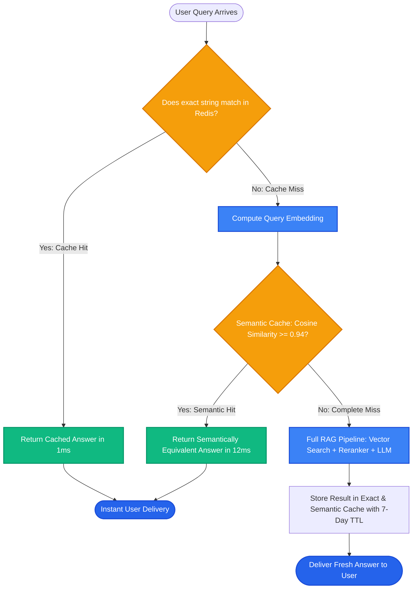

# Lesson 1: Caching and Cost Control in RAG

Man, welcome to Phase 14! You now know how to build advanced RAG systems. But here is the reality of running AI in production: **LLM tokens and database calls cost real money**.

In most enterprise applications, 60% to 80% of all user queries are repetitive (*"How do I reset my password?"*, *"What are the company holidays?"*, *"Where is the cafeteria?"*).

If you run the full embedding + vector search + LLM generation loop for every single repeated question, you are throwing money away. Let's learn how **Semantic Caching** cuts latency from 2 seconds to 5 milliseconds and slashes API bills by up to 70%.

---

### Step 1: Why Do We Need This?

A naive production RAG pipeline processes every user query from scratch:
- Embed query ($) + Search vector database ($) + Call LLM ($$$).
- Every query takes 1.5 to 3 seconds.

Look at why this is wasteful:
1. **The Exact-Match Waste:** 500 employees ask *"What is the office Wi-Fi password?"* on Monday morning. The system generates the exact same answer 500 times, costing $5.00 in tokens and burning server compute.
2. **The Paraphrase Waste:** Employee A asks: *"How do I reset my password?"* Employee B asks: *"Steps to change forgotten password."* A naive exact-match cache (like standard Redis) misses Employee B because the words are different, forcing another full LLM run.
3. **Ingestion Re-Embedding Waste:** When updating a 500-page policy manual with 2 new sentences, naive scripts re-embed all 500 pages, wasting time and API quota.

Implementing multi-layer caching eliminates duplicate work, drops latency to near-zero, and protects your budget.

---

### Step 2: What Is It?

A production RAG caching architecture uses three distinct layers:

1. **Ingestion Hash Cache (Never re-embed the same text):**
   - Stores the SHA-256 hash of each text chunk.
   - If a file hasn't changed, reuse the existing vector. Zero embedding API calls!

2. **Exact-Match Response Cache (Redis / In-Memory):**
   - Key: Hash of the exact query string.
   - Value: The generated answer.
   - Response time: **< 1 millisecond**.

3. **Semantic Response Cache (GPTCache / Redis Vector):**
   - Embeds the query and checks a database of *previously answered questions*.
   - If a previous question has a **Cosine Similarity > 0.95** (e.g. *"reset password"* vs *"change forgotten password"*), it returns the cached answer immediately!
   - Response time: **< 15 milliseconds** (skipping the slow LLM call completely).

#### The Everyday Analogy: The Fast-Food Kitchen
- **Naive RAG is a kitchen cooking everything from scratch:** Even if 100 people order the standard cheeseburger, the chef grinds fresh meat, bakes fresh buns, and cooks each burger one by one. The line is 45 minutes long.
- **Production Caching is keeping popular items warm:** Popular cheeseburgers are ready in warming trays. When an order arrives, it is handed out in 5 seconds. The kitchen only cooks fresh meals for unique, custom orders.

---

### Step 3: Real-World Example

Imagine an enterprise HR assistant serving 50,000 employees:

- **Without Caching:**
  - 100,000 queries per day.
  - Average query latency: **2,200 ms**.
  - Daily OpenAI API cost: **$350 / day ($10,500 / month)**.

- **With Semantic Caching (Redis + TTL = 7 Days):**
  - Cache Hit Ratio: **68%** (68,000 queries served from cache!).
  - Cached Query Latency: **8 ms** (Feels instantaneous to users).
  - Daily OpenAI API cost drops to **$112 / day ($3,360 / month)**.
  - **Result:** You save over **$7,000 every single month** while making the application 10x faster!

---

### Step 4: How Does It Work?

Here is the 3-tier caching query evaluation flow:

```
User Query Arrives: "How to change my password?"
                       │
         [Tier 1: Exact Match Cache (Redis)]
         Key: SHA256("how to change my password?")
                       │
      ├── Cache Hit  ──► Return Cached Answer in 1ms!
      └── Cache Miss ──► Proceed to Tier 2
                             │
         [Tier 2: Semantic Cache (Vector Similarity)]
         Embed query & compare against past questions
                       │
      ├── Cosine Sim > 0.95 ──► Return Cached Answer in 12ms!
      └── Cache Miss        ──► Proceed to Tier 3
                                   │
         [Tier 3: Full RAG Pipeline]
         Search Vector DB ──► Rerank ──► LLM Generation (2,000ms)
                                   │
         [Store Answer in Semantic & Exact Caches with TTL]
                                   │
         Deliver Answer to User
```

#### Time-To-Live (TTL) Cache Invalidation:
Never cache answers forever! Policies change.
- Attach a **TTL** (e.g. `ex=604800` for 7 days) to all cache entries.
- When an HR policy document is updated, publish a cache invalidation event to clear affected keys.

---

### Step 5: Code Example

Here is a Python implementation of an in-memory Semantic Cache using cosine similarity:

```python
"""
Semantic Cache Implementation for RAG
"""

import numpy as np
from typing import Optional, Dict, Any

def cosine_similarity(v1: np.ndarray, v2: np.ndarray) -> float:
    return float(np.dot(v1, v2) / (np.linalg.norm(v1) * np.linalg.norm(v2)))

class SemanticCache:
    def __init__(self, similarity_threshold: float = 0.92):
        self.threshold = similarity_threshold
        # Stores list of: {"query_text": str, "vector": np.ndarray, "answer": str}
        self.cache_entries = []

    def lookup(self, query_vector: np.ndarray) -> Optional[Dict[str, Any]]:
        """Checks if a semantically equivalent question was already answered."""
        best_match = None
        best_score = -1.0

        for entry in self.cache_entries:
            sim = cosine_similarity(query_vector, entry["vector"])
            if sim > best_score:
                best_score = sim
                best_match = entry

        if best_match and best_score >= self.threshold:
            return {"answer": best_match["answer"], "score": best_score, "original_query": best_match["query_text"]}
        return None

    def store(self, query_text: str, query_vector: np.ndarray, answer: str):
        """Saves new question and answer to cache."""
        self.cache_entries.append({
            "query_text": query_text,
            "vector": query_vector,
            "answer": answer
        })

if __name__ == "__main__":
    cache = SemanticCache(similarity_threshold=0.90)

    # 1. First user asks a question (Cache Miss -> Calls LLM -> Stores in Cache)
    v_original = np.array([0.95, 0.10, 0.05])
    cache.store(
        query_text="How do I reset my password?",
        query_vector=v_original,
        answer="Go to Settings > Security > Reset Password to change your credentials."
    )
    print("Stored original question in Semantic Cache.")

    # 2. Second user asks a paraphrased question:
    # "Steps to change forgotten password" (Embeds very close to original: sim ~0.94)
    v_paraphrase = np.array([0.93, 0.12, 0.04])
    
    hit = cache.lookup(v_paraphrase)
    if hit:
        print("\n--- CACHE HIT! (0ms LLM Cost) ---")
        print(f"Matched Original: '{hit['original_query']}' (Sim: {hit['score']:.4f})")
        print(f"Returned Answer: {hit['answer']}")
    else:
        print("Cache Miss. Executing full RAG pipeline...")
```

---

### Step 6: How Is It Used in Production?

| Caching Strategy | What Breaks | The Production Fix | Real Impact |
| :--- | :--- | :--- | :--- |
| **Threshold Set Too Low (< 0.85)** | *"How to cancel Pro plan?"* returns cached answer for *"How to upgrade to Pro plan?"* | Keep semantic cache threshold strictly between **0.92 and 0.96** | Prevents serving completely wrong answers |
| **No TTL / Stale Answers** | Policy changes on Tuesday, but cache keeps serving the old 2023 policy for months | Enforce maximum 7-day TTL; trigger programmatic invalidation on document updates | Guarantees up-to-date answers |
| **Caching User-Specific PII** | User A asks *"What is my account balance?"*, User B gets User A's private balance! | Never cache queries containing personal pronouns or private session data | 100% security against cross-user data leaks |
| **Re-embedding Unchanged Docs** | Ingestion pipeline re-embeds 50,000 files daily | Calculate SHA-256 hash of file content; skip embedding if hash matches database record | Saves 90% in ingestion embedding costs |

---

### Step 7: Quick Revision

- **60-80% of Enterprise Queries Are Repetitive:** Caching them saves thousands of dollars and delivers sub-15ms response times.
- **Three Caching Layers:**
  1. Ingestion Hash Cache (prevents re-embedding unchanged files).
  2. Exact-Match Response Cache (Redis string lookup in 1ms).
  3. Semantic Response Cache (Vector similarity lookup in 12ms).
- **Conservative Threshold:** Set semantic similarity cutoff between **0.92 and 0.96** to avoid false matches.
- **Never Cache PII:** Exclude user-specific or account-balance queries from the shared response cache.
- **Interview Answer:** *"In production RAG systems, we implement a multi-tier caching strategy comprising document hash deduplication during ingestion, exact Redis string caching, and vector-based semantic caching. Setting a high similarity threshold (0.93+) and strict TTL invalidation policies reduces LLM inference costs by over 60% while maintaining sub-15ms latency on common queries."*

---

### Step 8: Final Flow Diagram



---

### Step 9: Quiz

Test your understanding of caching and cost control. Submit your answers as `1-A, 2-B, 3-C, 4-D`:

**1. What is the fundamental advantage of a 'Semantic Cache' over a traditional exact-string cache like Redis?**
- A) A semantic cache can recognize paraphrased questions (e.g. *"reset password"* vs *"change forgotten password"*) and return the cached answer without calling the LLM.
- B) A semantic cache deletes the user's password.
- C) A semantic cache makes the database run on battery power.
- D) A semantic cache converts English into binary code.

**2. What happens if you set the similarity threshold on a semantic cache too low (for example, 0.70)?**
- A) The computer will shut down.
- B) The cache will suffer from false positives, returning cached answers for questions that were actually about different topics (e.g. confusing upgrade with cancel).
- C) The database will delete its files.
- D) The API bill will increase by 1000x.

**3. Why must user-specific questions (like *"What is my credit card balance?"*) be excluded from shared response caching?**
- A) Because credit cards are illegal in Python.
- B) To prevent private personal data from User A being leaked to User B when they ask a similar question.
- C) Because numbers cannot be cached.
- D) Because the LLM only understands words.

**4. How does an 'Ingestion Hash Cache' save money when updating company documents?**
- A) It deletes the new documents.
- B) It computes a hash (e.g. SHA-256) of each text chunk and skips embedding calls for any chunks that haven't changed since the last build.
- C) It translates files into Spanish.
- D) It formats the server hard drive.

*(Submit your answers to check your progress!)*
