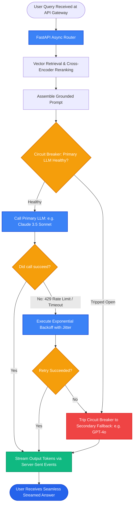

# Lesson 3: Production Deployment, Monitoring, and Failure Modes

Man, welcome to the final lesson of the RAG curriculum! You now know every algorithm, database, and pattern needed to build world-class RAG systems.

Now let's explore **how to deploy, serve, and monitor RAG in high-traffic production environments**, and how to build **resilient fallbacks and circuit breakers** so your application never crashes when third-party APIs go down.


---

### Step 1: Why Do We Need This?

A RAG pipeline that runs smoothly in a Jupyter notebook will immediately collapse under real production traffic:
1. **The Ingestion Bottleneck:** If an admin uploads a 500-page PDF via a REST API, and your server processes it synchronously inside the request handler, the HTTP connection times out after 30 seconds and the server's CPU hits 100%, blocking all other users!
2. **Third-Party API Rate Limits (HTTP 429):** OpenAI or Anthropic suddenly return `429 Too Many Requests` during a traffic spike. Without retry backoff and fallback models, your entire customer-facing app crashes.
3. **The Silent Outage:** Your vector database becomes slow (latency spikes from 20ms to 4,000ms). Without monitoring and circuit breakers, every request hangs, backing up connection pools until the web server runs out of memory.

Production engineering is about decoupling heavy work into background queues, streaming responses, and designing graceful fallbacks for every possible failure.

---

### Step 2: What Is It?

A **Production-Ready RAG Deployment** separates your system into two isolated operational tiers:

1. **The Asynchronous Ingestion Tier (Background Queues):**
   - Heavy document parsing, OCR, and embedding jobs are dispatched to background workers (using Redis + Celery or BullMQ).
   - The web server responds immediately: `{"status": "queued", "job_id": "job_123"}`.

2. **The High-Speed Serving Tier (FastAPI + Streaming):**
   - Serves user queries in milliseconds using asynchronous non-blocking event loops (`async`/`await`).
   - Delivers answers via **Server-Sent Events (SSE)** token streaming.
   - Protected by **Circuit Breakers** and **Model Fallbacks**.


#### The Everyday Analogy: The Restaurant Kitchen and Waitstaff
- If the waitstaff had to walk into the kitchen, butcher a whole cow, chop vegetables, and bake bread every time a customer ordered a steak, the restaurant would serve two people a day.
- In a real restaurant, **prep cooks work in the background hours before opening** (Async Ingestion Queue).
- The waitstaff (FastAPI) takes orders, communicates with the kitchen, and serves dishes smoothly. If the gas stove breaks, the chef switches to the electric grill immediately (Circuit Breaker Fallback).

---

### Step 3: Real-World Example

Imagine an enterprise RAG assistant deployed on AWS with 10,000 active employees:

- **Incident:** OpenAI experiences an unexpected global API outage for 20 minutes.
- **Unprepared App Behavior:** Every user question crashes with `500 Internal Server Error`. Employees flood IT with complaints.
- **Production-Hardened Behavior:**
  1. The **Circuit Breaker** detects three consecutive OpenAI API timeouts.
  2. It trips open and automatically routes incoming prompts to the **secondary fallback model** (e.g. Anthropic Claude 3.5 Sonnet or a self-hosted local model).
  3. The system serves answers without interruption.
  4. Once OpenAI recovers, the circuit breaker resets automatically.
  5. **Uptime: 99.99%. Zero customer complaints.**

---

### Step 4: How Does It Work?

Here is the decoupled production architecture:

```
[INGESTION WORKFLOW - Asynchronous]
Admin uploads 500-page PDF ──► FastAPI returns 202 Accepted (job_id)
                                          │
                                 Pushed to Redis Queue
                                          │
                            [Celery / BullMQ Background Workers]
                            - Parse PDF & OCR
                            - Recursive Chunking
                            - Batch Embedding
                            - Upsert to Vector DB

[SERVING WORKFLOW - Real-Time Streaming]
User Question ──► FastAPI Async Route
                        │
                Check Redis Semantic Cache
                        │
             ├── Cache Hit  ──► Stream Cached Answer (8ms)
             └── Cache Miss ──► Vector Search + Reranker
                                     │
                             [Circuit Breaker]
                        ├── Primary LLM: Healthy? ──► Stream Tokens via SSE
                        └── Primary LLM: Failed?  ──► Switch to Fallback Model!
```

---

### Step 5: Code Example

Here is a clean Python script showing a production-style resilient fallback and retry pattern:

```python
"""
Production Resilient LLM Caller with Fallback and Exponential Backoff
"""

import time
import random
from typing import Optional

def call_primary_llm(prompt: str) -> str:
    """Simulates calling the primary provider (e.g. OpenAI)."""
    # Simulate a 50% random rate limit failure
    if random.random() < 0.5:
        raise ConnectionError("Rate limit exceeded: 429 Too Many Requests")
    return f"Primary Model Answer for: {prompt}"

def call_fallback_llm(prompt: str) -> str:
    """Secondary fallback provider (e.g. Claude or Local Model)."""
    return f"Fallback Model Answer for: {prompt}"

def robust_rag_inference(prompt: str, max_retries: int = 2) -> str:
    """
    Executes primary LLM with exponential backoff; switches to fallback on failure.
    """
    delay = 0.5  # Start with 500ms backoff
    for attempt in range(1, max_retries + 1):
        try:
            print(f"Attempt {attempt}: Calling Primary LLM...")
            return call_primary_llm(prompt)
        except ConnectionError as err:
            print(f"  Primary LLM failed: {err}")
            if attempt < max_retries:
                sleep_time = delay + random.uniform(0, 0.2)  # Add jitter
                print(f"  Backing off for {sleep_time:.2f}s before retry...")
                time.sleep(sleep_time)
                delay *= 2  # Exponential backoff
            else:
                print("  Primary retries exhausted. Switching to Fallback LLM!")
                return call_fallback_llm(prompt)

if __name__ == "__main__":
    test_prompt = "What is our company holiday schedule?"
    result = robust_rag_inference(test_prompt)
    print("\n--- FINAL DELIVERED RESULT ---")
    print(result)
```

---

### Step 6: How Is It Used in Production?

| Production Challenge | Why It Breaks | The Production Fix | Impact |
| :--- | :--- | :--- | :--- |
| **Ingestion Blocking Web Traffic** | Parsing large PDFs in FastAPI event loop freezes all API routes | Offload all document loading and embedding to a Celery/Redis worker queue | Web server stays responsive with sub-10ms ping |
| **Thundering Herd on Model Outage** | 500 failed requests retry at the exact same millisecond, worsening the outage | Add randomized **jitter** to exponential backoff calculations | Smooths retry load across servers |
| **Unmonitored Latency Creep** | P95 latency slowly creeps from 1s to 6s over months without notice | Instrument Prometheus / OpenTelemetry metrics for P50, P95, and P99 latency | Alerts engineers immediately on slowdowns |
| **Token Budget Overruns** | Rogue loops or multi-step agents consume millions of tokens in hours | Enforce strict per-user and per-organization monthly token quotas in database | Eliminates unexpected cloud bills |

---

### Step 7: Quick Revision

- **Decouple Ingestion from Serving:** Process documents in background worker queues (Celery / BullMQ); never block the web server.
- **Stream Tokens via SSE:** Deliver tokens in real time to provide snappy, sub-200ms first-token responses.
- **Circuit Breakers & Fallbacks:** Always configure a secondary LLM provider to maintain 99.99% availability during outages.
- **Exponential Backoff with Jitter:** Prevent thundering herds by randomizing retry delays on rate limits.
- **Interview Answer:** *"In production RAG systems, we isolate heavy document ingestion into asynchronous task queues using Redis and Celery, while serving queries via an asynchronous FastAPI layer with Server-Sent Events for streaming. High availability is maintained using circuit breakers with automated fallbacks to secondary LLMs and exponential backoff on 429 rate limits."*

---

### Step 8: Final Flow Diagram



---

### Step 9: Quiz

Test your understanding of production RAG deployment and scaling. Submit your answers as `1-A, 2-B, 3-C, 4-D`:

**1. Why should heavy document parsing and embedding never be executed synchronously inside a standard web request handler?**
- A) Web request handlers cannot run Python.
- B) Processing large files synchronously blocks the web server's event loop and times out HTTP connections, freezing the API for all other users.
- C) Documents become unreadable when processed in web servers.
- D) It violates the terms of service of the operating system.

**2. What is the role of a 'Circuit Breaker' and 'Fallback Model' in a production RAG system?**
- A) To turn off the server during the night.
- B) To detect when the primary LLM provider is down or rate-limited and automatically route queries to a secondary model, maintaining 99.99% system availability.
- C) To delete all customer data.
- D) To make queries 100x slower.

**3. What is the purpose of adding 'Jitter' (random variation) to exponential retry backoff delays?**
- A) It encrypts the network packets.
- B) It prevents thousands of concurrent retries from hitting the failing API at the exact same millisecond (preventing the 'thundering herd' problem).
- C) It translates prompts into German.
- D) It reduces the size of the font on the screen.

**4. How should production AI web servers deliver generated text to modern web frontends for the best user experience?**
- A) Save the answer in a text file on the server and tell the user to FTP download it.
- B) Stream tokens incrementally in real time using Server-Sent Events (SSE) or WebSockets.
- C) Send the answer via postal mail.
- D) Wait 60 seconds and refresh the entire page.

*(Submit your answers to check your progress!)*
