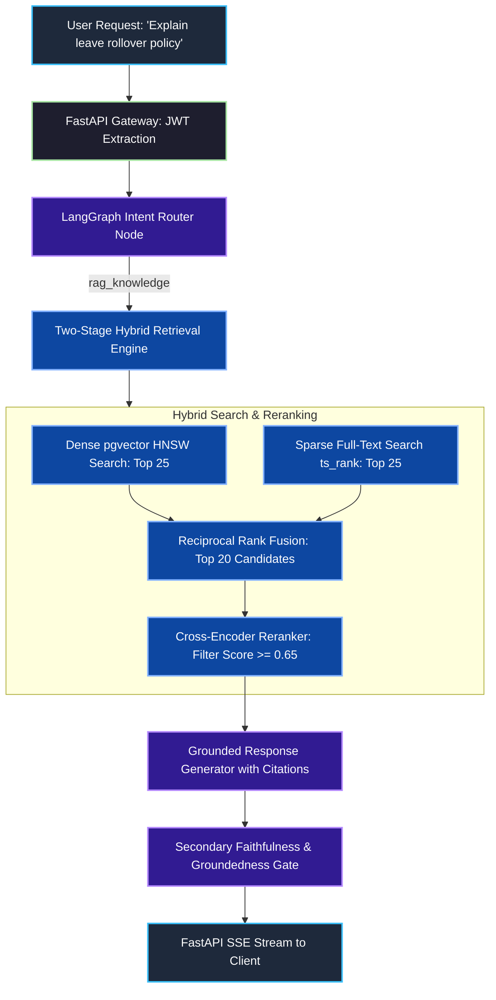

# Project 8: Production-Grade Multi-Tenant SaaS RAG & Agent Platform

> **Difficulty**: Expert / Capstone | **Estimated Time**: 12–16 hours | **Stack**: RAG, LangChain, LangGraph, Python FastAPI, PostgreSQL 16 (`pgvector`), Celery, Redis

---

## 1. Project Overview

This capstone project expands the RAG curriculum into a production-grade multi-tenant enterprise knowledge and support assistant. You will build a system that:
- Ingests organizational documents asynchronously via Celery with token-aware semantic chunking.
- Implements two-stage hybrid retrieval: dense HNSW vectors + sparse PostgreSQL full-text search (`tsvector`) fused via **Reciprocal Rank Fusion (RRF)** ($k=60$) followed by **Cross-Encoder reranking** (`ms-marco-MiniLM-L-6-v2`).
- Enforces a 3-layer multi-tenant defense-in-depth model (JWT claim verification, database Row-Level Security, and partition-filtered vector indexing).
- Integrates with LangGraph for agentic workflow orchestration, dynamic tool execution (billing, ticketing), and Human-in-the-Loop (HITL) approval gates.
- Delivers real-time token streaming with intermediate state telemetry via FastAPI Server-Sent Events (SSE).

For the full architectural deep dive, state machine schemas, and complete Python implementation, see:
👉 **[LangGraph Project 4: Production-Grade Multi-Tenant AI Chat Assistant](../../LangGraph/Projects/04-Production-Grade-Multi-Tenant-RAG-Chat-Assistant.md)**

---

## 2. Key Architecture Milestones

| Milestone | Key Deliverable | Validation Criteria |
|-----------|-----------------|---------------------|
| **1. Multi-Tenant Ingestion** | Celery worker with `pypdf`, `python-docx`, and token-aware `RecursiveCharacterTextSplitter` (800 tokens, 120 overlap). | SHA-256 deduplication and atomic transaction upsert into `document_chunks`. |
| **2. Hybrid RRF Retrieval** | Combined Dense + Sparse search with Reciprocal Rank Fusion ($k=60$) in PostgreSQL. | High recall across both keyword error codes (`ERR_504`) and conceptual queries. |
| **3. Cross-Encoder Reranker** | Integration of `cross-encoder/ms-marco-MiniLM-L-6-v2` with $0.65$ confidence gating. | Low context bloat; top 4 chunks sent to generator; zero ungrounded responses. |
| **4. LangGraph State Machine** | Intent classification router, tool execution nodes, and `interrupt()` HITL breakpoint for sensitive operations. | Durable persistence in `PostgresSaver`; supervisor resumption via `Command(resume=...)`. |
| **5. SSE Streaming** | FastAPI endpoint streaming `event: token` and `event: status` over Server-Sent Events. | TTFT < 400ms; zero JSON tool-call schema leakage to the user. |

---

## 3. Senior Interview Checklist

Before presenting this project in an interview, be prepared to discuss:
- **Tenant Isolation**: Why pure metadata filtering in vector stores is insufficient without PostgreSQL Row-Level Security (RLS) at the kernel level.
- **The "Lost in the Middle" Dilemma**: Why passing 20 chunks degrades LLM attention and why two-stage hybrid retrieval is required.
- **Durable Checkpointing**: How `PostgresSaver` handles server restarts during 14-hour human supervisor reviews.
- **Automated RAG Triad Evaluation**: How Context Relevance, Faithfulness, and Answer Relevance are measured continuously using Ragas.
