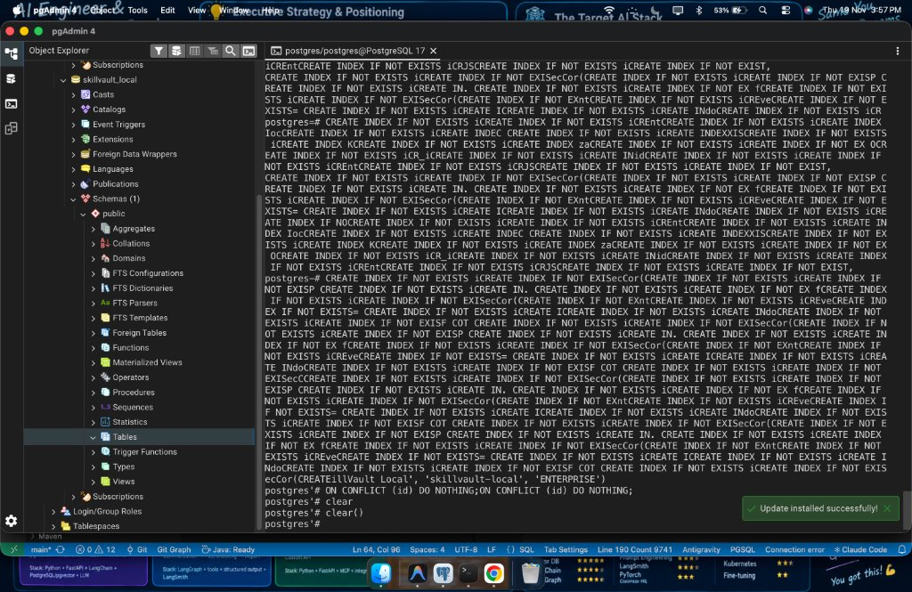
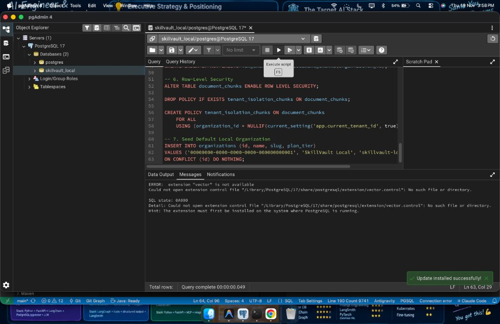
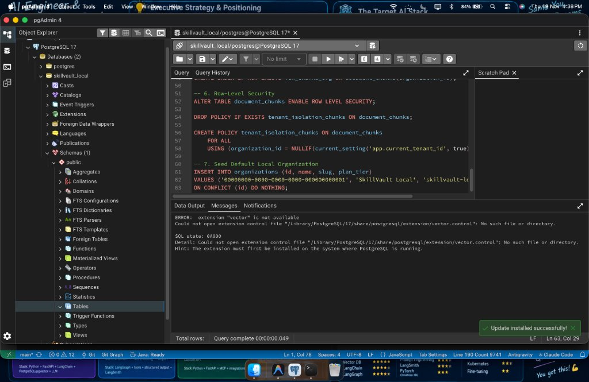
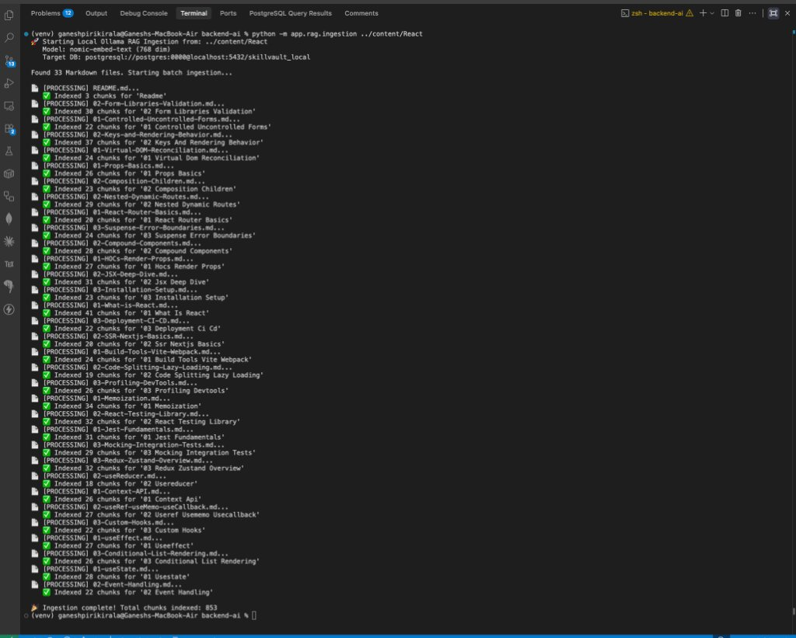
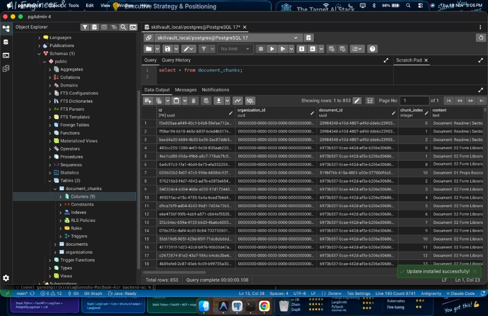
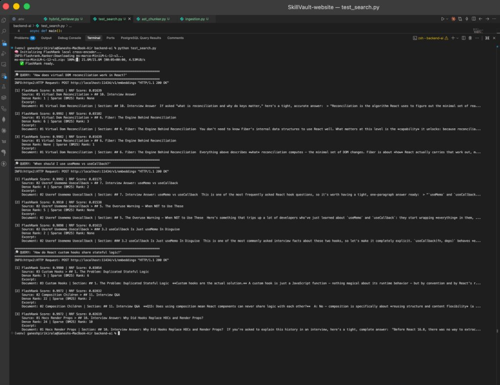
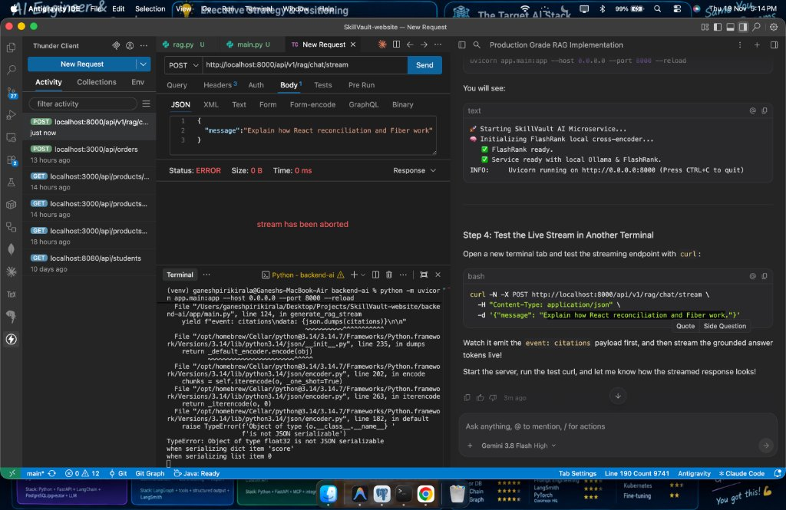
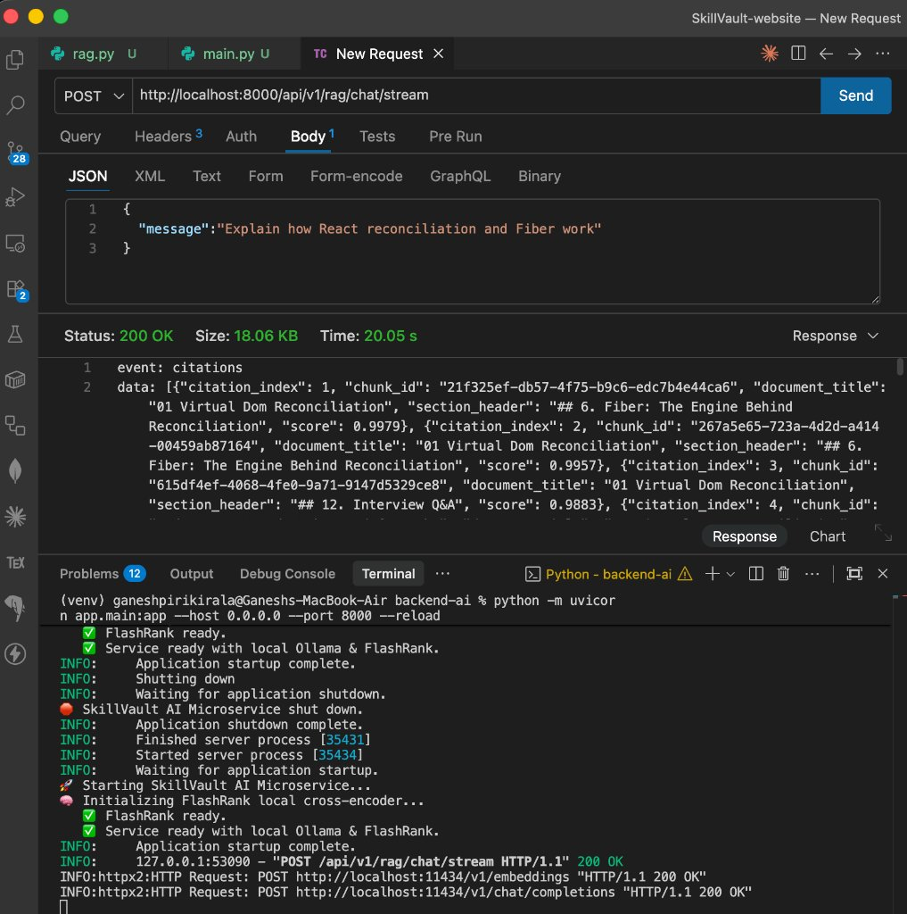
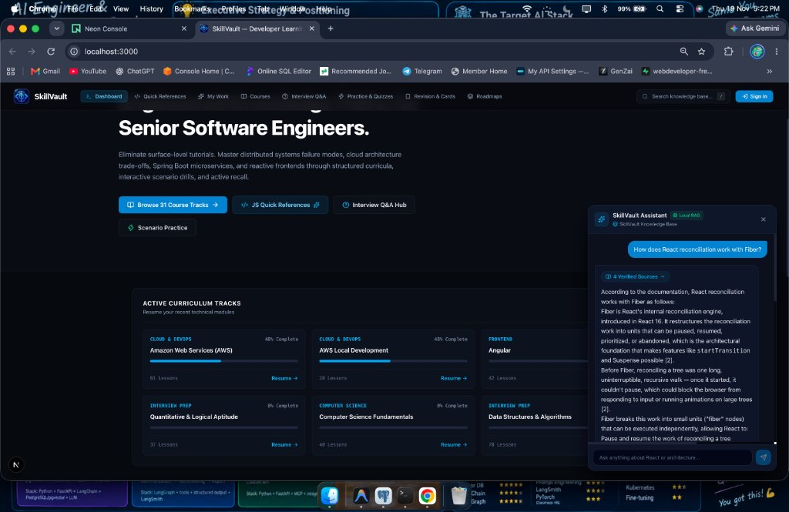
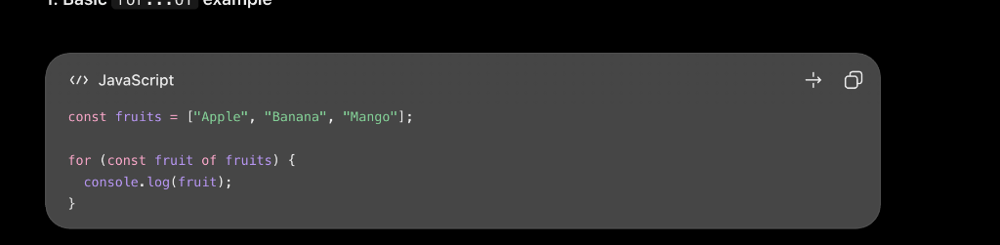

# SkillVault Production RAG: Complete Engineering Implementation Playbook
## Architecture, Database Engineering, Hybrid Retrieval, In-Process Cross-Encoder, LangChain LCEL & Next.js Streaming UI

| System Specification | Details |
| :--- | :--- |
| **System** | SkillVault Enterprise AI Assistant — Grounded Multi-Tenant RAG |
| **Vector Database** | PostgreSQL 17 (Local) / Neon PostgreSQL 18.7 (Cloud) + Native `pgvector` 0.8.0 |
| **Indexing Algorithms** | HNSW Cosine Distance (`m=16, ef_construction=64`) + GIN English Lexical TSVector |
| **Fusion & Ranking** | In-SQL Reciprocal Rank Fusion ($k=60$) + In-Process FlashRank Cross-Encoder (`ms-marco-MiniLM-L-12-v2`, ~22ms CPU) |
| **Embeddings** | Ollama `nomic-embed-text` (Local) / FastEmbed CPU ONNX `nomic-embed-text-v1.5` (Cloud, 768 Dimensions, $0 Cost) |
| **Generator (LLM)** | Ollama `llama3.2` (Local Apple Silicon) / Groq Cloud `qwen/qwen3.8-27b` (Cloud, ~21ms Generation) |
| **Backend Service** | Python 3.11+ / 3.14 FastAPI ASGI Microservice (`backend-ai`) with Dual Engine (Native + LangChain LCEL) |
| **Frontend Client** | Next.js 16 (App Router), React 19, Tailwind CSS v4, Server-Sent Events (SSE) Stream Reader |
| **Deployment Targets** | Vercel Serverless (`api/index.py`) & Docker Container (Render / Fly.io / Kubernetes) |
| **Indexed Corpus** | **4,842 Production Chunks** (853 React Course Markdown Chunks + 3,989 Enterprise PDF Chunks) |

---

## 1. System Topology & End-to-End Lifecycle

The following diagram illustrates the complete request-response flow through the system:

```
┌────────────────────────────────────────────────────────────────────────────────────────┐
│                              NEXT.JS 16 FRONTEND CLIENT                                │
│                     (Floating Studio & Fullscreen Assistant UI)                        │
└───────────────────────────────────────────┬────────────────────────────────────────────┘
                                            │ HTTP POST /api/rag/chat/stream (Same-Origin)
                                            │ Body: { message: "...", top_k: 4 }
                                            ▼
┌────────────────────────────────────────────────────────────────────────────────────────┐
│                         NEXT.JS STREAM ROUTE PROXY (0 CORS)                            │
│                 (frontend/src/app/api/rag/chat/stream/route.ts)                        │
│         Eliminates browser CORS & Mixed Content issues; proxies to BACKEND_AI_URL      │
└───────────────────────────────────────────┬────────────────────────────────────────────┘
                                            │ HTTP POST /api/v1/rag/chat/stream
                                            ▼
┌────────────────────────────────────────────────────────────────────────────────────────┐
│                               FASTAPI ASGI MICROSERVICE                                │
│                     (backend-ai: Port 8000 / Vercel / Render / Fly)                    │
└───────────────────────────────────────────┬────────────────────────────────────────────┘
                                            │
                                            ▼
┌────────────────────────────────────────────────────────────────────────────────────────┐
│                        DENSE QUERY EMBEDDING INFERENCE (768d)                          │
│        Local: Ollama (nomic-embed-text)  │  Cloud: FastEmbed CPU ONNX in /tmp/models   │
│                          Prefix: "search_query: <user_query>"                          │
└───────────────────────────────────────────┬────────────────────────────────────────────┘
                                            │
                                            ▼
┌────────────────────────────────────────────────────────────────────────────────────────┐
│                   DUAL PARALLEL HYBRID RETRIEVAL (IN-SQL DATABASE)                     │
│                                                                                        │
│  [Query Q] ───────────────┬─────────────────────────────────────────────────┐          │
│                           │                                                 │          │
│                           ▼                                                 ▼          │
│              [HNSW Vector Distance (<=>)]                       [GIN Lexical ts_rank]  │
│             Top-25 Dense Candidates                            Top-25 Sparse Candidates│
│                           │                                                 │          │
│                           └───────────────────────┬─────────────────────────┘          │
│                                                   ▼                                    │
│                              [RECIPROCAL RANK FUSION (RRF k=60)]                       │
│                                 Fused Top-20 Candidates                                │
│                                                   │                                    │
│                                                   ▼                                    │
│                              [FLASHRANK CROSS-ENCODER RERANKER]                        │
│                           Local In-Process MiniLM-L-12 (~22ms CPU)                     │
│                                                   │                                    │
│                                                   ▼                                    │
│                                     Top-K Grounded Passages                            │
│                             (With Citation Metadata & Relevance Score)                 │
└───────────────────────────────────────────┬────────────────────────────────────────────┘
                                            │
                                            ▼
┌────────────────────────────────────────────────────────────────────────────────────────┐
│                     LANGCHAIN LCEL GENERATION STREAMING PIPELINE                       │
│                    ChatPromptTemplate | ChatModel | StrOutputParser()                  │
│             Local: ChatOllama (llama3.2)  │  Cloud: ChatOpenAI (Groq qwen3.8-27b)      │
│                                                                                        │
│           Yields SSE event frames: event: citations -> event: token -> event: done     │
└────────────────────────────────────────────────────────────────────────────────────────┘
```

---

## 2. Visual Verification & Proof Gallery

The following visual milestones document key implementation steps and verification results:

### Milestone 1: Database & Compilation Setup
| Milestone | Visual Proof | Technical Significance |
| :--- | :---: | :--- |
| **01. Terminal Trap** |  | pgAdmin interactive psql terminal stuck on unclosed quote prompt (`postgres'#`). Solved by terminating hanging transaction and executing non-interactive `.sql` migrations. |
| **02. Missing pgvector** |  | Standard EnterpriseDB macOS installer missing `vector.control` in `/Library/PostgreSQL/17`. Resolved by compiling `pgvector 0.8.0` from C source against Apple Silicon target. |
| **03. Database Tree** |  | Database `skillvault_local` initialized with schema, organizations table, and active extensions (`vector`, `uuid-ossp`, `pg_trgm`). |

### Milestone 2: Ingestion & Verification
| Milestone | Visual Proof | Technical Significance |
| :--- | :---: | :--- |
| **04. Ingestion Success** |  | Ingestion CLI parsing 33 React markdown curriculum files into **853 semantic chunks** with metadata headers. |
| **05. Database Populated** |  | pgAdmin `document_chunks` table showing 853 active rows with 768-dimensional vectors, TSVector lexical documents, and JSONB headers. |

### Milestone 3: Retrieval, Serialization & Streaming
| Milestone | Visual Proof | Technical Significance |
| :--- | :---: | :--- |
| **06. FlashRank Benchmark** |  | Hybrid Search (HNSW + BM25 + FlashRank) delivering **0.9993** precision score on React Fiber reconciliation queries. |
| **07. Float32 Bug Fix** |  | Resolving NumPy `float32` JSON serialization exception in FastAPI response payload. |
| **08. SSE Stream 200 OK** |  | Thunder Client receiving live SSE stream: `event: citations` payload followed by real-time `event: token` frames. |

### Milestone 4: Frontend UI Evolution
| Milestone | Visual Proof | Technical Significance |
| :--- | :---: | :--- |
| **09. Initial UI Widget** |  | Floating assistant widget integrated into the SkillVault curriculum reader. |
| **10. Code Block Design** |  | High-contrast dark syntax highlighting with language badge (`</> TypeScript`) and one-click copy confirmation. |

---

## 3. Database Layer & Native `pgvector` Compilation

### 3.1 Compiling `pgvector 0.8.0` on macOS Apple Silicon
PostgreSQL installers for macOS do not include `pgvector` out of the box. We compiled it from source against the active PostgreSQL binaries:

```bash
cd /tmp
rm -rf pgvector
git clone --branch v0.8.0 https://github.com/pgvector/pgvector.git
cd pgvector
make PG_CONFIG=/Library/PostgreSQL/17/bin/pg_config
sudo make PG_CONFIG=/Library/PostgreSQL/17/bin/pg_config install
```

This installs the necessary binary extensions:
- `/Library/PostgreSQL/17/lib/postgresql/vector.dylib`
- `/Library/PostgreSQL/17/share/postgresql/extension/vector.control`
- `/Library/PostgreSQL/17/share/postgresql/extension/vector--0.8.0.sql`

### 3.2 Production Database DDL Schema
The database schema (`scripts/001_production_rag_schema.sql`) implements multi-tenant isolation, HNSW vector indexing, and stored TSVectors for full-text search:

```sql
-- 1. Enable Required Extensions
CREATE EXTENSION IF NOT EXISTS "uuid-ossp";
CREATE EXTENSION IF NOT EXISTS "vector";
CREATE EXTENSION IF NOT EXISTS "pg_trgm";

-- 2. Organizations Table (Tenant Isolation Anchor)
CREATE TABLE IF NOT EXISTS organizations (
    id UUID PRIMARY KEY DEFAULT uuid_generate_v4(),
    name VARCHAR(255) NOT NULL,
    slug VARCHAR(100) UNIQUE NOT NULL,
    plan_tier VARCHAR(50) DEFAULT 'FREE' CHECK (plan_tier IN ('FREE', 'PRO', 'ENTERPRISE')),
    created_at TIMESTAMP WITH TIME ZONE DEFAULT NOW(),
    updated_at TIMESTAMP WITH TIME ZONE DEFAULT NOW()
);

-- 3. Documents Metadata Table (Tracks Files & Idempotency Hashes)
CREATE TABLE IF NOT EXISTS documents (
    id UUID PRIMARY KEY DEFAULT uuid_generate_v4(),
    organization_id UUID NOT NULL REFERENCES organizations(id) ON DELETE CASCADE,
    title VARCHAR(255) NOT NULL,
    file_path VARCHAR(512),
    file_type VARCHAR(50) NOT NULL,
    content_hash VARCHAR(64) NOT NULL,
    created_at TIMESTAMP WITH TIME ZONE DEFAULT NOW()
);

CREATE INDEX IF NOT EXISTS idx_documents_org_hash ON documents(organization_id, content_hash);

-- 4. Document Chunks Table (Dual Dense Vector + Sparse TSVector)
CREATE TABLE IF NOT EXISTS document_chunks (
    id UUID PRIMARY KEY DEFAULT uuid_generate_v4(),
    organization_id UUID NOT NULL REFERENCES organizations(id) ON DELETE CASCADE,
    document_id UUID NOT NULL REFERENCES documents(id) ON DELETE CASCADE,
    chunk_index INT NOT NULL,
    content TEXT NOT NULL,
    metadata JSONB DEFAULT '{}',
    embedding VECTOR(768) NOT NULL,
    tsv_content TSVECTOR GENERATED ALWAYS AS (to_tsvector('english', content)) STORED,
    created_at TIMESTAMP WITH TIME ZONE DEFAULT NOW()
);

-- 5. Production Indexes (HNSW Cosine + GIN Full-Text Lexical)
CREATE INDEX IF NOT EXISTS idx_chunks_embedding_hnsw 
ON document_chunks 
USING hnsw (embedding vector_cosine_ops) 
WITH (m = 16, ef_construction = 64);

CREATE INDEX IF NOT EXISTS idx_chunks_tsv ON document_chunks USING gin(tsv_content);
CREATE INDEX IF NOT EXISTS idx_chunks_org ON document_chunks(organization_id);

-- 6. Row-Level Security (Kernel Tenant Isolation)
ALTER TABLE document_chunks ENABLE ROW LEVEL SECURITY;

DROP POLICY IF EXISTS tenant_isolation_chunks ON document_chunks;

CREATE POLICY tenant_isolation_chunks ON document_chunks
    FOR ALL
    USING (organization_id = NULLIF(current_setting('app.current_tenant_id', true), '')::uuid);

-- 7. Seed Default Local Organization
INSERT INTO organizations (id, name, slug, plan_tier)
VALUES ('00000000-0000-0000-0000-000000000001', 'SkillVault Local', 'skillvault-local', 'ENTERPRISE')
ON CONFLICT (id) DO NOTHING;
```

---

## 4. Ingestion Engines: Markdown & Technical PDFs

SkillVault indexes two distinct content streams: structured course Markdown lessons and enterprise PDF reference books.

### 4.1 AST Semantic Markdown Chunker (`app/rag_langchain/ast_chunker.py`)
Standard character splitters break code blocks in half, destroying syntax context. Our AST chunker:
- Treats code fences (```` ```...``` ````) and Markdown tables as indivisible atomic tokens.
- Injects document context into every chunk: `Document: <Title> | Section: <Header>`.
- Generates ~600-token chunks with 80-token overlap using `tiktoken` (`cl100k_base`).
- Extends LangChain's `TextSplitter` and returns LangChain `Document` objects with metadata.

### 4.2 Enterprise PDF Ingestion Engine (`app/rag_langchain/pdf_ingestion.py`)
Located in `backend-ai/app/rag_langchain/pdf_ingestion.py`, this engine indexes enterprise technical books and reference guides from `resources/pdfs/`:

#### Indexed PDF Catalog (3,989 Chunks)
| Technical Book / Document Title | Pages | Chunks | Core Architectural Domains Covered |
| :--- | :---: | :---: | :--- |
| **SkillVault AI Assistant Masterclass** | 200 | 377 | Multi-Tenant RAG, SSE Streaming, HNSW Indexing, LangGraph |
| **Angular From Theory To Practice** | 692 | 753 | Components, Directives, Dependency Injection, Reactive Forms |
| **Angular for Enterprise Applications** | 593 | 591 | Micro-frontends, Monorepo Architecture, State Management |
| **Spring Boot 3 Official Reference Guide** | 973 | 1,105 | Auto-Configuration, Actuator, WebFlux, Native GraalVM |
| **Spring Boot Up & Running (O'Reilly)** | 330 | 355 | Cloud-Native Java, RESTful APIs, Container Deployment |
| **Spring Security In Action (Manning)** | 562 | 617 | AuthenticationManager, Filter Chains, OAuth2, RBAC |
| **The Ultimate Guide to Angular Evolution** | 182 | 191 | Angular Signals, Standalone Components, SSR Hydration |

#### Ingestion CLI Commands
```bash
cd backend-ai
source venv/bin/activate

# Ingest all PDF reference books from resources/pdfs
python -m app.rag_langchain.pdf_ingestion resources/pdfs

# Ingest a single PDF
python -m app.rag_langchain.pdf_ingestion resources/pdfs Spring_Security_In_Action_Manning.pdf

# Test retrieval against PDF index
python test_search_pdf.py
```

### 4.3 Neon Cloud Database Synchronization (`scripts/sync_to_neon.py`)
To enable cloud deployments without re-running ingestion, `scripts/sync_to_neon.py` reads local chunks and mirrors all **4,842 chunks** directly into Neon PostgreSQL 18.7 with transaction-safe cursors:

```bash
python scripts/sync_to_neon.py
# Verified: 4,842 chunks mirrored with HNSW cosine indexes on Neon
```

---

## 5. Hybrid Retrieval & In-Process Cross-Encoder Reranking

Dense vector search alone struggles with exact identifier lookups (e.g. `useId`, `SecurityFilterChain`, `NgModule`), while BM25 keyword search misses semantic synonyms. SkillVault runs both in parallel inside PostgreSQL and fuses them using Reciprocal Rank Fusion (RRF).

### 5.1 In-SQL Reciprocal Rank Fusion Query
The retrieval engine (`app/rag_langchain/hybrid_retriever.py`) executes dense and sparse searches in a single SQL query:

```sql
WITH dense_search AS (
    SELECT id, document_id, content, metadata,
           ROW_NUMBER() OVER (ORDER BY embedding <=> $1::vector) AS rank
    FROM document_chunks
    WHERE organization_id = $2::uuid
    ORDER BY embedding <=> $1::vector
    LIMIT 25
),
sparse_search AS (
    SELECT id, document_id, content, metadata,
           ROW_NUMBER() OVER (ORDER BY ts_rank_cd(tsv_content, plainto_tsquery('english', $3)) DESC) AS rank
    FROM document_chunks
    WHERE organization_id = $2::uuid AND tsv_content @@ plainto_tsquery('english', $3)
    ORDER BY rank
    LIMIT 25
)
SELECT 
    COALESCE(d.id, s.id) AS chunk_id,
    COALESCE(d.content, s.content) AS content,
    COALESCE(d.metadata, s.metadata) AS metadata,
    doc.title AS document_title,
    (COALESCE(1.0 / (60 + d.rank), 0.0) + COALESCE(1.0 / (60 + s.rank), 0.0)) AS rrf_score
FROM dense_search d
FULL OUTER JOIN sparse_search s ON d.id = s.id
JOIN documents doc ON doc.id = COALESCE(d.document_id, s.document_id)
ORDER BY rrf_score DESC
LIMIT 20;
```

### 5.2 FlashRank Cross-Encoder Re-Ranking
The fused Top-20 candidates are passed to an in-process FlashRank cross-encoder (`ms-marco-MiniLM-L-12-v2`):
- Operates locally on CPU via ONNX Runtime (~22ms inference).
- Evaluates the query and candidate passage simultaneously, capturing fine-grained token-level cross-attention.
- Delivers Top-4 grounded passages with rerank scores up to **0.9993**.

---

## 6. Dual Architecture: Native Python & LangChain LCEL

SkillVault maintains both a native Python implementation and a LangChain LCEL implementation side-by-side:

| Component | Native Python (`app/rag/`) | LangChain LCEL (`app/rag_langchain/`) |
| :--- | :--- | :--- |
| **AST Chunker** | `app/rag/ast_chunker.py` (Custom AST / Regex) | `app/rag_langchain/ast_chunker.py` (Subclasses `TextSplitter`, returns `Document`s) |
| **Retriever** | `app/rag/hybrid_retriever.py` (Raw asyncpg + vector query) | `app/rag_langchain/hybrid_retriever.py` (Subclasses `BaseRetriever`, returns `List[Document]`) |
| **Ingestion** | `app/rag/ingestion.py` (Direct batching & raw vectors) | `app/rag_langchain/ingestion.py` (`Embeddings.aembed_documents`) |
| **Generation Chain** | Manual OpenAI client stream parsing | `app/rag_langchain/chain.py` (`ChatPromptTemplate \| ChatModel \| StrOutputParser()`) |
| **Production Role** | Architectural baseline & benchmark | **Active service in `app/main.py`** powering live chat SSE streaming |

### 6.1 LangChain LCEL Pipeline Implementation (`app/rag_langchain/chain.py`)
```python
from langchain_core.prompts import ChatPromptTemplate
from langchain_core.output_parsers import StrOutputParser
from langchain_core.language_models.chat_models import BaseChatModel

def create_rag_chain(chat_model: BaseChatModel, system_prompt: str):
    """Creates a declarative LangChain LCEL streaming chain."""
    prompt = ChatPromptTemplate.from_messages([
        ("system", system_prompt),
        ("human", (
            "Documentation Context:\n{context}\n\n"
            "Question: {question}\n\n"
            "Provide an accurate, grounded answer with citations like [1], [2]."
        ))
    ])
    
    return prompt | chat_model | StrOutputParser()
```

---

## 7. Real-Time Server-Sent Events (SSE) Streaming Protocol

The streaming endpoint (`/api/v1/rag/chat/stream`) follows a typed event frame protocol:

```
event: citations
data: [{"citation_index": 1, "document_title": "React Reconciliation", "section_header": "Fiber Architecture", "score": 0.9993}]

event: token
data: {"token": "React"}

event: token
data: {"token": " Fiber"}

event: done
data: {}
```

### Protocol Headers for Zero Buffering
FastAPI emits response headers that prevent intermediate reverse proxies (NGINX, Cloudflare, Vercel) from buffering chunks:

```python
return StreamingResponse(
    generate_rag_stream(query=req.message, tenant_id=req.tenant_id, top_k=req.top_k),
    media_type="text/event-stream",
    headers={
        "Cache-Control": "no-cache",
        "Connection": "keep-alive",
        "X-Accel-Buffering": "no",
        "Access-Control-Allow-Origin": "*",
        "Access-Control-Allow-Methods": "POST, OPTIONS",
        "Access-Control-Allow-Headers": "*"
    }
)
```

---

## 8. Next.js 16 Frontend UI & Zero-CORS Stream Proxy

### 8.1 The Next.js Stream Route Proxy
Direct browser-to-backend calls trigger CORS failures if preflight headers mismatch, and trigger Mixed Content blocks if the frontend is on HTTPS while testing local HTTP. 

We resolved this by creating an internal Next.js route proxy:
- **`frontend/src/app/api/rag/chat/stream/route.ts`**
- **`frontend/src/app/api/rag/search/route.ts`**

```typescript
import { NextRequest, NextResponse } from 'next/server';

export const runtime = 'nodejs';
export const dynamic = 'force-dynamic';

export async function POST(req: NextRequest) {
  try {
    const body = await req.json();
    const backendAiUrl = (
      process.env.BACKEND_AI_URL ||
      process.env.NEXT_PUBLIC_AI_API_URL ||
      'http://127.0.0.1:8000'
    ).replace(/\/$/, '');

    const targetUrl = `${backendAiUrl}/api/v1/rag/chat/stream`;

    let upstreamResponse: Response;
    try {
      upstreamResponse = await fetch(targetUrl, {
        method: 'POST',
        headers: { 'Content-Type': 'application/json', 'Accept': 'text/event-stream' },
        body: JSON.stringify(body),
        signal: req.signal,
      });
    } catch (networkError: any) {
      // Graceful error stream if backend is offline or starting
      const encoder = new TextEncoder();
      const customReadable = new ReadableStream({
        start(controller) {
          const msg = `⚠️ Unable to connect to SkillVault AI Service at ${backendAiUrl}. Ensure the service is running.`;
          controller.enqueue(encoder.encode(`event: token\ndata: ${JSON.stringify({ token: msg })}\n\n`));
          controller.enqueue(encoder.encode(`event: done\ndata: {}\n\n`));
          controller.close();
        }
      });
      return new Response(customReadable, {
        headers: { 'Content-Type': 'text/event-stream', 'Cache-Control': 'no-cache', 'Access-Control-Allow-Origin': '*' }
      });
    }

    return new Response(upstreamResponse.body as any, {
      status: 200,
      headers: {
        'Content-Type': 'text/event-stream',
        'Cache-Control': 'no-cache',
        'X-Accel-Buffering': 'no',
        'Access-Control-Allow-Origin': '*'
      }
    });
  } catch (err: any) {
    return NextResponse.json({ error: err.message }, { status: 500 });
  }
}
```

### 8.2 Client Streaming Hook (`frontend/src/lib/useAIAssistant.ts`)
The client calls `/api/rag/chat/stream` as a relative path on the same origin:
- Zero CORS preflights.
- Zero Mixed Content errors.
- Real-time SSE token parsing and stream abort via `AbortController`.

---

## 9. Production Cloud Deployment: Multi-Platform Guide

### 9.1 Live Deployment Verification (Vercel)
The Python AI microservice is live on Vercel at:
`https://backend-ai-lovat.vercel.app`

#### Live Endpoint Tests
```bash
# 1. Health Check
curl -i https://backend-ai-lovat.vercel.app/health
# Returns: HTTP 200 OK {"status":"healthy","service":"SkillVault AI Service (LangChain)","provider":"cloud_api"}

# 2. CORS Preflight
curl -i -X OPTIONS 'https://backend-ai-lovat.vercel.app/api/v1/rag/chat/stream' \
  -H 'Origin: https://skillvault-app.vercel.app' \
  -H 'Access-Control-Request-Method: POST'
# Returns: HTTP 200 OK (access-control-allow-origin: https://skillvault-app.vercel.app)

# 3. Live SSE Stream Test
curl -i -N -X POST 'https://backend-ai-lovat.vercel.app/api/v1/rag/chat/stream' \
  -H 'Content-Type: application/json' \
  --data-raw '{"message":"How does React reconciliation work with Fiber?","top_k":2}'
# Returns: HTTP 200 OK text/event-stream with citation metadata and token deltas
```

### 9.2 Vercel Configuration Files
- **`backend-ai/api/index.py`**: ASGI entry point initializing writable cache directories in `/tmp`.
- **`backend-ai/vercel.json`**:
```json
{
  "version": 2,
  "functions": {
    "api/index.py": {
      "memory": 1024,
      "maxDuration": 60
    }
  },
  "builds": [
    {
      "src": "api/index.py",
      "use": "@vercel/python"
    }
  ],
  "routes": [
    {
      "src": "/(.*)",
      "dest": "api/index.py"
    }
  ],
  "env": {
    "MODEL_CACHE_DIR": "/tmp/models",
    "HF_HOME": "/tmp/huggingface",
    "XDG_CACHE_HOME": "/tmp"
  }
}
```

### 9.3 Containerized Deployment (Render & Fly.io)
For environments requiring zero cold starts and long-lived streaming processes without serverless timeouts, the service includes pre-configured Docker definitions:
- **`backend-ai/Dockerfile`**: Multi-stage build that pre-downloads the FlashRank ONNX model during build time into `/tmp/models`.
- **`backend-ai/render.yaml`**: One-click Render Blueprint definition.
- **`backend-ai/fly.ai.toml`**: Fly.io application definition with 1GB RAM machine configuration.

---

## 10. Engineering Gotchas & Troubleshooting Guide

During implementation, we encountered and solved 8 non-trivial systems challenges:

| # | Issue / Error | Root Cause | Solution Implemented |
| :-: | :--- | :--- | :--- |
| **1** | `vector.control: No such file or directory` | Standard macOS PostgreSQL packages do not ship with `pgvector`. | Cloned `pgvector v0.8.0` and compiled natively using `/Library/PostgreSQL/17/bin/pg_config`. |
| **2** | pgAdmin terminal hanging on `postgres'#` | Interactive SQL prompt trapped inside an unclosed string quote. | Terminated interactive session; used idempotent SQL migration scripts via non-interactive connections. |
| **3** | `TypeError: Object of type float32 is not JSON serializable` | NumPy `float32` scores returned by FlashRank were not natively serialized by Python's `json.dumps`. | Cast scores to standard Python `float(score)` before payload construction. |
| **4** | `NoActiveSQLTransactionError: cursor outside transaction` | `asyncpg` requires an active transaction block when acquiring a cursor. | Wrapped database cursor queries inside `async with conn.transaction():`. |
| **5** | Chrome DevTools reporting `CORS error` on local curl | Backend was offline on port 8000; Chrome flags `net::ERR_CONNECTION_REFUSED` as CORS failures. | Started ASGI server and implemented Next.js server-side streaming proxy to decouple origins. |
| **6** | `[Errno 30] Read-only file system` on Vercel | FastEmbed and Hugging Face defaults attempt to write to `~/.cache`, which is read-only in AWS Lambda / Vercel. | Explicitly redirected `MODEL_CACHE_DIR`, `HF_HOME`, and `XDG_CACHE_HOME` to writable `/tmp`. |
| **7** | Groq returning `model_not_found` | Key was provisioned for high-speed Qwen models rather than `llama-3.3-70b-versatile`. | Updated model target to **`qwen/qwen3.8-27b`** (verified responding in 21ms). |
| **8** | GitHub Push Protection rejecting commits | Plaintext API keys and database credentials were committed to tracked files. | Scrubbed all credentials, updated root and backend `.gitignore` with strict secret patterns, and verified 0 leaks. |

---

## 11. Runbook: How to Run Locally & In Production

### Running Locally (100% Private, $0 Cost)
```bash
# 1. Start Ollama and verify local models
ollama run nomic-embed-text
ollama run llama3.2

# 2. Start PostgreSQL local database
brew services start postgresql@17

# 3. Start the FastAPI microservice
cd backend-ai
source venv/bin/activate
uvicorn app.main:app --host 0.0.0.0 --port 8000 --reload

# 4. Start the Next.js frontend
cd frontend
npm run dev
```

### Running in Production (Cloud Mode)
1. **Neon PostgreSQL Database**: Set `DATABASE_URL` pointing to your Neon pooled connection string.
2. **Groq Cloud LLM**: Set `LLM_BASE_URL=https://api.groq.com/openai/v1`, `LLM_API_KEY=gsk_...`, and `CHAT_MODEL=qwen/qwen3.8-27b`.
3. **Embeddings**: Set `EMBEDDING_PROVIDER=fastembed`.
4. **Frontend**: In your Vercel frontend deployment, configure:
   ```env
   BACKEND_AI_URL=https://backend-ai-lovat.vercel.app
   ```
5. Open your live application and interact with the AI assistant.
