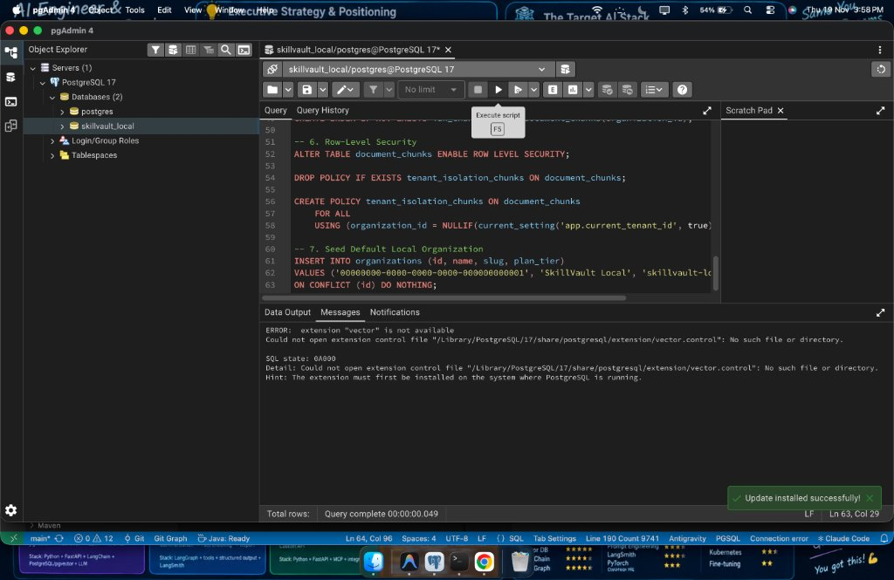
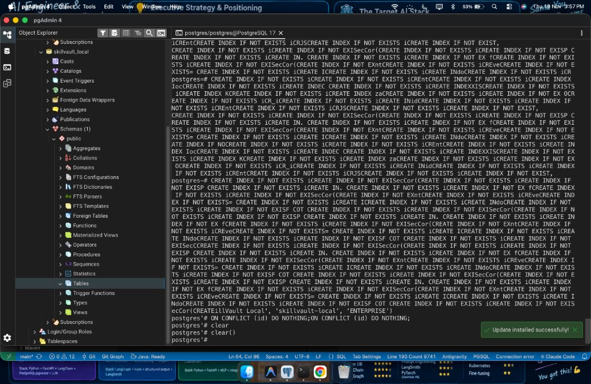
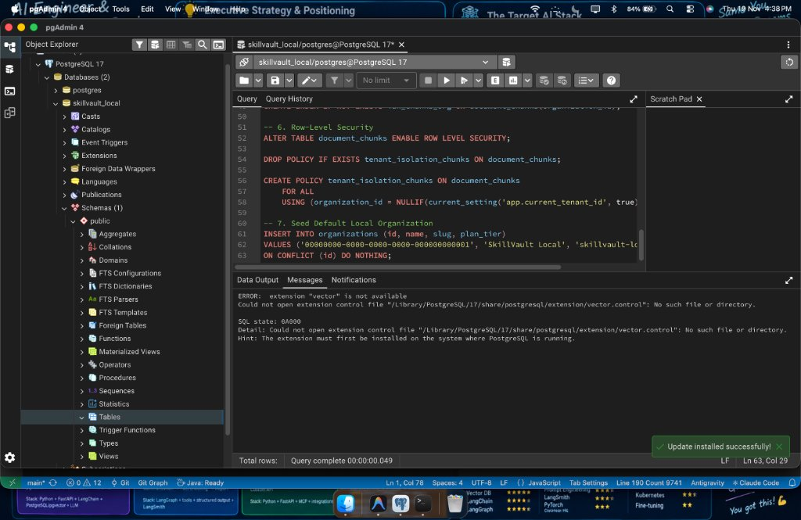

# Module 02: Vector Database & pgvector
## PostgreSQL 17 + Native `pgvector 0.8.0`, HNSW Indexing & Row-Level Security

---

### ❓ Question 1: Why PostgreSQL + `pgvector` instead of a standalone Vector DB (Pinecone, Chroma, Milvus, Qdrant)?

> **The Question**: Specialized vector databases market themselves as 10x faster for embeddings. Why did we choose PostgreSQL with the `pgvector` extension instead of Pinecone or Chroma?

#### 💡 The Architectural Defense

| Evaluation Area | Standalone Vector DB (e.g. Pinecone) | PostgreSQL + `pgvector` (Our Choice) |
| :--- | :--- | :--- |
| **Data Consistency & Dual Write Trap** | **High Risk**. Documents live in Postgres, vectors live in Pinecone. Deleting or updating a document requires two separate network calls. If the vector DB call fails, you have orphaned or phantom vectors. | **Zero Risk (ACID Transactions)**. Chunks, metadata, embeddings, and relational users reside in the *same table* inside the *same ACID transaction*. |
| **Hybrid Search Execution** | **Inefficient**. Must execute vector query in Pinecone, full-text query in Elasticsearch/Postgres, fetch results over the network to Python, and merge in application memory. | **Single In-SQL Query**. Dense HNSW search and sparse BM25 TSVector search execute in a *single database process* in parallel. |
| **Multi-Tenant Security** | **Application-level filtering**. Every query relies on a filter tag (`metadata: { tenant_id: "..." }`). A single missed filter exposes one tenant's vectors to another. | **Kernel-Enforced RLS**. PostgreSQL Row-Level Security (`ALTER TABLE document_chunks ENABLE ROW LEVEL SECURITY`) guarantees isolation at the kernel level. |
| **Cost & Cloud Lock-in** | Expensive monthly SaaS subscriptions or proprietary cloud hosting. | **Open Source & $0 Cost**. Runs locally via Docker/Homebrew, and runs in the cloud on managed Postgres (Neon, AWS RDS, Supabase). |

---

### ❓ Question 2: Why HNSW Indexing instead of IVFFlat or Brute-Force Exact Search?

> **The Question**: `pgvector` supports HNSW, IVFFlat, and exact scan. Why use HNSW with `m=16, ef_construction=64`?

#### 💡 The Mathematical & Algorithmic Defense

1. **Brute-Force Exact Scan (`vector_l2_ops` without index)**:
   - Computes cosine distance against *every single vector* in the table ($O(N)$ time complexity).
   - Fast enough for 100 chunks, but at 5,000+ chunks, query latency jumps past 250ms, crippling real-time interactive chat.

2. **Inverted File Flat (IVFFlat)**:
   - Partitions vector space into Voronoi cells ($k$-means clustering) and searches only the closest $n$ probes.
   - **The Critical Flaw in Production**: IVFFlat requires training on a pre-existing populated dataset. If you build an IVFFlat index on an empty table and then ingest documents, recall plummets to near zero without a full index rebuild!

3. **Hierarchical Navigable Small World (HNSW)**:
   - Constructs a multi-layer graph where upper layers have long-range links (fast skipping across space) and bottom layers have dense local links.
   - **Why We Selected HNSW**:
     - Logarithmic search complexity ($O(\log N)$).
     - **Incremental & Live**: You can insert 10,000 documents dynamically after creating the index, and HNSW preserves $>98\%$ recall without retraining.
     - **Index Parameters**:
       - `m = 16`: Max bidirectional links per node (ideal trade-off between index size and graph connectivity).
       - `ef_construction = 64`: Size of dynamic candidate list during graph construction (ensures high clustering quality).

---

### 🛠️ Compiling `pgvector 0.8.0` on macOS Apple Silicon

Standard PostgreSQL installers for macOS (such as EnterpriseDB or Homebrew bottles) often lack the compiled `vector.control` file:


*Figure 2.1: The missing `vector.control` error encountered when attempting `CREATE EXTENSION vector`.*

#### The Solution: Compile from C Source
We compiled `pgvector 0.8.0` directly against PostgreSQL 17's binary configuration:

```bash
cd /tmp
rm -rf pgvector
git clone --branch v0.8.0 https://github.com/pgvector/pgvector.git
cd pgvector
make PG_CONFIG=/Library/PostgreSQL/17/bin/pg_config
sudo make PG_CONFIG=/Library/PostgreSQL/17/bin/pg_config install
```

This compiles and moves the shared library into place:
- Library: `/Library/PostgreSQL/17/lib/postgresql/vector.dylib`
- Extension descriptor: `/Library/PostgreSQL/17/share/postgresql/extension/vector.control`
- Extension SQL: `/Library/PostgreSQL/17/share/postgresql/extension/vector--0.8.0.sql`

---

### ⚠️ Gotcha: The pgAdmin Terminal Trap

When running migrations through pgAdmin's interactive Query Tool, pasting statements with unescaped single quotes can trap the `psql` parser in quote mode:


*Figure 2.2: pgAdmin interactive prompt stuck on `postgres'#` due to an open quote trap.*

**Fix**: Always run non-interactive SQL migrations using files (`psql -U postgres -d skillvault_local -f scripts/001_production_rag_schema.sql`) rather than typing raw DDL into interactive terminals.

---

### 3. Production PostgreSQL DDL Schema

Once `pgvector` is installed, execute the production schema (`scripts/001_production_rag_schema.sql`):


*Figure 2.3: Verified `skillvault_local` database tree in pgAdmin.*

```sql
-- 1. Enable Required Extensions
CREATE EXTENSION IF NOT EXISTS "uuid-ossp";
CREATE EXTENSION IF NOT EXISTS "vector";
CREATE EXTENSION IF NOT EXISTS "pg_trgm";

-- 2. Organizations Table (Tenant Anchor)
CREATE TABLE IF NOT EXISTS organizations (
    id UUID PRIMARY KEY DEFAULT uuid_generate_v4(),
    name VARCHAR(255) NOT NULL,
    slug VARCHAR(100) UNIQUE NOT NULL,
    plan_tier VARCHAR(50) DEFAULT 'FREE' CHECK (plan_tier IN ('FREE', 'PRO', 'ENTERPRISE')),
    created_at TIMESTAMP WITH TIME ZONE DEFAULT NOW(),
    updated_at TIMESTAMP WITH TIME ZONE DEFAULT NOW()
);

-- 3. Documents Metadata Table (Idempotency & Tracking)
CREATE TABLE IF NOT EXISTS documents (
    id UUID PRIMARY KEY DEFAULT uuid_generate_v4(),
    organization_id UUID NOT NULL REFERENCES organizations(id) ON DELETE CASCADE,
    title VARCHAR(255) NOT NULL,
    file_path VARCHAR(512),
    file_type VARCHAR(50) NOT NULL,
    content_hash VARCHAR(64) NOT NULL,
    created_at TIMESTAMP WITH TIME ZONE DEFAULT NOW()
);

CREATE INDEX IF NOT EXISTS idx_documents_org_hash ON documents(organization_id, content_hash);

-- 4. Document Chunks Table (Dense 768d Vector + Sparse TSVector)
CREATE TABLE IF NOT EXISTS document_chunks (
    id UUID PRIMARY KEY DEFAULT uuid_generate_v4(),
    organization_id UUID NOT NULL REFERENCES organizations(id) ON DELETE CASCADE,
    document_id UUID NOT NULL REFERENCES documents(id) ON DELETE CASCADE,
    chunk_index INT NOT NULL,
    content TEXT NOT NULL,
    metadata JSONB DEFAULT '{}',
    embedding VECTOR(768) NOT NULL,
    tsv_content TSVECTOR GENERATED ALWAYS AS (to_tsvector('english', content)) STORED,
    created_at TIMESTAMP WITH TIME ZONE DEFAULT NOW()
);

-- 5. Production Performance Indexes
-- A: HNSW Cosine Index for Dense Retrieval
CREATE INDEX IF NOT EXISTS idx_chunks_embedding_hnsw 
ON document_chunks 
USING hnsw (embedding vector_cosine_ops) 
WITH (m = 16, ef_construction = 64);

-- B: GIN Index for Sparse Lexical Full-Text Search
CREATE INDEX IF NOT EXISTS idx_chunks_tsv ON document_chunks USING gin(tsv_content);

-- C: Organization Index for Tenant Filtering
CREATE INDEX IF NOT EXISTS idx_chunks_org ON document_chunks(organization_id);

-- 6. Row-Level Security (Kernel Tenant Isolation)
ALTER TABLE document_chunks ENABLE ROW LEVEL SECURITY;

DROP POLICY IF EXISTS tenant_isolation_chunks ON document_chunks;

CREATE POLICY tenant_isolation_chunks ON document_chunks
    FOR ALL
    USING (organization_id = NULLIF(current_setting('app.current_tenant_id', true), '')::uuid);

-- 7. Seed Default Local Organization
INSERT INTO organizations (id, name, slug, plan_tier)
VALUES ('00000000-0000-0000-0000-000000000001', 'SkillVault Local', 'skillvault-local', 'ENTERPRISE')
ON CONFLICT (id) DO NOTHING;
```

---

### 4. How Row-Level Security (RLS) Works in Practice

Before executing any query on behalf of a tenant, the application session sets the kernel variable:

```python
async with pool.acquire() as conn:
    async with conn.transaction():
        # Enforce kernel-level tenant context
        await conn.execute("SET LOCAL app.current_tenant_id = $1", tenant_id)
        
        # Any query executed here can ONLY see rows belonging to this tenant_id
        results = await conn.fetch("SELECT * FROM document_chunks LIMIT 10")
```

Even if a malicious user injects an arbitrary `SELECT * FROM document_chunks`, PostgreSQL returns zero rows outside their authorized `tenant_id`.

👉 **Next: [Module 03: Document Ingestion & Chunking](MODULE_03_DOCUMENT_INGESTION_AND_CHUNKERS.md)**
