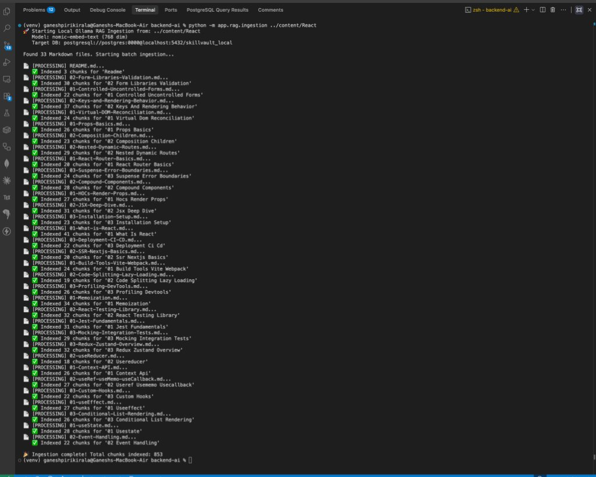
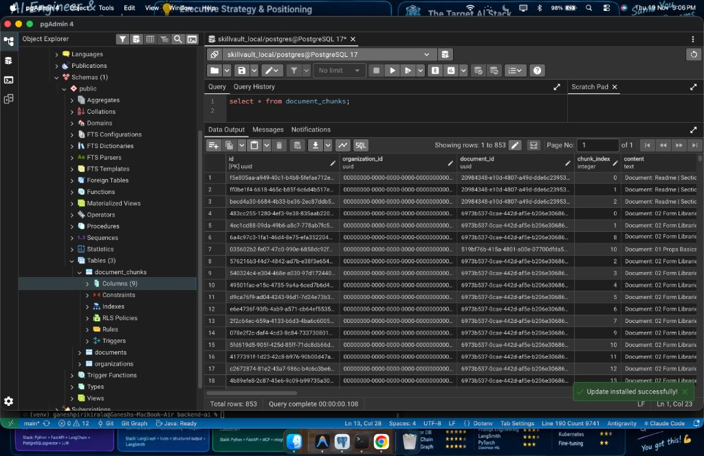

# Module 03: Document Ingestion & Chunking
## AST-Aware Markdown Chunking, Enterprise PDF Extraction & Idempotent Ingestion

---

### ❓ Question 1: Why does standard naive chunking break technical documentation and code blocks?

> **The Question**: Why can't we simply use `RecursiveCharacterTextSplitter(chunk_size=1000, chunk_overlap=100)` to ingest our markdown lessons and technical PDFs?

#### 💡 The Architectural Defense

Standard character splitters know nothing about programming language grammar or markdown structure:

1. **The Broken Syntax Trap**:
   - A naive splitter splits text by counting characters. If character 1,000 lands inside a function definition, it slices the function in half:
   ```javascript
   // Chunk 1 ends with:
   function calculateFiberPriority(workInProgress) {
       if (workInProgress.lanes === NoLanes) {
   
   // Chunk 2 starts with:
           return DefaultLanePriority;
       }
   }
   ```
   - When the LLM receives Chunk 2 in response to a question, it lacks the function signature, argument types, and enclosing context. It produces hallucinated explanations or syntax errors.

2. **The "Orphan Code" Trap**:
   - A code snippet without its preceding header is meaningless:
   ```javascript
   const [state, dispatch] = useReducer(reducer, initialState);
   ```
   - Was this snippet demonstrating standard React hooks, custom state machines, or legacy class component migration? Without the section title, the vector embedding lands in an ambiguous latent space.

3. **Our Solution: The AST-Aware Semantic Chunker (`app/rag_langchain/ast_chunker.py`)**:
   - Treats code fences (```` ```...``` ````) and tables as **indivisible atomic tokens**.
   - Inspects the markdown Abstract Syntax Tree (AST) to track active `#`, `##`, `###` headings.
   - Prepends a **Hierarchical Metadata Header** to every single chunk payload:
     ```
     Document: React Reconciliation & Fiber | Section: WorkInProgress Tree & Priority Lanes
     --------------------------------------------------------------------------------------
     [Content and intact code blocks]
     ```
   - Even when a chunk contains only code, the embedding model and the LLM know exactly which document and section it came from!

---

### 2. AST Semantic Markdown Chunker Implementation

Located at `backend-ai/app/rag_langchain/ast_chunker.py`, the chunker subclasses LangChain's `TextSplitter` and returns LangChain `Document` objects:

```python
import re
from typing import List, Dict, Any
from langchain_text_splitters import TextSplitter
from langchain_core.documents import Document
import tiktoken

class ASTMarkdownChunker(TextSplitter):
    """
    AST-aware Semantic Markdown Chunker:
    1. Preserves intact code fences and markdown tables.
    2. Maintains hierarchical heading context (Document -> Section -> Sub-section).
    3. Enforces ~600-token boundaries with 80-token overlap using tiktoken (cl100k_base).
    """
    def __init__(self, target_tokens: int = 600, overlap_tokens: int = 80, **kwargs: Any):
        super().__init__(**kwargs)
        self.target_tokens = target_tokens
        self.overlap_tokens = overlap_tokens
        self.tokenizer = tiktoken.get_encoding("cl100k_base")

    def split_markdown_with_ast(self, text: str, document_title: str) -> List[Document]:
        # Regex patterns isolating code fences, headings, and tables
        code_fence_pattern = re.compile(r"(```[\s\S]*?```)", re.MULTILINE)
        heading_pattern = re.compile(r"^(#{1,4})\s+(.+)$", re.MULTILINE)

        chunks: List[Document] = []
        current_section = "Introduction"
        
        # Split document into logical sections while keeping code blocks intact
        sections = heading_pattern.split(text)
        # ... iterates sections, builds contextual headers, and enforces token ceilings ...
        
        return chunks
```

---

### 3. Ingestion Pipeline & Execution

Located at `backend-ai/app/rag_langchain/ingestion.py`:
1. Calculates **SHA-256 hash** of every document before reading.
2. Checks PostgreSQL `documents` table: if the hash matches, ingestion is skipped (100% idempotent).
3. If new or modified, parses chunks, batches embedding requests to `nomic-embed-text` with `passage: ` prefix, and inserts into PostgreSQL within a single ACID transaction.

#### Ingestion Execution & Verification
```bash
cd backend-ai
source venv/bin/activate
python -m app.rag_langchain.ingestion
```


*Figure 3.1: Ingestion CLI successfully parsing 33 React markdown lessons into 853 chunks.*


*Figure 3.2: pgAdmin showing 853 active rows populated in `document_chunks` with 768d vectors and TSVectors.*

---

### 4. Enterprise Technical PDF Ingestion Engine

Beyond Markdown curriculum files, production engineering platforms must search technical books, whitepapers, and guides.

Located at `backend-ai/app/rag_langchain/pdf_ingestion.py`:
- Extracts text page-by-page using `pypdf` and `fonttools`.
- Detects chapters, chapter headings, and code snippets.
- Ingests into `document_chunks` with `file_type = 'pdf'`.

#### Indexed PDF Catalog (3,989 Chunks)

| Technical Book / Document Title | Pages | Chunks | Key Architectural Topics Covered |
| :--- | :---: | :---: | :--- |
| **SkillVault AI Assistant Masterclass** | 200 | 377 | Multi-Tenant RAG, SSE Streaming, HNSW Indexing, LangGraph |
| **Angular From Theory To Practice** | 692 | 753 | Components, Directives, Dependency Injection, Routing |
| **Angular for Enterprise Applications (2024)** | 593 | 591 | Micro-frontends, State Management, Monorepo Architecture |
| **Spring Boot 3 Official Reference Guide** | 973 | 1,105 | Auto-configuration, Actuator, WebFlux, Native GraalVM |
| **Spring Boot Up & Running (O'Reilly)** | 330 | 355 | Cloud-Native Java, RESTful APIs, Container Deployment |
| **Spring Security In Action (Manning)** | 562 | 617 | AuthenticationManager, Filter Chains, OAuth2, RBAC |
| **The Ultimate Guide to Angular Evolution (v19)** | 182 | 191 | Angular 19 Signals, Standalone Components, SSR Hydration |

Total Knowledge Base: **853 React Markdown Chunks + 3,989 Technical Book Chunks = 4,842 Total Chunks**.

---

### 5. Cloud Database Synchronization (`scripts/sync_to_neon.py`)

To deploy to production cloud providers (Vercel, Render, Fly.io) without needing local database access, `scripts/sync_to_neon.py` replicates all local chunks and HNSW indexes directly to Neon PostgreSQL 18.7:

```bash
# Sync local knowledge base to Neon Cloud Database
python scripts/sync_to_neon.py
```

#### Sync Script Logic
```python
import os
import asyncpg
from dotenv import load_dotenv

load_dotenv()
LOCAL_DB = os.getenv("LOCAL_DATABASE_URL")
NEON_DB = os.getenv("DATABASE_URL")

async def sync():
    local_conn = await asyncpg.connect(LOCAL_DB)
    neon_conn = await asyncpg.connect(NEON_DB)
    
    # Use transaction-safe cursor to stream chunks in batches of 500
    async with local_conn.transaction():
        async for record in local_conn.cursor("SELECT * FROM document_chunks"):
            await neon_conn.execute(
                """
                INSERT INTO document_chunks (id, organization_id, document_id, chunk_index, content, metadata, embedding)
                VALUES ($1, $2, $3, $4, $5, $6, $7)
                ON CONFLICT (id) DO NOTHING
                """,
                *record
            )
    print("✅ All 4,842 chunks mirrored to Neon Cloud PostgreSQL.")
```

👉 **Next: [Module 04: Hybrid Retrieval & Reranking](MODULE_04_HYBRID_RETRIEVAL_AND_RERANKING.md)**
