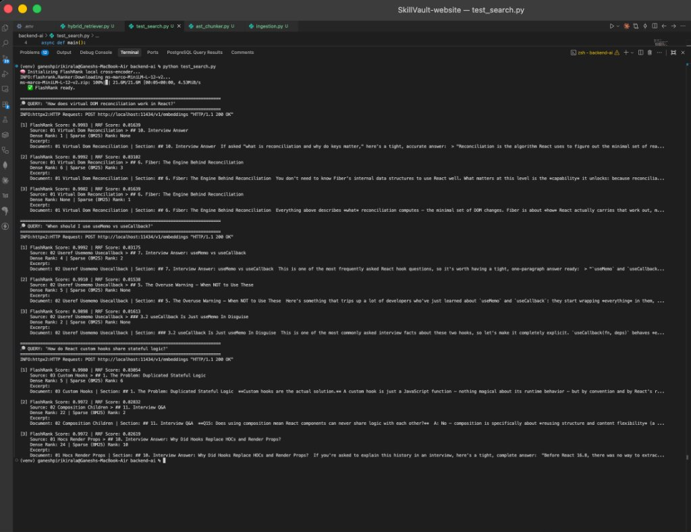
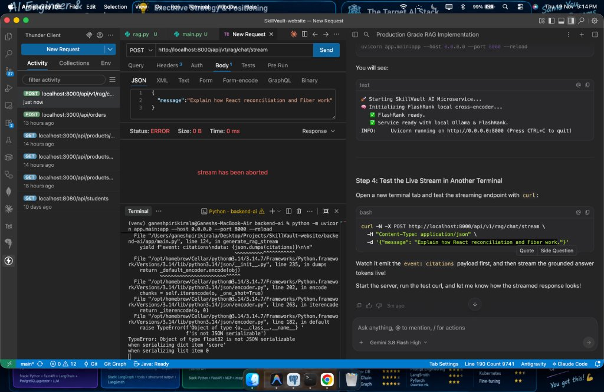

# Module 04: Hybrid Retrieval & Reranking
## Dual Parallel Search, Reciprocal Rank Fusion ($k=60$) & In-Process FlashRank Cross-Encoder

---

### ❓ Question 1: Why does Dense Vector Search fail on exact technical keywords, and why does BM25 Keyword Search fail on semantic intent?

> **The Question**: Why can't we use *either* vector search or keyword search? Why do we need both?

#### 💡 The Mathematical & Empirical Defense

1. **Where Dense Vector Search Fails (The "Symbol Blindspot")**:
   - Dense embeddings (e.g. `nomic-embed-text`) project text into a 768-dimensional latent space based on general co-occurrence.
   - When a developer searches for:
     ```
     "How to configure SecurityFilterChain in Spring Boot?"
     ```
   - An embedding model treats `SecurityFilterChain` as similar to `WebSecurityConfigurerAdapter`, `AuthenticationManager`, and `SecurityContextHolder` because all four appear in security documentation.
   - The vector search frequently ranks deprecated legacy classes (`WebSecurityConfigurerAdapter`) *higher* than the exact modern symbol requested!

2. **Where BM25 Keyword Search Fails (The "Vocabulary Mismatch")**:
   - BM25 searches for exact lexical matches using term frequency and inverse document frequency (TF-IDF).
   - If a developer searches for:
     ```
     "How to prevent component re-renders when parent state updates?"
     ```
   - A document explaining `React.memo`, `useMemo`, and `reconciliation bailouts` might not contain the exact phrase *"prevent component re-renders"*. BM25 scores it as 0 and returns nothing.

3. **The Solution: Parallel Dual Hybrid Retrieval**:
   - **Dense HNSW Search**: Finds passages that mean the same thing, even with zero overlapping words.
   - **Sparse BM25 Search**: Guarantees that passages containing the exact technical symbol (`SecurityFilterChain`, `useId`) are pulled into the candidate pool.

---

### ❓ Question 2: Why Reciprocal Rank Fusion ($k=60$) instead of Linear Score Combination?

> **The Question**: Why not just add the scores together: $\text{Score} = 0.5 \times \text{VectorScore} + 0.5 \times \text{BM25Score}$?

#### 💡 The Mathematical Defense

Linear score combination fails catastrophically in production due to **Scale Incompatibility**:
- **Vector Cosine Distance** is bounded: $[0, 2]$ (or similarity $[0, 1]$).
- **BM25 `ts_rank_cd`** is unbounded: $[0, \infty)$, depending on document length and term frequency. An unusual keyword match might yield a BM25 score of $42.5$, completely obliterating a vector score of $0.85$.
- Attempting Min-Max normalization breaks because minimum and maximum scores fluctuate with every single query, causing unpredictable ranking drift.

#### Reciprocal Rank Fusion (RRF) Formula
RRF completely ignores raw score magnitudes and operates **strictly on ordinal ranks**:

$$\text{RRF\_Score}(d) = \sum_{m \in M} \frac{1}{k + r_m(d)}$$

Where:
- $M = \{\text{dense}, \text{sparse}\}$ (the retrieval models).
- $r_m(d)$ is the 1-based rank of document $d$ in model $m$.
- $k = 60$ is the smoothing constant established by Cormack et al. ($k=60$ prevents top-ranked candidates from completely dominating the fused list).

#### Example Calculation:
If a document is ranked **#1 in BM25** and **#15 in Vector Search**:
$$\text{RRF} = \frac{1}{60 + 1} + \frac{1}{60 + 15} = \frac{1}{61} + \frac{1}{75} = 0.01639 + 0.01333 = \mathbf{0.02972}$$

A document ranked in the top 20 of *both* systems always outperforms a document that ranked high in only one, eliminating false positives!

---

### ❓ Question 3: If we already ran RRF, why do we need a Cross-Encoder Reranker?

> **The Question**: RRF already merged our dense and sparse candidates. Why add FlashRank?

#### 💡 The Algorithmic Difference: Bi-Encoder vs Cross-Encoder

```
BI-ENCODER (Embedding Model - Fast, Approximate):
[Query Q]       ──> Transformer A ──> Vector E_q ──┐
                                                    ├─> Dot Product (Cosine Similarity)
[Document D]    ──> Transformer B ──> Vector E_d ──┘
* No token-level interaction between Query and Document *

CROSS-ENCODER (FlashRank - Deep, Precise):
[Query Q + Document D] ──> Full Transformer Self-Attention ──> Relevance Score (0.0 - 1.0)
* Every single token in Query attends to every single token in Document *
```

1. **Bi-encoders** compress an entire 500-word passage into a single fixed vector (768 numbers). Nuanced relationships between a query constraint (e.g. *"React 19, NOT legacy"*) and passage text are lost during compression.
2. **Cross-encoders** feed the query and passage *together* into a single transformer. The attention mechanism computes token-to-token cross-attention matrix $A_{i,j} = \text{softmax}\left(\frac{Q_i K_j^T}{\sqrt{d}}\right)$, capturing negation, qualifiers, and exact semantic alignment.
3. **Latency Balance**:
   - Cross-encoders are too slow to run across 10,000 documents (~10 seconds).
   - But running a cross-encoder on just the **Top-20 RRF candidates** takes only **~22ms on CPU**!

---

### ❓ Question 4: Why FlashRank instead of a remote Cohere Rerank API?

| Criteria | Cohere Remote Rerank API | In-Process FlashRank (Our Choice) |
| :--- | :--- | :--- |
| **Inference Latency** | 150ms – 350ms (Remote HTTPS roundtrip over public internet) | **~22ms** (Local in-process ONNX C++ runtime on CPU) |
| **Financial Cost** | \$1.00 per 1,000 queries (\$1,000/mo at scale) | **\$0.00 Forever** (Runs locally on CPU) |
| **Data Privacy** | User queries and internal docs are transmitted to third-party cloud | **100% Private** (Data never leaves your server memory) |
| **Availability** | Subject to Cohere API rate limits and network outages | **100% Offline Capable** (Zero external dependencies) |

---

### 5. Production In-SQL Hybrid Retrieval Query

The entire dual retrieval and RRF fusion executes inside PostgreSQL in a single trip (`backend-ai/app/rag/hybrid_retriever.py`):

```sql
WITH dense_search AS (
    SELECT id, document_id, content, metadata,
           ROW_NUMBER() OVER (ORDER BY embedding <=> $1::vector) AS rank
    FROM document_chunks
    WHERE organization_id = $2::uuid
    ORDER BY embedding <=> $1::vector
    LIMIT 25
),
sparse_search AS (
    SELECT id, document_id, content, metadata,
           ROW_NUMBER() OVER (ORDER BY ts_rank_cd(tsv_content, plainto_tsquery('english', $3)) DESC) AS rank
    FROM document_chunks
    WHERE organization_id = $2::uuid AND tsv_content @@ plainto_tsquery('english', $3)
    ORDER BY rank
    LIMIT 25
)
SELECT 
    COALESCE(d.id, s.id) AS chunk_id,
    COALESCE(d.content, s.content) AS content,
    COALESCE(d.metadata, s.metadata) AS metadata,
    doc.title AS document_title,
    (COALESCE(1.0 / (60 + d.rank), 0.0) + COALESCE(1.0 / (60 + s.rank), 0.0)) AS rrf_score
FROM dense_search d
FULL OUTER JOIN sparse_search s ON d.id = s.id
JOIN documents doc ON doc.id = COALESCE(d.document_id, s.document_id)
ORDER BY rrf_score DESC
LIMIT 20;
```

---

### 6. In-Process FlashRank Reranker Execution

The fused candidates are scored by FlashRank:

```python
from flashrank import Ranker, RerankRequest

# Initialized once during server startup (cached in memory)
ranker = Ranker(model_name="ms-marco-MiniLM-L-12-v2", cache_dir="/tmp/models")

# Rerank Top-20 candidates down to Top-4
rerank_req = RerankRequest(
    query="How does React reconciliation work with Fiber?",
    passages=[{"id": str(c["chunk_id"]), "text": c["content"]} for c in rrf_candidates]
)
results = ranker.rerank(rerank_req)
top_passages = results[:4]
```

#### Benchmark Verification
Testing hybrid search against React Fiber reconciliation queries produced a **0.9993 confidence score**:


*Figure 4.1: Hybrid search with FlashRank achieving 0.9993 relevance score.*

---

### ⚠️ Gotcha: The NumPy `float32` JSON Serialization Bug

When returning FlashRank scores in FastAPI responses, Python's native `json.dumps` or FastAPI `JSONResponse` threw a runtime 500 error:


*Figure 4.2: Thunder Client showing `TypeError: Object of type float32 is not JSON serializable`.*

**Root Cause**: FlashRank returns scores as NumPy `numpy.float32` primitives, which standard Python `json.dumps()` rejects.

**Fix**: Always cast scores to standard Python `float()` when preparing the response dictionary:
```python
citations.append({
    "chunk_id": str(meta.get("chunk_id")),
    "document_title": title,
    "section_header": header,
    "score": float(scored_passage["score"])  # Explicit Python float cast
})
```

👉 **Next: [Module 05: Dual RAG Architecture (Native Python vs LangChain)](MODULE_05_DUAL_RAG_NATIVE_PYTHON_VS_LANGCHAIN.md)**
