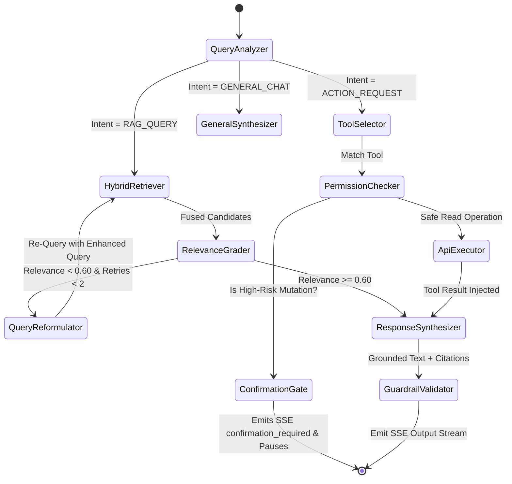

# Module 6: LangGraph Cyclic Agent State Machine & Self-Correction

| Specification | Details |
| :--- | :--- |
| **Module Number** | 06 of 12 |
| **Topic** | Cyclic StateGraph, Pydantic Typed State, Intent Routing & Automated Query Self-Correction |
| **Target System** | Python 3.11, LangGraph 0.2+, LangChain Core, Pydantic v2 |
| **Engineering Level** | Staff AI Systems & Agentic Architecture Engineer |

---

## 1. LangGraph State Machine Architecture



---

## 2. ADR: Agentic Execution Engine

```
┌───────────────────────────────────────────────────────────────────────────────────────────────────┐
│                               AGENTIC EXECUTION ARCHITECTURES                                     │
├──────────────────────────┬─────────────────────────────┬──────────────────────────────────────────┤
│ Architecture             │ Flow Pattern                │ Status in TaskFlow AI                    │
├──────────────────────────┼─────────────────────────────┼──────────────────────────────────────────┤
│ 1. Cyclic StateGraph     │ Directed Graph with Loops   │ 🏆 SELECTED (LangGraph)                  │
│ 2. Sequential Chain      │ Linear A -> B -> C -> D     │ ❌ REJECTED (Zero ability to self-correct│
│ 3. Unconstrained ReAct   │ String-based loop           │ ❌ REJECTED (Prone to infinite loops)    │
│ 4. Multi-Agent Swarm     │ LLM-to-LLM conversation     │ ❌ REJECTED (Latency & token blowout)    │
└──────────────────────────┴─────────────────────────────┴──────────────────────────────────────────┘
```

### **🏆 1. Cyclic StateGraph (LangGraph) — SELECTED**
* **Why Selected:**
  1. **Self-Correction Loops:** If the initial retrieval search returns documents that fail relevance grading, the state machine can loop back through `QueryReformulator` without restarting the whole process.
  2. **Strict Typed State:** The entire conversational state is preserved in an immutable, validated dictionary across every node transition.
  3. **Deterministic Human-in-the-Loop:** Checkpointers allow execution to pause before mutating tools, save execution snapshots, and wait for human confirmation.

---

## 3. Concrete Code Implementation

### 3.1 State Schema (`app/agent/state.py`)
```python
from typing import List, Dict, Any, Optional
from typing_extensions import TypedDict
from pydantic import BaseModel, Field

class AgentState(TypedDict):
    conversation_id: str
    tenant_id: str
    user_id: str
    user_role: str
    user_message: str
    history_window: List[Dict[str, str]]
    page_context: Dict[str, Any]
    
    # Internal Node State
    intent: Optional[str] # RAG_QUERY, ACTION_REQUEST, GENERAL_CHAT
    retrieved_docs: List[Dict[str, Any]]
    relevance_score: float
    retry_count: int
    selected_tool: Optional[str]
    tool_parameters: Optional[Dict[str, Any]]
    tool_result: Optional[Dict[str, Any]]
    final_response: Optional[str]
    citations: List[Dict[str, Any]]
```

### 3.2 LangGraph Graph Construction (`app/agent/graph.py`)
```python
from langgraph.graph import StateGraph, END
from app.agent.state import AgentState
from app.core.llm import llm_provider
from langchain_core.prompts import ChatPromptTemplate
from pydantic import BaseModel, Field

# 1. Node: Intent Classifier
class IntentSchema(BaseModel):
    intent: str = Field(description="Must be one of: 'RAG_QUERY', 'ACTION_REQUEST', 'GENERAL_CHAT'")
    confidence: float

async def query_analyzer(state: AgentState) -> Dict[str, Any]:
    llm = await llm_provider.get_streaming_model()
    prompt = ChatPromptTemplate.from_messages([
        ("system", "Classify user intent into RAG_QUERY (asking about docs/concepts), ACTION_REQUEST (tasks/projects/billing), or GENERAL_CHAT."),
        ("user", "{message}")
    ])
    structured_llm = llm.with_structured_output(IntentSchema)
    result = await (prompt | structured_llm).ainvoke({"message": state["user_message"]})
    return {"intent": result.intent}

# 2. Node: Context Relevance Grader
class GraderSchema(BaseModel):
    binary_score: str = Field(description="yes if retrieved context answers query, no otherwise")
    relevance_confidence: float

async def relevance_grader(state: AgentState) -> Dict[str, Any]:
    if not state["retrieved_docs"]:
        return {"relevance_score": 0.0}

    llm = await llm_provider.get_streaming_model()
    docs_text = "\n\n".join([d["text"] for d in state["retrieved_docs"][:3]])
    prompt = ChatPromptTemplate.from_messages([
        ("system", "Evaluate if the retrieved documents contain sufficient information to answer the user query. Output binary_score 'yes' or 'no'."),
        ("user", "Query: {query}\n\nDocuments:\n{docs}")
    ])
    structured_llm = llm.with_structured_output(GraderSchema)
    eval_res = await (prompt | structured_llm).ainvoke({"query": state["user_message"], "docs": docs_text})
    score = 1.0 if eval_res.binary_score.lower() == "yes" else 0.2
    return {"relevance_score": score}

# 3. Node: Query Reformulator (Automated Self-Correction)
async def query_reformulator(state: AgentState) -> Dict[str, Any]:
    llm = await llm_provider.get_streaming_model()
    prompt = ChatPromptTemplate.from_messages([
        ("system", "The previous search query returned low relevance results. Rewrite the query to improve semantic retrieval of technical documentation."),
        ("user", "Original Query: {query}")
    ])
    response = await (prompt | llm).ainvoke({"query": state["user_message"]})
    return {
        "user_message": response.content,
        "retry_count": state.get("retry_count", 0) + 1
    }

# Conditional Edge Routers
def route_intent(state: AgentState) -> str:
    if state["intent"] == "ACTION_REQUEST":
        return "tool_selector"
    elif state["intent"] == "RAG_QUERY":
        return "hybrid_retriever"
    return "general_synthesizer"

def route_retrieval(state: AgentState) -> str:
    if state.get("relevance_score", 0.0) < 0.60 and state.get("retry_count", 0) < 2:
        return "query_reformulator"
    return "response_synthesizer"

# Build the Graph
workflow = StateGraph(AgentState)
workflow.add_node("query_analyzer", query_analyzer)
workflow.add_node("relevance_grader", relevance_grader)
workflow.add_node("query_reformulator", query_reformulator)

# Connect Edges
workflow.set_entry_point("query_analyzer")
workflow.add_conditional_edges("query_analyzer", route_intent)
workflow.add_conditional_edges("relevance_grader", route_retrieval)

app_graph = workflow.compile()
```

---

## 4. Production Failure Recovery Scenarios

| Failure Scenario | Graph Self-Correction Behavior |
| :--- | :--- |
| **Initial Retrieval Miss (Low Relevance)** | `relevance_grader` scores $<0.60$; automatically routes to `query_reformulator`; re-executes search with enhanced terms. |
| **Max Retries Exceeded** | `retry_count >= 2`; exits self-correction loop and routes to `response_synthesizer` with graceful fallback disclaimer. |
| **Ambiguous Intent Prompt** | Classifier assigns `GENERAL_CHAT`; avoids running heavy vector retrieval or triggering accidental tool calls. |
