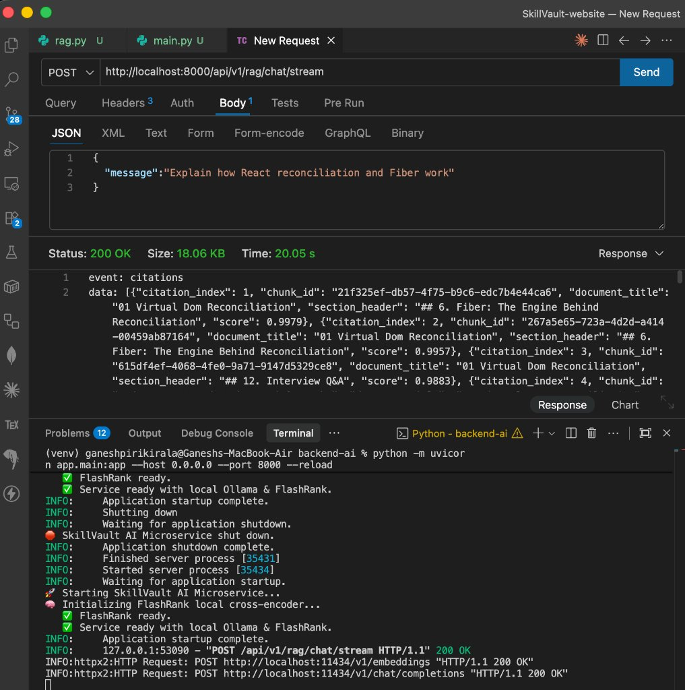
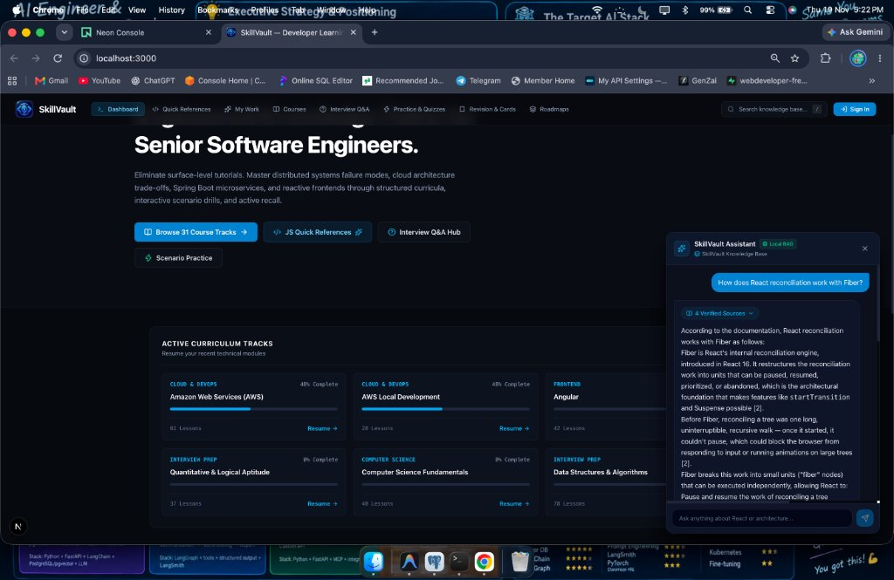
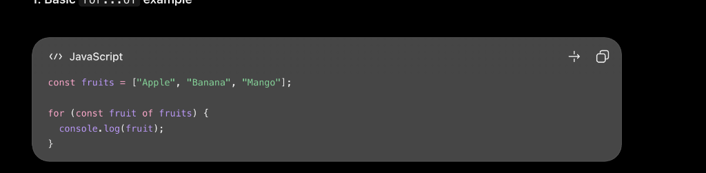

# Module 06: Streaming SSE & Zero-CORS Proxy
## Server-Sent Events (SSE) Protocol, Anti-Buffering Headers & Same-Origin Route Proxying

---

### ❓ Question 1: Why Server-Sent Events (SSE) instead of WebSockets or HTTP Polling?

> **The Question**: Many chat applications use WebSockets. Why did we choose Server-Sent Events (`text/event-stream`) for our production RAG streaming?

#### 💡 The Architectural Defense

| Criteria | WebSockets (`ws://`, `wss://`) | Server-Sent Events (`text/event-stream`) |
| :--- | :--- | :--- |
| **Protocol Complexity** | Requires protocol upgrade handshake (`HTTP 101 Switching Protocols`), stateful connection management, and dedicated socket servers. | **Standard HTTP/1.1 or HTTP/2**. Handled natively by any HTTP server, reverse proxy, or API gateway. |
| **Directionality** | Full-duplex bidirectional. Overkill for AI generation where the client sends one prompt and the server streams text back. | **Unidirectional Server-to-Client**. Purpose-built for streaming server events to the browser. |
| **Edge & CDN Compatibility** | Frequently blocked or abruptly terminated by corporate firewalls, VPNs, and serverless edge gateways. | **100% Firewall & CDN Compatible**. Operates on standard ports 80/443 with standard HTTP keepalive. |
| **Automatic Reconnection** | Manual heartbeat pings and reconnect loops required in client JavaScript. | **Browser-Native Reconnection**. Browsers automatically attempt reconnection if an SSE connection drops. |

---

### ❓ Question 2: Why did Chrome report a "CORS error" and why do direct cross-origin calls fail in production?

> **The Question**: When testing with curl or in the browser, why did we see:
> `"Access to fetch at 'http://localhost:8000/api/v1/rag/chat/stream' from origin 'http://localhost:3000' has been blocked by CORS policy"`?

#### 💡 The Network Reality & Root Cause

1. **The "Connection Refused" Masking Trap**:
   - When the backend service is offline or not listening on port 8000, the operating system kernel returns `RST` (connection refused: `net::ERR_CONNECTION_REFUSED`).
   - Because the port is closed, no HTTP response is ever generated — meaning **no CORS headers (`Access-Control-Allow-Origin`) can possibly be sent**.
   - Chrome's network engine evaluates the missing header and logs it as:
     `"blocked by CORS policy: No 'Access-Control-Allow-Origin' header is present on the requested resource."`
   - Developers spend hours tweaking CORS middleware when in reality **the backend server simply wasn't running!**

2. **The Mixed Content Production Trap**:
   - In production, your Next.js application is hosted on HTTPS (e.g. `https://skillvault-app.vercel.app`).
   - If client-side JavaScript calls `http://localhost:8000`, the browser strictly blocks the request under its **Mixed Content Security Policy** (an HTTPS page cannot fetch insecure HTTP resources).

---

### ❓ Question 3: How does the Next.js Internal Stream Proxy solve CORS forever?

> **The Question**: How does an internal Next.js route proxy eliminate CORS completely?

#### 💡 The Architectural Solution

Instead of the browser connecting cross-origin to the backend, the browser talks to its **own Next.js server on the same domain**:

```
BROWSER (https://skillvault.vercel.app)
   │
   │ 1. SAME-ORIGIN FETCH: /api/rag/chat/stream (Relative URL)
   │    * Browser NEVER makes an OPTIONS preflight! *
   │    * ZERO CORS errors possible! *
   │    * ZERO Mixed Content errors (HTTPS -> HTTPS)! *
   ▼
NEXT.JS SERVER ROUTE PROXY (src/app/api/rag/chat/stream/route.ts)
   │
   │ 2. SERVER-TO-SERVER FORWARDING (Fetch with req.signal)
   │    * Runs securely over backend network to BACKEND_AI_URL *
   ▼
FASTAPI AI MICROSERVICE (Port 8000 / Render / Fly.io / Vercel)
```

---

### 4. Implementation: The Next.js Zero-CORS Stream Proxy

Located at `frontend/src/app/api/rag/chat/stream/route.ts`:

```typescript
import { NextRequest, NextResponse } from 'next/server';

export const runtime = 'nodejs';
export const dynamic = 'force-dynamic';

export async function POST(req: NextRequest) {
  try {
    const body = await req.json();
    const backendAiUrl = (
      process.env.BACKEND_AI_URL ||
      process.env.NEXT_PUBLIC_AI_API_URL ||
      'http://127.0.0.1:8000'
    ).replace(/\/$/, '');

    const targetUrl = `${backendAiUrl}/api/v1/rag/chat/stream`;

    let upstreamResponse: Response;
    try {
      upstreamResponse = await fetch(targetUrl, {
        method: 'POST',
        headers: {
          'Content-Type': 'application/json',
          'Accept': 'text/event-stream',
        },
        body: JSON.stringify(body),
        signal: req.signal, // Propagate client aborts
      });
    } catch (networkError: any) {
      // Graceful error stream if the backend is down or redeploying
      const encoder = new TextEncoder();
      const customReadable = new ReadableStream({
        start(controller) {
          const msg = `⚠️ Unable to connect to SkillVault AI Service at ${backendAiUrl}. Ensure the AI service is running.`;
          controller.enqueue(encoder.encode(`event: token\ndata: ${JSON.stringify({ token: msg })}\n\n`));
          controller.enqueue(encoder.encode(`event: done\ndata: {}\n\n`));
          controller.close();
        }
      });

      return new Response(customReadable, {
        headers: {
          'Content-Type': 'text/event-stream',
          'Cache-Control': 'no-cache, no-transform',
          'Access-Control-Allow-Origin': '*',
        },
      });
    }

    // Pipe SSE stream directly to browser
    return new Response(upstreamResponse.body as any, {
      status: 200,
      headers: {
        'Content-Type': 'text/event-stream',
        'Cache-Control': 'no-cache, no-transform',
        'Connection': 'keep-alive',
        'X-Accel-Buffering': 'no', // Disable NGINX/Vercel buffering
        'Access-Control-Allow-Origin': '*',
      },
    });
  } catch (err: any) {
    return NextResponse.json({ error: err.message }, { status: 500 });
  }
}
```

---

### 5. FastAPI SSE Streaming Implementation

Located at `backend-ai/app/main.py`:

```python
async def generate_rag_stream(query: str, tenant_id: str, top_k: int):
    r, _, chain = await get_rag_components()

    # 1. Retrieve & Rerank via LangChain Hybrid Retriever
    docs = await r._aget_relevant_documents(query=query, tenant_id=tenant_id, top_k=top_k)

    # 2. Emit verified citation frame
    citations = [
        {
            "citation_index": idx,
            "document_title": d.metadata.get("document_title"),
            "section_header": d.metadata.get("section_header"),
            "score": float(d.metadata.get("score", 0.0))
        }
        for idx, d in enumerate(docs, 1)
    ]
    yield f"event: citations\ndata: {json.dumps(citations)}\n\n"

    # 3. Stream real-time token deltas via LangChain LCEL
    context_str = "\n".join([f"[{c['citation_index']}] {d.page_content}" for c, d in zip(citations, docs)])
    async for token in chain.astream({"context": context_str, "question": query}):
        yield f"event: token\ndata: {json.dumps({'token': token})}\n\n"

    # 4. Emit completion frame
    yield "event: done\ndata: {}\n\n"

@app.post("/api/v1/rag/chat/stream")
async def chat_stream_endpoint(req: ChatStreamRequest):
    return StreamingResponse(
        generate_rag_stream(req.message, req.tenant_id, req.top_k),
        media_type="text/event-stream",
        headers={
            "Cache-Control": "no-cache",
            "Connection": "keep-alive",
            "X-Accel-Buffering": "no", # Critical: disables NGINX reverse-proxy buffering
            "Access-Control-Allow-Origin": "*",
            "Access-Control-Allow-Methods": "POST, OPTIONS",
            "Access-Control-Allow-Headers": "*"
        }
    )
```

#### Verification: Live Stream in Thunder Client

*Figure 6.1: Thunder Client receiving live SSE stream with citations event frame and token deltas.*

---

### 6. Client React 19 Streaming Hook (`useAIAssistant.ts`)

Located at `frontend/src/lib/useAIAssistant.ts`:
- Consumes the stream using native `fetch` and `ReadableStreamDefaultReader`.
- Includes cancellation support through `AbortController`.
- Dispatches parsed tokens into message state for real-time typewriter rendering.

```typescript
// If NEXT_PUBLIC_AI_API_URL is configured, use it. Otherwise, default to relative '/api/rag/chat/stream'
const AI_API_URL = process.env.NEXT_PUBLIC_AI_API_URL || '';

export function useAIAssistant() {
  const [messages, setMessages] = useState<ChatMessage[]>([]);
  const [isGenerating, setIsGenerating] = useState(false);
  const abortControllerRef = useRef<AbortController | null>(null);

  const sendMessage = useCallback(async (userText: string) => {
    const controller = new AbortController();
    abortControllerRef.current = controller;
    setIsGenerating(true);

    const endpoint = AI_API_URL ? `${AI_API_URL}/api/v1/rag/chat/stream` : '/api/rag/chat/stream';
    const response = await fetch(endpoint, {
      method: 'POST',
      headers: { 'Content-Type': 'application/json' },
      body: JSON.stringify({ message: userText, top_k: 4 }),
      signal: controller.signal,
    });

    const reader = response.body!.getReader();
    const decoder = new TextDecoder();
    let buffer = '';

    while (true) {
      const { value, done } = await reader.read();
      if (done) break;

      buffer += decoder.decode(value, { stream: true });
      const blocks = buffer.split('\n\n');
      buffer = blocks.pop() || '';

      for (const block of blocks) {
        if (block.startsWith('event: citations')) {
          const citations = JSON.parse(block.split('data: ')[1]);
          // Update assistant message with verified source cards
        } else if (block.startsWith('event: token')) {
          const { token } = JSON.parse(block.split('data: ')[1]);
          // Append token delta to assistant text
        }
      }
    }
    setIsGenerating(false);
  }, []);

  return { messages, isGenerating, sendMessage, stopGeneration };
}
```

---

### 7. Frontend UI: Floating Assistant & Dark Code Blocks

The frontend provides both a compact floating launcher and an expandable full-screen studio:


*Figure 6.2: The floating assistant launcher integrated into the curriculum view.*


*Figure 6.3: Target code block styling with language badge (`</> TypeScript`) and one-click copy confirmation.*

👉 **Next: [Module 07: Production Cloud Deployment (Vercel, Render, Fly.io & Neon)](MODULE_07_PRODUCTION_DEPLOYMENT_VERCEL_RENDER_NEON.md)**
