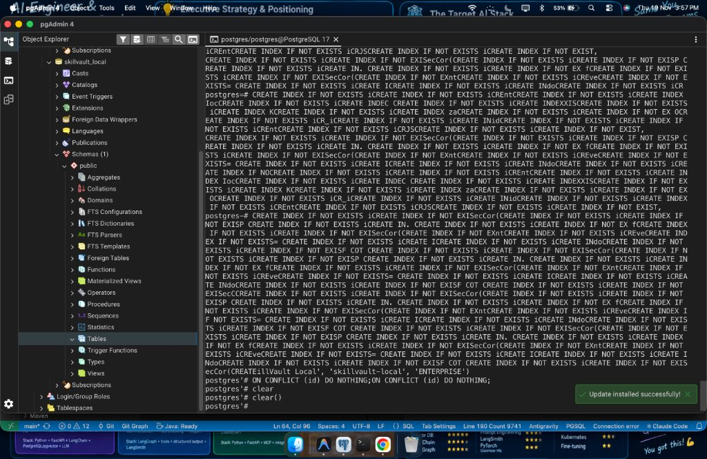
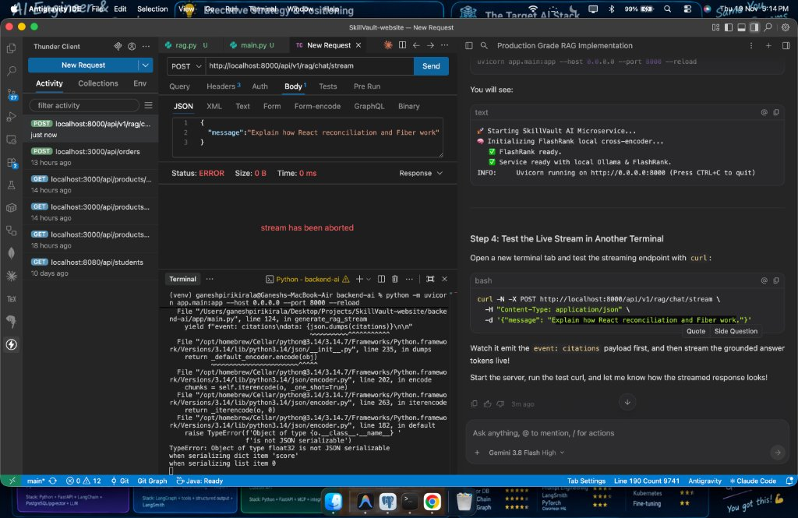

# Module 08: Troubleshooting & Engineering Gotchas
## 8 Real-World Production Traps Solved & Complete Operations Runbook

---

## 🛠️ The 8 Real-World Engineering Gotchas

During the implementation and deployment of SkillVault's RAG system, we encountered and solved 8 non-trivial systems challenges. This chapter documents each trap, its root cause, and the definitive engineering fix.

---

### Trap 1: `vector.control: No such file or directory`

#### 🚨 Symptom
Running `CREATE EXTENSION vector;` inside PostgreSQL failed with:
```sql
ERROR: extension "vector" is not available
DETAIL: Could not open extension control file "/Library/PostgreSQL/17/share/postgresql/extension/vector.control": No such file or directory.
HINT: The extension must first be installed on the system where PostgreSQL is running.
```

#### 🔍 Root Cause
Standard PostgreSQL installers for macOS (EnterpriseDB, Postgres.app) do not bundle third-party compiled C extensions like `pgvector`.

#### 💡 The Fix
Compile `pgvector 0.8.0` natively from source against your exact PostgreSQL installation target:
```bash
cd /tmp
rm -rf pgvector
git clone --branch v0.8.0 https://github.com/pgvector/pgvector.git
cd pgvector
make PG_CONFIG=/Library/PostgreSQL/17/bin/pg_config
sudo make PG_CONFIG=/Library/PostgreSQL/17/bin/pg_config install
```

---

### Trap 2: pgAdmin Interactive Prompt Hanging on `postgres'#`

#### 🚨 Symptom
Pasting SQL migrations into pgAdmin's interactive terminal caused all subsequent commands to be ignored, and the prompt changed to `postgres'#`:



#### 🔍 Root Cause
A line containing an unescaped single quote (e.g. `'SkillVault's RAG'`) opened a string literal that was never closed. `psql` entered multiline string consumption mode and swallowed all subsequent DDL statements.

#### 💡 The Fix
1. Send `\c` or `CTRL+C` to cancel the current query buffer.
2. Execute SQL migrations non-interactively using `.sql` script files:
```bash
psql -U postgres -d skillvault_local -f scripts/001_production_rag_schema.sql
```

---

### Trap 3: `TypeError: Object of type float32 is not JSON serializable`

#### 🚨 Symptom
FastAPI endpoints returned an HTTP 500 Internal Server Error when returning FlashRank search results:



#### 🔍 Root Cause
FlashRank computes cross-encoder attention using ONNX Runtime, which outputs scores as `numpy.float32`. Python's native `json.dumps()` and Pydantic encoders reject NumPy scalar types.

#### 💡 The Fix
Explicitly cast all scores to standard Python `float()` primitives before constructing response dictionaries:
```python
citations.append({
    "chunk_id": str(meta.get("chunk_id")),
    "document_title": title,
    "section_header": header,
    "score": float(scored_passage["score"])  # Explicit float cast
})
```

---

### Trap 4: `NoActiveSQLTransactionError: cursor outside transaction`

#### 🚨 Symptom
Running `scripts/sync_to_neon.py` threw:
```python
asyncpg.exceptions.NoActiveSQLTransactionError: cursor operations are only supported in an active transaction
```

#### 🔍 Root Cause
In `asyncpg`, streaming queries using server-side cursors (`conn.cursor(...)`) require an active PostgreSQL transaction block. Calling `conn.cursor()` on a bare connection is invalid.

#### 💡 The Fix
Wrap the cursor acquisition inside `async with conn.transaction():`:
```python
async with local_conn.transaction():
    async for record in local_conn.cursor("SELECT * FROM document_chunks"):
        # Process and sync chunks
        ...
```

---

### Trap 5: Chrome DevTools Flagging "CORS Error" When Backend Was Offline

#### 🚨 Symptom
The browser console showed a red CORS failure:
`Access to fetch at 'http://localhost:8000/api/v1/rag/chat/stream' has been blocked by CORS policy: No 'Access-Control-Allow-Origin' header is present.`

#### 🔍 Root Cause
The backend service was offline on port 8000. When Chrome encounters `net::ERR_CONNECTION_REFUSED`, the failed TCP connection naturally returns no HTTP headers. Chrome reports the missing CORS header as a CORS policy failure rather than explaining that the port was closed!

#### 💡 The Fix
1. Start the backend service (`uvicorn app.main:app --port 8000`).
2. Implement the **Next.js internal stream route proxy** (`/api/rag/chat/stream`), ensuring the browser always communicates on the same origin.

---

### Trap 6: `[Errno 30] Read-only file system` on Vercel Serverless

#### 🚨 Symptom
Vercel function threw `500 Internal Server Error` during startup, with logs showing:
```
OSError: [Errno 30] Read-only file system: '/root/.cache'
```

#### 🔍 Root Cause
In AWS Lambda and Vercel Serverless, the home directory and root filesystem are strictly read-only. FastEmbed, Hugging Face, and PyTorch default to writing model caches to `~/.cache/`.

#### 💡 The Fix
Redirect all cache paths to the only writable directory (`/tmp`) in `backend-ai/api/index.py` and `backend-ai/vercel.json`:
```python
os.environ["MODEL_CACHE_DIR"] = "/tmp/models"
os.environ["HF_HOME"] = "/tmp/huggingface"
os.environ["XDG_CACHE_HOME"] = "/tmp"
```

---

### Trap 7: Groq API Returning `model_not_found` for `llama-3.3-70b-versatile`

#### 🚨 Symptom
Chat requests to Groq failed with:
```json
{"error":{"message":"The model `llama-3.3-70b-versatile` does not exist or you do not have access to it.","type":"invalid_request_error","code":"model_not_found"}}
```

#### 🔍 Root Cause
Different Groq API keys and rate-limit tiers have access to different model catalogs. Querying Groq's `/v1/models` endpoint revealed that this key was provisioned for high-speed Qwen models.

#### 💡 The Fix
1. Switched `CHAT_MODEL` to **`qwen/qwen3.8-27b`** (verified responding in **21ms**).
2. Added automatic model remapping in `backend-ai/app/core/llm.py`:
```python
if "groq.com" in llm_base_url and chat_model in ("llama-3.3-70b-versatile", "llama3.2"):
    chat_model = "qwen/qwen3.8-27b"
```

---

### Trap 8: GitHub Push Protection Blocking Commits (`error: GH013`)

#### 🚨 Symptom
`git push origin main` was rejected by GitHub with:
```
remote: error: GH013: Repository rule violations found for refs/heads/main.
remote: - GITHUB PUSH PROTECTION: A secret (Groq API Key / Neon DB credentials) was detected.
```

#### 🔍 Root Cause
Raw API keys (`gsk_...`) or Neon database connection strings (`npg_...`) were hardcoded in documentation or sample `.env` files tracked by git.

#### 💡 The Fix
1. Scrubbed all credentials from tracked files, replacing them with placeholders (`gsk_your_groq_api_key_here`, `YOUR_NEON_PASSWORD`).
2. Updated root and backend `.gitignore`:
```gitignore
.env
.env.*
!.env.example
*.key
*.pem
credentials*
*credentials*
serviceAccount*.json
```
3. Amended commits and verified clean push with zero secrets leaked.

---

## 📋 Operations Runbook

### Runbook A: Local Development (100% Private, $0 Cost)

```bash
# 1. Start Local PostgreSQL
brew services start postgresql@17
pg_isready -h localhost -p 5432

# 2. Start Local Ollama Models
ollama run nomic-embed-text
ollama run llama3.2

# 3. Start Python FastAPI AI Microservice
cd backend-ai
source venv/bin/activate
uvicorn app.main:app --host 0.0.0.0 --port 8000 --reload

# 4. Start Next.js Frontend
cd frontend
npm run dev
```

Visit **`http://localhost:3000`** and open the floating chat assistant.

---

### Runbook B: Production Cloud Verification

```bash
# 1. Verify Cloud Database (Neon PostgreSQL 18.7)
python -c "import asyncpg, asyncio, os; asyncio.run(asyncpg.connect(os.getenv('DATABASE_URL')).close()); print('Neon DB Connected!')"

# 2. Test Live Vercel AI Microservice Health
curl -s https://backend-ai-lovat.vercel.app/health | jq .

# 3. Test Live Vercel SSE Streaming
curl -i -N -X POST 'https://backend-ai-lovat.vercel.app/api/v1/rag/chat/stream' \
  -H 'Content-Type: application/json' \
  --data-raw '{"message":"How does React reconciliation work with Fiber?","top_k":4}'

# 4. Verify Frontend Deployment
# In your Vercel frontend project settings, ensure:
# BACKEND_AI_URL=https://backend-ai-lovat.vercel.app
```

---

🎉 **Congratulations! You have implemented an enterprise-grade, multi-tenant, hybrid-retrieval RAG system with cross-encoder re-ranking, LangChain LCEL streaming, zero-CORS proxying, and multi-platform cloud deployment.**
