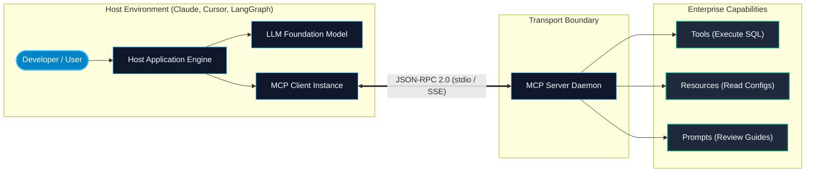

# Introduction to Model Context Protocol (MCP)

> "Before USB, every peripheral needed a proprietary cable and driver. Before MCP, every AI model required proprietary plugins and custom adapters to talk to your tools and databases. MCP is the USB-C of the agentic AI era."

---


### Step 1: Why Do We Need This?

#### The Real Problem: The $M \times N$ Integration Trap

In the early days of LLM application development, connecting models to external enterprise systems required writing custom point-to-point glue code. 

If you had **$M$ models or host applications** (e.g. Claude Desktop, Cursor, LangChain agent, custom internal dashboard, ChatGPT) and **$N$ tools or data sources** (e.g. PostgreSQL, GitHub, Jira, Slack, S3):

$$\text{Total Integrations Required} = M \times N$$

- If you supported 4 agent frameworks and 15 internal enterprise data sources, your engineering team had to build and maintain **60 unique adapters**.
- Each adapter implemented its own authentication, parameter schemas, error serialization, and rate limiting.
- When an API changed (e.g., GitHub GraphQL v4 schema update), 4 different agent adapters broke simultaneously.
- Developers were spending 80% of their time writing integration boilerplate rather than improving reasoning architectures.

```text
The M x N Integration Bottleneck:
Claude Desktop ──┬──> Postgres Custom Adapter ──> PostgreSQL
Cursor IDE     ──┼──> GitHub Custom Adapter   ──> GitHub API
LangChain App  ──┼──> Slack Custom Adapter    ──> Slack API
Custom Agent   ──┴──> Jira Custom Adapter     ──> Jira Cloud
(Every host builds custom code for every data source)
```

#### Why MCP Solves It

The **Model Context Protocol (MCP)**, open-sourced by Anthropic in late 2024, transforms the problem into:

$$\text{Total Integrations Required} = M + N$$

MCP introduces an open, vendor-neutral protocol where:
1. Every **Data Source or Tool** publishes an **MCP Server** once.
2. Every **AI Application or Host** implements an **MCP Client** once.
3. Any host can instantly discover and invoke any server's capabilities securely, locally or remotely.

---

### Step 2: What Is It?

#### Simple Explanation: The Universal USB-C Standard for AI

Imagine your laptop. Whether you plug in a monitor, an external SSD, a mechanical keyboard, or an audio interface, your operating system communicates across a standardized bus protocol (USB / PCIe). The manufacturer of the SSD did not need to coordinate with the manufacturer of your laptop.

In the AI ecosystem:
- The **Host Application** (e.g. Claude Desktop, Cursor IDE, LangGraph runtime) is the laptop.
- The **MCP Server** (e.g. PostgreSQL server, Slack bot, Git inspector) is the USB peripheral.
- The **JSON-RPC 2.0 messages** passing over standard I/O or SSE are the USB bus signals.

#### Core Concepts Table

| Concept | What It Does In Simple English | Technical Role |
| :--- | :--- | :--- |
| **Host** | The end-user application running the LLM (e.g. Cursor, Claude). | Initiates connections, coordinates security approvals, routes context to LLM. |
| **Client** | The protocol connector inside the host that manages a 1:1 link to a server. | Sends JSON-RPC requests, parses responses, manages capabilities. |
| **Server** | A lightweight service exposing specialized local or remote capabilities. | Exposes Tools, Resources, and Prompts over a defined transport. |
| **Transport** | The physical communication channel between Client and Server. | Subprocess standard input/output (`stdio`) or HTTP with Server-Sent Events (`SSE`). |
| **Tools** | Executable actions that the LLM can call with arguments. | Model-controlled functions (e.g., `execute_sql`, `deploy_service`). |
| **Resources** | Read-only data payloads that provide context to the LLM. | Application-controlled data streams (e.g., `file:///app.log`, `postgres://schema`). |
| **Prompts** | Pre-engineered prompt templates and workflows. | User-controlled templates and slash commands surfaced in the Host UI. |

---

### Step 3: Real-World Example

#### The Polyglot Engineering Team Assistant

Consider an engineering team with 50 microservices in GitHub, relational state in Amazon Aurora PostgreSQL, and issue tracking in Linear:

- **Without MCP:** An engineer using Cursor has to copy-paste table definitions from DBeaver, manually query Git log in terminal, and paste the ticket description from Linear into the chat window.
- **With MCP:** The engineer adds three open-source MCP servers to their config file:
  1. `@modelcontextprotocol/server-postgres`
  2. `@modelcontextprotocol/server-github`
  3. `linear-mcp-server`
- **The Outcome:** The developer simply types: *"Analyze ticket ENG-842, check why migration 004 fails on users table in dev DB, and draft a pull request to fix the index."* 
  The AI host queries Linear via MCP, inspects PostgreSQL schema via MCP, examines the git diff via MCP, and creates the PR—without writing a single line of custom adapter code.

---

### Step 4: How Does It Work?

The MCP interaction lifecycle follows an asynchronous, request-response and notification pattern:

```text
Host App (e.g., Cursor)                 MCP Server (e.g., Postgres Engine)
       │                                                │
       │ ── 1. Spawn Subprocess (stdio) ──────────────> │
       │                                                │
       │ ── 2. "initialize" (capabilities & version) ─> │
       │ <─ 3. InitializeResult (server capabilities) ──│
       │                                                │
       │ ── 4. "notifications/initialized" ───────────> │
       │                                                │
       │ ── 5. "tools/list" ──────────────────────────> │
       │ <─ 6. List of available tools & schemas ────── │
       │                                                │
       │ ── 7. "tools/call" (execute_query) ──────────> │
       │ <─ 8. Tool execution result ───────────────────│
```

1. **Process Launch:** The Host launches the MCP Server executable as a child process via `stdio` or connects over network via HTTP `SSE`.
2. **Handshake Initialization:** The Client sends an `initialize` JSON-RPC request containing protocol version and supported client capabilities.
3. **Capability Negotiation:** The Server returns its capabilities (e.g., supports `tools`, `resources`, `prompts`, `logging`).
4. **Ready State:** The Client sends a `notifications/initialized` signal confirming the connection is established.
5. **Discovery:** The Client requests tool catalogs (`tools/list`), resource trees (`resources/list`), or prompt templates (`prompts/list`).
6. **Execution & Stream:** When the user prompts the model, the LLM requests a tool call; the Client dispatches `tools/call` to the Server and returns the structured output directly to the LLM context.

---

### Step 5: Wire Protocol Example

Here is what the raw JSON-RPC 2.0 messages look like over the wire during the initial handshake and tool discovery:

#### 1. Client Initialize Request:
```json
{
  "jsonrpc": "2.0",
  "id": 1,
  "method": "initialize",
  "params": {
    "protocolVersion": "2024-11-05",
    "capabilities": {
      "roots": { "listChanged": true },
      "sampling": {}
    },
    "clientInfo": {
      "name": "SkillVault-Agent-Host",
      "version": "1.0.0"
    }
  }
}
```

#### 2. Server Initialize Response:
```json
{
  "jsonrpc": "2.0",
  "id": 1,
  "result": {
    "protocolVersion": "2024-11-05",
    "capabilities": {
      "tools": { "listChanged": true },
      "resources": { "subscribe": true, "listChanged": true },
      "prompts": { "listChanged": true },
      "logging": {}
    },
    "serverInfo": {
      "name": "enterprise-postgres-mcp",
      "version": "2.4.0"
    }
  }
}
```

#### 3. Client Tools List Request:
```json
{
  "jsonrpc": "2.0",
  "id": 2,
  "method": "tools/list",
  "params": {}
}
```

#### 4. Server Tools List Response:
```json
{
  "jsonrpc": "2.0",
  "id": 2,
  "result": {
    "tools": [
      {
        "name": "query_database",
        "description": "Execute a safe, read-only SQL SELECT query against PostgreSQL.",
        "inputSchema": {
          "type": "object",
          "properties": {
            "sql": {
              "type": "string",
              "description": "The SQL query to execute"
            }
          },
          "required": ["sql"]
        }
      }
    ]
  }
}
```

---

### Step 6: How Is It Used in Production?

#### Production Patterns & Edge Cases

| Scenario | Production Challenge | Recommended Solution |
| :--- | :--- | :--- |
| **Subprocess Zombie Leaks** | Host terminates unexpectedly, leaving orphaned child MCP server processes consuming RAM. | Implement parent process PID polling or tie child process lifecycle to OS process groups / pipes. |
| **Excessive Tool Bloat** | Registering 100+ MCP tools overflows LLM context windows and degrades tool selection accuracy. | Use dynamic tool indexing, MCP gateway routers, or cluster tools by relevance domain. |
| **Unbounded Resource Payload** | Querying a resource returns 50MB of raw logs, exhausting token limits. | Enforce pagination with cursor tokens and chunk text before passing to the model context. |
| **Privilege Escalation** | An LLM invokes destructive SQL commands (`DROP TABLE`) via a tool. | Restrict database user credentials to read-only replicas and require explicit Human-in-the-Loop confirmation. |

---

### Step 7: Quick Revision

- MCP eliminates the $M \times N$ problem by providing a standard protocol for AI hosts and backend services.
- The architecture cleanly separates **Hosts** (apps running the LLM), **Clients** (protocol drivers), and **Servers** (capability providers).
- MCP has three core primitives: **Tools** (actions for LLM), **Resources** (data context for LLM), and **Prompts** (templates for users).
- Communication is powered by **JSON-RPC 2.0** over standard I/O (`stdio`) or Server-Sent Events (`SSE`).
- All tool definitions enforce strict **JSON Schema** validation for model safety and deterministic calling.

---

### Step 8: Final Flow Diagram



---

### Step 9: Quiz

1. What primary architectural problem does the Model Context Protocol (MCP) solve?
   - A) Slow GPU tensor matrix multiplications in PyTorch
   - B) The $M \times N$ integration bottleneck between multiple LLM hosts and data sources
   - C) CSS rendering inconsistencies across web browsers
   - D) Hard drive disk fragmentation on Linux servers

2. In MCP architecture, what is the role of a "Resource"?
   - A) An active Python function that executes shell scripts on the server
   - B) Application-controlled read-only data (like files or database schemas) used as context
   - C) The CPU and RAM allocation of the host machine
   - D) A billing metric for Anthropic API credits

3. Which messaging standard is used for MCP communication over the wire?
   - A) SOAP XML 1.1
   - B) Protocol Buffers binary stream
   - C) JSON-RPC 2.0
   - D) Apache Thrift

4. What happens during the initial protocol handshake between an MCP Client and Server?
   - A) The client sends the user's credit card information
   - B) The server formats the client's hard drive
   - C) Both parties exchange protocol versions and negotiate supported capabilities
   - D) The client re-compiles the server's source code

*Submit your answers (e.g. 1-B, 2-B, 3-C, 4-C) to verify your score!*
