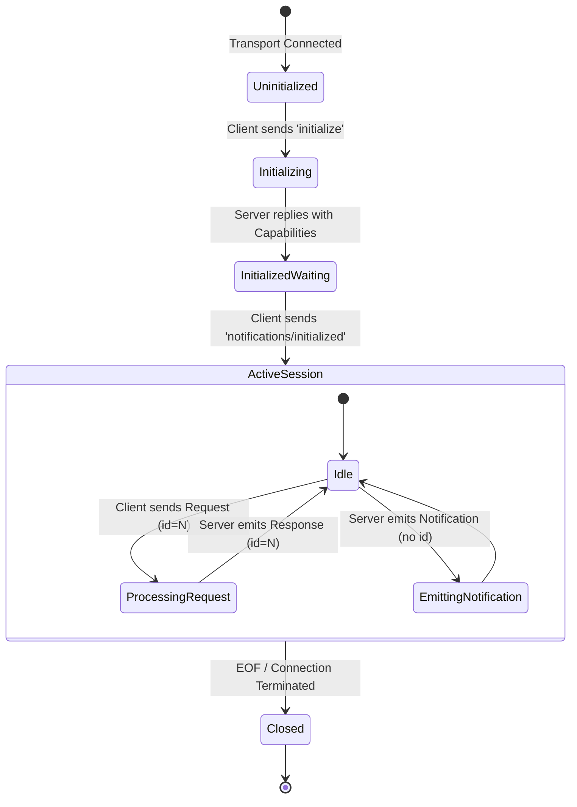

# JSON-RPC 2.0 and Protocol Lifecycle

> "A communication protocol without deterministic message framing and explicit state transitions is just noise. MCP builds upon JSON-RPC 2.0 to give AI agents bulletproof contract guarantees."

---


### Step 1: Why Do We Need This?

#### The Real Problem

When an AI host needs to ask an external server to run code or fetch documents, standard REST APIs introduce impedance mismatches:
- REST is inherently client-driven; a server cannot easily notify the client when an underlying file or database table changes without polling.
- REST lacks a uniform envelope for distinguishing between standard procedure calls, asynchronous notifications (fire-and-forget), and error payloads.
- Custom ad-hoc JSON protocols require every engineering team to invent custom status codes, request identifiers, and parameter validation mechanisms.

#### Why JSON-RPC 2.0 Solves It

The Model Context Protocol adopts **JSON-RPC 2.0** as its wire specification. JSON-RPC 2.0 provides:
1. **Strict Message Envelopes:** Clear discrimination between Requests (expecting responses), Responses, and Notifications (one-way signals without response).
2. **Correlation Identifiers:** The `id` field guarantees that async concurrent requests are paired with their exact corresponding responses even when responses arrive out of order.
3. **Deterministic Error Handling:** Standardized numeric error codes (e.g. `-32601 Method not found`, `-32602 Invalid params`) and structured `data` objects.
4. **Bidirectional Capability:** Over persistent transports, both Host and Server can send requests and notifications to each other.

---

### Step 2: What Is It?

#### Simple Explanation: The Signed Diplomatic Courier

Think of JSON-RPC 2.0 in MCP like a **diplomatic courier with numbered envelopes**:
- When the Host wants information, it places a dispatch with a unique tracking number (`id: 42`).
- If the courier needs to deliver an urgent memo that requires no acknowledgment (e.g. *"Server is shutting down"* or *"Database schema just updated"*), it drops off a sealed letter without a tracking number (`id` omitted). That is a **Notification**.
- When the Server replies, it stamps the return letter with tracking number `42`. Even if 100 letters were in flight simultaneously, the Host knows exactly which mission succeeded.

#### JSON-RPC Message Types Table

| Message Type | Defining Characteristic | When Used in MCP |
| :--- | :--- | :--- |
| **Request** | Must contain `"jsonrpc": "2.0"`, `"id"`, `"method"`, and optional `"params"`. | Listing tools, calling a function, reading a resource template. |
| **Response** | Contains `"jsonrpc": "2.0"`, matching `"id"`, and `"result"` object. | Returning tool output or resource payloads to client. |
| **Error** | Contains `"jsonrpc": "2.0"`, matching `"id"`, and `"error"` object (`code`, `message`). | Method not found, parameter validation failure, timeout. |
| **Notification** | Contains `"jsonrpc": "2.0"`, `"method"`, optional `"params"`, but **NO `id`**. | `notifications/initialized`, `notifications/resources/updated`, progress updates. |

---

### Step 3: Real-World Example

#### The Schema Discovery Handshake

When you launch Claude Desktop or Cursor configured with an MCP PostgreSQL server:
1. **Initialization:** Host sends `initialize` with its supported protocol version and client info.
2. **Negotiation:** Server confirms it supports `resources` and `tools` with protocol version `2024-11-05`.
3. **Confirmation:** Host acknowledges with `notifications/initialized`.
4. **Subscription:** Server notifies Host anytime a migration runs via `notifications/resources/list_changed`.
5. **Call:** When user asks *"Count active users"*, Host dispatches `tools/call` with `id: 101` and parameters `{"sql": "SELECT COUNT(*) FROM users"}`.

---

### Step 4: How Does It Work?

```text
Host (Client)                                          Server
     │                                                   │
     │ ──────── 1. initialize (Request id=1) ──────────> │
     │ <─────── 2. InitializeResult (Response id=1) ──── │
     │                                                   │
     │ ──────── 3. notifications/initialized ──────────> │ (Connection Active)
     │                                                   │
     │ ──────── 4. ping (Request id=2) ────────────────> │
     │ <─────── 5. {} (Response id=2) ────────────────── │
     │                                                   │
     │ ──────── 6. tools/call (Request id=3) ──────────> │
     │ <─────── 7. CallToolResult (Response id=3) ────── │
     │                                                   │
     │ <─────── 8. notifications/message (Log info) ──── │
```

#### Lifecycle Phases:
1. **Uninitialized Phase:** Connection established, but no tools or resources can be called until handshake succeeds.
2. **Handshake Phase:** Exchange `initialize` request and response. If protocol versions do not match or required capabilities are missing, connection terminates.
3. **Initialized Notification:** Client signals readiness. Server unlocks all capabilities.
4. **Operation Phase:** Bidirectional exchange of Requests, Responses, and Notifications.
5. **Shutdown Phase:** Transport closes (EOF on stdio or HTTP disconnect). Process cleans up file handles and sockets.

---

### Step 5: Wire Protocol Code Example

Here is a raw Python implementation showing how to serialize and validate JSON-RPC 2.0 messages using Pydantic:

```python
# mcp_protocol_engine.py
from typing import Any, Dict, Optional, Union
from pydantic import BaseModel, Field, ValidationError

class JSONRPCRequest(BaseModel):
    jsonrpc: str = Field(default="2.0", pattern=r"^2\.0$")
    id: Union[int, str]
    method: str
    params: Optional[Dict[str, Any]] = None

class JSONRPCResponse(BaseModel):
    jsonrpc: str = Field(default="2.0", pattern=r"^2\.0$")
    id: Union[int, str]
    result: Dict[str, Any]

class JSONRPCErrorDetail(BaseModel):
    code: int
    message: str
    data: Optional[Any] = None

class JSONRPCError(BaseModel):
    jsonrpc: str = Field(default="2.0", pattern=r"^2\.0$")
    id: Optional[Union[int, str]]
    error: JSONRPCErrorDetail

class JSONRPCNotification(BaseModel):
    jsonrpc: str = Field(default="2.0", pattern=r"^2\.0$")
    method: str
    params: Optional[Dict[str, Any]] = None

def process_raw_line(raw_json_str: str) -> str:
    """Parses incoming JSON string, routes to handler, and returns wire response."""
    import json
    data = json.loads(raw_json_str)

    # Check if request has an ID
    if "id" in data:
        req = JSONRPCRequest(**data)
        if req.method == "ping":
            resp = JSONRPCResponse(id=req.id, result={})
            return resp.model_dump_json()
        elif req.method == "tools/list":
            resp = JSONRPCResponse(
                id=req.id,
                result={
                    "tools": [
                        {
                            "name": "calculate_hash",
                            "description": "Calculates SHA-256 hash of a string",
                            "inputSchema": {
                                "type": "object",
                                "properties": {"input": {"type": "string"}},
                                "required": ["input"]
                            }
                        }
                    ]
                }
            )
            return resp.model_dump_json()
        else:
            err = JSONRPCError(
                id=req.id,
                error=JSONRPCErrorDetail(code=-32601, message=f"Method '{req.method}' not found")
            )
            return err.model_dump_json()
    else:
        # One-way notification
        notif = JSONRPCNotification(**data)
        print(f"[SERVER LOG]: Received notification: {notif.method}")
        return ""

if __name__ == "__main__":
    # Test Ping Request
    ping_payload = '{"jsonrpc": "2.0", "id": 1, "method": "ping"}'
    print("Response:", process_raw_line(ping_payload))

    # Test Tools List Request
    tools_payload = '{"jsonrpc": "2.0", "id": 2, "method": "tools/list"}'
    print("Response:", process_raw_line(tools_payload))
```

---

### Step 6: How Is It Used in Production?

#### Production Patterns & Edge Cases

| Scenario | Production Challenge | Recommended Solution |
| :--- | :--- | :--- |
| **Out-of-Order Execution** | A slow tool call (`id: 4`) takes 5 seconds, while a fast tool (`id: 5`) finishes in 10ms. | Client must use an asynchronous promise/future map keyed by `id` rather than assuming FIFO order. |
| **Standard Error Codes** | Distinguishing between infrastructure bugs vs business logic errors. | Use standard JSON-RPC codes (`-32700 Parse error`, `-32600 Invalid Request`, `-32601 Method not found`, `-32602 Invalid params`, `-32603 Internal error`). Use the `data` field for domain errors. |
| **Heartbeat & Zombie Detection** | Remote SSE connection freezes silently without TCP FIN packet. | Implement periodic `ping` requests every 15 seconds; terminate sessions if `ping` fails 3 times. |
| **Notification Backpressure** | Rapid database mutations produce thousands of `notifications/resources/updated` per second. | Implement client-side debouncing or batch update notifications using windowing buffers. |

---

### Step 7: Quick Revision

- All MCP communications strictly obey the **JSON-RPC 2.0** specification.
- Every message belongs to one of four shapes: **Request**, **Response**, **Error**, or **Notification**.
- Notifications **never** have an `id` field and must **never** receive a response from the peer.
- The connection lifecycle requires a strict 3-step initialization: `initialize` request $\rightarrow$ `InitializeResult` response $\rightarrow$ `notifications/initialized` notification.
- Built-in `ping` requests allow bidirectional heartbeat monitoring to prevent hung subprocesses and stale HTTP connections.

---

### Step 8: Final Flow Diagram



---

### Step 9: Quiz

1. How can you reliably distinguish a JSON-RPC 2.0 Notification from a Request?
   - A) Notifications are encrypted with RSA
   - B) Notifications omit the `id` property entirely
   - C) Notifications only use XML payloads
   - D) Notifications require an immediate HTTP 201 Created reply

2. What standard JSON-RPC error code is returned when an MCP client calls an unrecognized method?
   - A) `404 Not Found`
   - B) `-32601 Method not found`
   - C) `500 Internal Error`
   - D) `-9999 Critical Exception`

3. Why is the `id` field essential when handling concurrent MCP tool executions?
   - A) It bills the user's credit card
   - B) It allows the client to pair asynchronous responses with their originating request promises
   - C) It contains the SHA-256 hash of the payload
   - D) It specifies the CPU core to execute the process

4. What message must the client emit immediately after receiving the `InitializeResult` from the server?
   - A) `tools/call`
   - B) `ping`
   - C) `notifications/initialized`
   - D) `shutdown`

*Submit your answers (e.g. 1-B, 2-B, 3-B, 4-C) to verify your score!*
