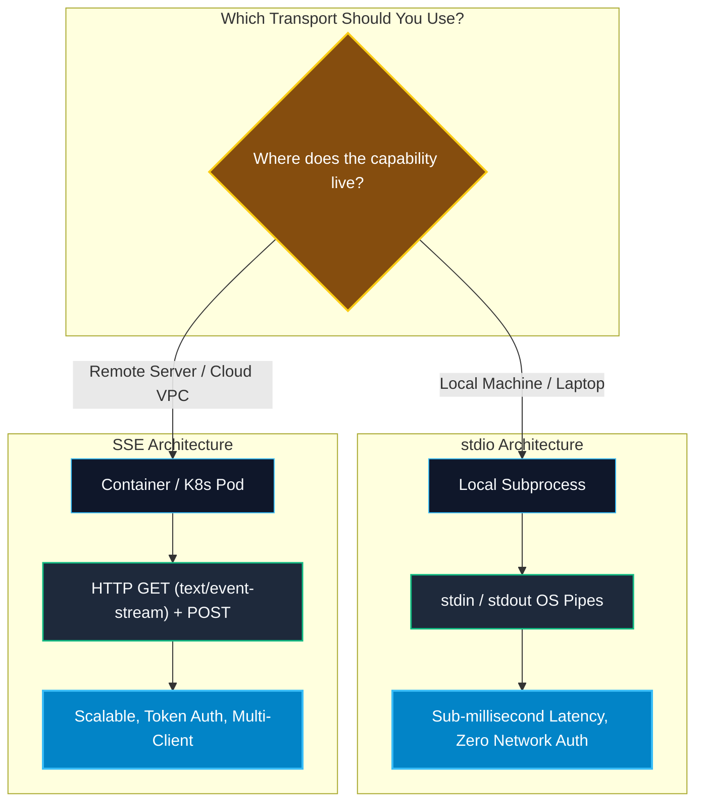

# Transport Mechanisms: Stdio vs. SSE

> "The transport layer is the plumbing of MCP. Choose stdio when you want zero-config local subprocess speed; choose SSE when you want distributed, containerized microservices in the cloud."

---


### Step 1: Why Do We Need This?

#### The Real Problem

AI tools run in radically different deployment topologies:
1. **Local Desktop / Developer Machines:** A developer using Claude Desktop or Cursor wants to query their local Git repository, inspect local files, or run unit tests. Setting up local HTTP servers with ports, SSL certs, and firewall exceptions creates friction.
2. **Enterprise Cloud & Microservices:** A central production agent needs to access an enterprise PostgreSQL cluster inside an AWS VPC or a customer support ticketing backend. Running a local subprocess on the developer's laptop is impossible; the agent must communicate over secure network protocols.

#### Why MCP Solves It

MCP decouples the **wire protocol (JSON-RPC 2.0)** from the **physical transport mechanism**. The official specification defines two standardized transports:
- **`stdio` (Standard Input / Output):** The client spawns the server as a local child process. Messages are newline-delimited JSON strings streamed over stdin and stdout.
- **`SSE` (Server-Sent Events over HTTP):** The client opens an HTTP connection to a remote endpoint. Server streams events to the client via `text/event-stream`, while client sends requests via HTTP `POST`.

---

### Step 2: What Is It?

#### Simple Explanation: Walkie-Talkies vs. Cellular Network

- **`stdio` is like a direct cable between two walkie-talkies in the same room.** It is instant, requires no internet connection, cannot be intercepted from the outside, and turns off the second you pull the plug.
- **`SSE` is like a cell phone tower connection.** You can call a server located on the other side of the planet, run inside a Kubernetes pod in Zurich, and connect multiple clients—provided you authenticate properly.

#### Transport Comparison Matrix

| Feature | `stdio` Transport | `SSE` (HTTP) Transport |
| :--- | :--- | :--- |
| **Execution Model** | Local child process spawned via `exec()` / `popen()` | Remote web server or container accessed over URL |
| **Setup Complexity** | Zero network setup; runs directly on host machine | Requires HTTP port, DNS/IP, and firewall configuration |
| **Authentication** | Inherits local OS file and user permissions | Requires Bearer Tokens, API Keys, or OAuth2 |
| **Latency** | Sub-millisecond (in-memory OS pipe) | Network latency (10ms - 200ms depending on region) |
| **Client-to-Server Comm** | Written to server's `stdin` | Sent via HTTP `POST` to server's endpoint |
| **Server-to-Client Comm** | Emitted to server's `stdout` | Pushed via persistent HTTP `text/event-stream` |
| **Debugging Complexity** | Standard print statements to stdout corrupt JSON framing | Easy to inspect via cURL, Wireshark, or Chrome DevTools |

---

### Step 3: Real-World Example

#### Dual Architecture in an Enterprise AI Pipeline

- **Local Development (`stdio`):** A developer uses Cursor with a local filesystem MCP server:
  ```json
  {
    "mcpServers": {
      "filesystem": {
        "command": "npx",
        "args": ["-y", "@modelcontextprotocol/server-filesystem", "/Users/alice/projects"]
      }
    }
  }
  ```
  The host launches Node.js as a child process; operations complete in 0.5ms with zero network exposure.

- **Production Cloud Deployment (`SSE`):** An automated customer service agent running on AWS Lambda connects to a shared enterprise CRM MCP server hosted on Google Cloud Run:
  ```json
  {
    "mcpServers": {
      "crm-gateway": {
        "url": "https://mcp-crm.internal.enterprise.com/sse",
        "headers": {
          "Authorization": "Bearer eyJhbGciOi..."
        }
      }
    }
  }
  ```
  The server scales elastically to handle 10,000 requests/min across multiple agent instances.

---

### Step 4: How Does It Work?

#### 1. The `stdio` Framing Protocol
In `stdio`, communication is **newline-delimited JSON-RPC**:
- Client writes a JSON line followed by `\n` to child process `stdin`.
- Server writes a JSON line followed by `\n` to its `stdout`.
- **CRITICAL RULE:** The server must **NEVER** write debug logs or unformatted text to `stdout`! Any debug logging must be emitted via `stderr` or encapsulated inside a `notifications/message` JSON-RPC frame. Otherwise, the client's JSON parser crashes.

#### 2. The `SSE` Framing Protocol
In `SSE`, HTTP handles the connection:
- Client sends an HTTP `GET` with header `Accept: text/event-stream`.
- Server responds with HTTP 200 and emits an initial `endpoint` event containing a unique postback URL (e.g., `/messages?sessionId=abc-123`).
- When Client wants to send a request, it makes an HTTP `POST` to `/messages?sessionId=abc-123`.
- Server processes the request and streams the JSON-RPC response back over the open SSE channel.

```text
SSE Handshake & Dispatch Flow:
Client                                           Server
  │                                                │
  │ ── 1. GET /sse (Accept: text/event-stream) ──> │
  │ <─ 2. HTTP 200 (event: endpoint, data: /msg) ─ │
  │                                                │
  │ ── 3. POST /msg (JSON-RPC initialize) ───────> │
  │ <─ 4. SSE (event: message, data: Result) ───── │
```

---

### Step 5: Code Example: Stdio vs. SSE Implementation

Here is a runnable Python demonstration showing the core mechanics of both transports:

#### Part A: `stdio` Server Runner

```python
# stdio_server.py
import sys
import json

def run_stdio_server():
    """Reads JSON-RPC from stdin line-by-line and writes response to stdout."""
    # Write debug diagnostics strictly to stderr!
    sys.stderr.write("[DEBUG]: Stdio MCP Server started.\n")
    sys.stderr.flush()

    for line in sys.stdin:
        line = line.strip()
        if not line:
            continue
        try:
            req = json.loads(line)
            req_id = req.get("id")
            method = req.get("method")

            if method == "initialize":
                res = {
                    "jsonrpc": "2.0",
                    "id": req_id,
                    "result": {
                        "protocolVersion": "2024-11-05",
                        "capabilities": {"tools": {}},
                        "serverInfo": {"name": "sample-stdio", "version": "1.0"}
                    }
                }
            else:
                res = {"jsonrpc": "2.0", "id": req_id, "result": {"status": "ok"}}

            # Send result followed by newline to stdout
            sys.stdout.write(json.dumps(res) + "\n")
            sys.stdout.flush()
        except Exception as e:
            sys.stderr.write(f"[ERROR]: {e}\n")
            sys.stderr.flush()

if __name__ == "__main__":
    run_stdio_server()
```

#### Part B: Remote `SSE` FastMCP Server Runner

```python
# sse_server.py
from mcp.server.fastmcp import FastMCP

# Initialize FastMCP Server configured for SSE transport
mcp = FastMCP("RemoteClusterAnalytics")

@mcp.tool()
def get_cluster_status(cluster_name: str) -> dict:
    """Returns real-time health metrics for a Kubernetes cluster."""
    return {
        "cluster": cluster_name,
        "nodes_online": 12,
        "cpu_utilization": "42%",
        "status": "Healthy"
    }

if __name__ == "__main__":
    # Runs an ASGI server on port 8000 exposing /sse and message postback endpoints
    print("Serving Remote MCP Server over SSE at http://0.0.0.0:8000/sse")
    mcp.run(transport="sse")
```

---

### Step 6: How Is It Used in Production?

#### Production Patterns & Edge Cases

| Scenario | Production Challenge | Recommended Solution |
| :--- | :--- | :--- |
| **Accidental stdout Pollution** | A third-party library writes `print("Connected to DB")`, corrupting the stdio JSON-RPC stream. | Redirect Python `sys.stdout` to `sys.stderr` on server startup and use a dedicated file descriptor or low-level pipe for protocol messages. |
| **SSE Reconnections & Session Loss**| Network blips cause client disconnects; stateful tool operations lose session ID. | Implement durable Redis session caches and emit sequence numbers with SSE events to allow message replay. |
| **Process Zombies** | When client crashes, child `stdio` process remains running indefinitely. | Listen for `stdin` EOF (null read in C/Python) and trigger immediate `sys.exit(0)`. |
| **CORS on Remote SSE** | Web-based AI host cannot connect to remote MCP server due to browser security. | Explicitly configure CORS headers (`Access-Control-Allow-Origin: *`, `Allow-Methods: GET, POST`). |

---

### Step 7: Quick Revision

- **`stdio`** executes as a local child process using `stdin` for requests and `stdout` for responses.
- **`SSE`** communicates over HTTP, allowing remote, distributed, and multi-tenant server deployments.
- In `stdio` servers, **never write non-JSON data to `stdout`**; always route logs and diagnostics to `stderr`.
- `SSE` uses a two-phase HTTP pattern: `GET /sse` opens the downstream event stream, and `POST /message` dispatches upstream requests.
- Choose `stdio` for developer tooling, local disk access, and zero-latency CLI agents; choose `SSE` for microservices, cloud VPCs, and shared enterprise knowledge bases.

---

### Step 8: Final Flow Diagram



---

### Step 9: Quiz

1. Why must a `stdio` MCP server never write debugging statements using `print()` directly to standard output?
   - A) Because standard output uses too much electricity
   - B) Because non-JSON strings on stdout will corrupt the client's JSON-RPC parser and break the connection
   - C) Because stdout is read-only on Linux
   - D) Because print statements delete local files

2. Where should server-side logs and diagnostic messages be written in a `stdio` MCP server?
   - A) Direct to `/dev/null`
   - B) Standard Error (`stderr`) or via protocol `notifications/message`
   - C) Placed inside the `ping` response
   - D) Sent via email to the administrator

3. In the MCP `SSE` transport, how does the client send requests to the server?
   - A) By opening a UDP socket on port 53
   - B) By making HTTP POST requests to the session endpoint provided by the server
   - C) By flashing the server's motherboard LED
   - D) By appending query parameters to the initial GET request

4. Which transport is ideal when building a production MCP gateway inside a private Kubernetes VPC accessible by multiple microservice agents?
   - A) `stdio`
   - B) `SSE` over HTTPS
   - C) Floppy disk exchange
   - D) Bluetooth Low Energy

*Submit your answers (e.g. 1-B, 2-B, 3-B, 4-B) to verify your score!*
