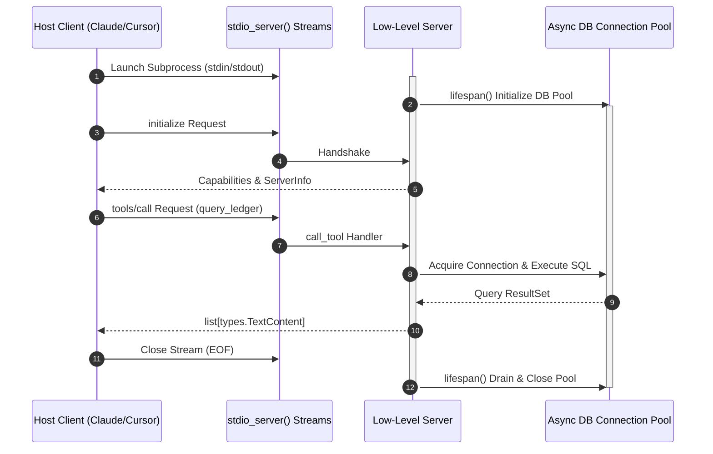

# Low-Level Python Server API

> "FastMCP is the automatic transmission that gets you moving fast. The Low-Level Server API is the manual gearbox that gives enterprise architects complete control over connection pools, async lifespans, and protocol capabilities."

---


### Step 1: Why Do We Need This?

#### The Real Problem

While FastMCP simplifies 90% of use cases, complex enterprise systems encounter limitations:
- **Database Connection Pools:** You need to initialize an `asyncpg` or `SQLAlchemy` connection pool *once* when the server boots and cleanly drain it when the process exits.
- **Custom Capabilities & Granular Handshakes:** You need to selectively enable or disable experimental MCP capabilities based on environmental feature flags.
- **Fine-Grained Context & Sessions:** You need direct access to the low-level `ServerSession` to track individual client IDs, emit custom out-of-band notifications, or inject custom middleware.

#### Why the Low-Level Server API Solves It

The low-level API (`mcp.server.lowlevel.Server`) provides complete control:
1. **Explicit Request Handlers:** Direct registration of handlers via `@server.list_tools()`, `@server.call_tool()`, `@server.list_resources()`, and `@server.read_resource()`.
2. **Lifespan Management:** Structured startup and teardown hooks using Python's `asynccontextmanager` pattern.
3. **Transport Decoupling:** Direct interaction with `stdio_server()` and `create_initialization_options()` for advanced piping.

---

### Step 2: What Is It?

#### Simple Explanation: Under the Hood of the Engine

Think of FastMCP like the dashboard of a car (steering wheel, pedals, speed gauge). The **Low-Level Server API** is opening the hood and connecting directly to the engine block, alternator, and battery terminals:
- You control exactly when the engine fires up (`lifespan`).
- You configure the exact wiring harness (`stdio_server` streams).
- You decide how every individual gear shifts (`ServerSession` message dispatch).

#### Core Low-Level API Primitives

| Class / Function | Purpose |
| :--- | :--- |
| **`Server(name)`** | Core state container holding registered handlers and protocol capabilities. |
| **`stdio_server()`** | Async context manager yielding `(read_stream, write_stream)` over OS pipes. |
| **`server.run(read_stream, write_stream, options)`** | The main execution loop processing JSON-RPC messages until EOF. |
| **`InitializationOptions`** | Declares server version, capability flags, and instruction metadata. |
| **`ServerSession`** | Represents the active bidirectional communication channel with a specific client. |

---

### Step 3: Real-World Example

#### The Enterprise PostgreSQL Gateway with Connection Pooling

In a production microservice:
1. When the server launches, it must connect to a PostgreSQL cluster with a pool of 20 connections.
2. If the connection fails, the server must abort before advertising tools to Claude.
3. During tool execution, each concurrent query borrows a connection from the pool and returns it immediately.
4. When the host terminates, the pool must close all open TCP sockets gracefully.
The low-level API makes this lifespan management clean and deterministic.

---

### Step 4: How Does It Work?

```text
1. Define Low-Level Server Instance:
   server = Server("enterprise-db-mcp")

2. Register Explicit Protocol Handlers:
   @server.list_tools()
   async def handle_list_tools() -> list[types.Tool]: ...

   @server.call_tool()
   async def handle_call_tool(name: str, arguments: dict) -> list[types.TextContent]: ...

3. Run Transport Loop with Asyncio & AnyIO:
   async with stdio_server() as (read_stream, write_stream):
       await server.run(
           read_stream,
           write_stream,
           InitializationOptions(...)
       )
```

---

### Step 5: Code Example: Production Low-Level Python Server

Here is a complete, runnable low-level Python MCP server managing an explicit startup/shutdown lifespan and typed handlers:

```python
# lowlevel_server.py
import asyncio
import sys
from contextlib import asynccontextmanager
import mcp.types as types
from mcp.server.lowlevel import Server
from mcp.server.stdio import stdio_server
from mcp.server.models import InitializationOptions

# 1. Initialize Low-Level Server Instance
app = Server("production-postgres-gateway")

# Mock database connection pool state
db_pool = None

@asynccontextmanager
async def lifespan():
    """Manages server startup and graceful teardown."""
    global db_pool
    sys.stderr.write("[LIFESPAN]: Initializing PostgreSQL connection pool...\n")
    # Simulate async DB pool setup
    db_pool = {"active_connections": 10, "status": "connected"}
    sys.stderr.flush()
    try:
        yield
    finally:
        sys.stderr.write("[LIFESPAN]: Draining connection pool and closing sockets...\n")
        db_pool = None
        sys.stderr.flush()

# 2. Register Tool Catalog Handler
@app.list_tools()
async def list_tools() -> list[types.Tool]:
    """Explicitly returns the list of Tool definitions using MCP types."""
    return [
        types.Tool(
            name="query_customer_ledger",
            description="Queries the financial ledger for customer transactions.",
            inputSchema={
                "type": "object",
                "properties": {
                    "customer_id": {"type": "string", "description": "UUID of customer"},
                    "limit": {"type": "integer", "default": 10}
                },
                "required": ["customer_id"]
            }
        )
    ]

# 3. Register Tool Execution Handler
@app.call_tool()
async def call_tool(name: str, arguments: dict) -> list[types.TextContent | types.ImageContent]:
    """Directly handles tool execution with granular exception isolation."""
    if name != "query_customer_ledger":
        raise ValueError(f"Unknown tool name: {name}")

    customer_id = arguments.get("customer_id")
    limit = arguments.get("limit", 10)

    # Validate internal DB pool readiness
    if not db_pool:
        raise RuntimeError("Database connection pool is offline.")

    # Simulate query execution
    simulated_rows = f"Found {limit} transactions for customer {customer_id}: Balance = $1,420.50"
    
    return [
        types.TextContent(
            type="text",
            text=simulated_rows
        )
    ]

# 4. Entrypoint and Transport Execution
async def main():
    async with lifespan():
        # Initialize stdio reader and writer streams
        async with stdio_server() as (read_stream, write_stream):
            # Define exact server initialization options
            init_options = InitializationOptions(
                server_name="production-postgres-gateway",
                server_version="1.0.0",
                capabilities=app.get_capabilities(
                    notification_options=types.NotificationOptions(),
                    experimental_capabilities={}
                )
            )
            # Run the server loop
            await app.run(
                read_stream,
                write_stream,
                init_options
            )

if __name__ == "__main__":
    asyncio.run(main())
```

---

### Step 6: How Is It Used in Production?

#### Production Patterns & Edge Cases

| Scenario | Production Challenge | Recommended Solution |
| :--- | :--- | :--- |
| **Signal Handling (SIGTERM/SIGINT)**| Kubernetes evicts pod; ongoing transactions are abruptly severed. | Catch `asyncio.CancelledError` inside the main task to trigger the lifespan teardown block cleanly. |
| **Direct Notification Emission** | Server needs to notify host that a cache was invalidated. | Access `app.request_context.session` and call `session.send_resource_updated(uri)`. |
| **Typed Protocol Objects** | Developers accidentally return raw dictionaries instead of `mcp.types` models. | Always construct explicit instances of `types.Tool`, `types.TextContent`, or `types.Resource`. |
| **Concurrent Tool Execution** | Multiple tools execute concurrently, exceeding maximum pool size. | Guard database queries using an `asyncio.Semaphore(max_concurrent_queries)`. |

---

### Step 7: Quick Revision

- The **Low-Level Server API** (`mcp.server.lowlevel.Server`) provides explicit control over request routing, capabilities, and lifespans.
- Use Python's **`@asynccontextmanager`** to manage external connection pools and background workers cleanly.
- Handlers are registered using explicit decorators: `@app.list_tools()`, `@app.call_tool()`, `@app.list_resources()`, `@app.read_resource()`.
- Returned payloads must use strongly-typed models from **`mcp.types`** (e.g., `types.Tool`, `types.TextContent`).
- Standard transports are initialized via **`async with stdio_server()`** and driven by **`app.run(...)`**.

---

### Step 8: Final Flow Diagram



---

### Step 9: Quiz

1. Why would an engineering team select the Low-Level Python Server API over FastMCP?
   - A) FastMCP does not support Python 3
   - B) The Low-Level API provides explicit control over connection lifespans, typed models, and ServerSession internals
   - C) FastMCP cannot return text
   - D) The Low-Level API runs without an operating system

2. What Python type must be returned from an explicit `@app.list_tools()` handler in the low-level API?
   - A) A list of raw strings
   - B) A list of `mcp.types.Tool` instances
   - C) An HTML table
   - D) A boolean True/False

3. What mechanism should be used in the low-level API to ensure database connections are cleanly drained during server shutdown?
   - A) A `while True` sleep loop
   - B) An `@asynccontextmanager` lifespan block wrapping `app.run()`
   - C) Calling `os._exit(0)`
   - D) Hardcoding an exception

4. Which transport helper provides the async read and write streams for a subprocess MCP server?
   - A) `stdio_server()`
   - B) `open_socket()`
   - C) `os.popen()`
   - D) `urllib.request`

*Submit your answers (e.g. 1-B, 2-B, 3-B, 4-A) to verify your score!*
