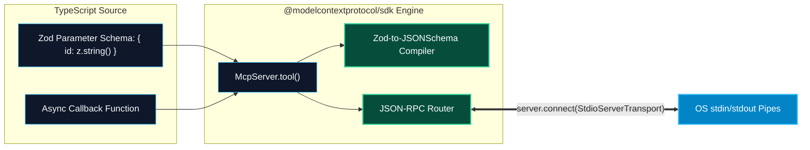

# TypeScript MCP SDK Fundamentals

> "TypeScript and Node.js are the lingua franca of developer tooling and web infrastructure. With the official MCP TypeScript SDK, you can expose your existing enterprise NPM packages and REST APIs to AI models with complete type safety."

---


### Step 1: Why Do We Need This?

#### The Real Problem

Enterprise developer tooling—including the extension ecosystems of VS Code, Cursor, Zed, and GitHub Actions—is predominantly built on TypeScript:
- Many enterprise systems already have rich, battle-tested TypeScript client libraries (Octokit for GitHub, Prisma for databases, Stripe SDK).
- Rewriting these integration clients in Python just to create an MCP server duplicates development effort and introduces maintenance overhead.
- JavaScript developers need an idiomatic, asynchronous, and non-blocking framework that feels as natural as Express.js or Fastify.

#### Why the TypeScript SDK Solves It

Anthropic maintains the official **`@modelcontextprotocol/sdk`** package for TypeScript:
- **`McpServer` High-Level Class:** Provides clean, declarative registration methods: `server.tool()`, `server.resource()`, and `server.prompt()`.
- **First-Class Zod Integration:** Rather than writing raw JSON Schema dictionaries, parameter schemas are defined using **Zod** (`z.string()`, `z.number()`). Types are inferred automatically for the execution callback.
- **Pluggable Transports:** Connect seamlessly to `StdioServerTransport` for CLI distributions or `SSEServerTransport` for HTTP microservices.

---

### Step 2: What Is It?

#### Simple Explanation: The Express.js for AI Protocol

Think of `@modelcontextprotocol/sdk` like **Express.js, but tailored for LLMs**:
- In Express, you write: `app.get("/users", (req, res) => ...)`
- In MCP TypeScript, you write: 
  ```typescript
  server.tool("get_user", { id: z.string() }, async ({ id }) => ({
    content: [{ type: "text", text: `User: ${id}` }]
  }));
  ```
- The framework handles JSON-RPC serialization, type checking, error formatting, and transport abstraction behind the scenes.

#### Core TypeScript SDK Classes

| Class / Export | Purpose |
| :--- | :--- |
| **`McpServer`** | The primary high-level server builder for registering tools, resources, and prompts. |
| **`ResourceTemplate`** | Class for constructing dynamic URI templates (e.g. `users://{id}/profile`). |
| **`StdioServerTransport`** | Standard I/O transport using Node.js `process.stdin` and `process.stdout`. |
| **`SSEServerTransport`** | HTTP transport for Server-Sent Events and POST message routing. |

---

### Step 3: Real-World Example

#### The NPM Package Vulnerability Inspector

Imagine an MCP server for software engineering teams that checks package security:
1. An engineer working in Cursor asks: *"Is the `jsonwebtoken` dependency in this repo vulnerable?"*
2. Cursor invokes the TypeScript MCP tool: `check_npm_package({ name: "jsonwebtoken", version: "8.5.1" })`.
3. The server calls the official NPM audit registry API, detects CVE-2022-23529, and returns the remediation advice.
4. The engineer asks to upgrade, and the model executes `npm_install({ package: "jsonwebtoken@9.0.0" })`.

---

### Step 4: How Does It Work?

```text
1. Define McpServer with Metadata:
   const server = new McpServer({ name: "npm-guard", version: "1.0.0" });

2. Register Tool with Zod Schema:
   server.tool(
     "audit_package",
     { packageName: z.string().min(1) },
     async ({ packageName }) => { ... }
   );

3. Initialize Transport and Connect:
   const transport = new StdioServerTransport();
   await server.connect(transport);
```

1. **Instantiation:** `new McpServer()` sets up internal routing tables and capabilities.
2. **Schema Compilation:** When `server.tool(...)` is called with a Zod shape, the SDK automatically compiles the Zod object into a standard JSON Schema object for `tools/list`.
3. **Connection:** When `server.connect(transport)` is called, the server hooks into the transport's message stream and completes the initialization handshake.

---

### Step 5: Code Example: Complete TypeScript MCP Server

Here is a complete, runnable TypeScript implementation using `@modelcontextprotocol/sdk` and `zod`:

```typescript
// server.ts
import { McpServer, ResourceTemplate } from "@modelcontextprotocol/sdk/server/mcp.js";
import { StdioServerTransport } from "@modelcontextprotocol/sdk/server/stdio.js";
import { z } from "zod";

// 1. Initialize MCP Server
const server = new McpServer({
  name: "enterprise-node-devops",
  version: "1.0.0"
});

// Mock database of microservices
const SERVICES = [
  { id: "auth-svc", port: 4001, status: "healthy", version: "v2.1.0" },
  { id: "payments-svc", port: 4002, status: "degraded", version: "v1.9.4" },
  { id: "inventory-svc", port: 4003, status: "healthy", version: "v3.0.1" }
];

// 2. REGISTER TOOL (With Zod Validation)
server.tool(
  "restart_service",
  "Triggers a graceful restart of an internal microservice.",
  {
    serviceId: z.string().describe("The ID of the microservice to restart"),
    force: z.boolean().default(false).describe("Whether to bypass in-flight request drains")
  },
  async ({ serviceId, force }) => {
    const target = SERVICES.find(s => s.id === serviceId);
    if (!target) {
      return {
        isError: true,
        content: [{ type: "text", text: `Error: Microservice '${serviceId}' was not found.` }]
      };
    }

    // Simulate restart logic
    target.status = "healthy";
    return {
      content: [
        {
          type: "text",
          text: `Service '${serviceId}' successfully restarted (Force: ${force}). Current status: ${target.status}.`
        }
      ]
    };
  }
);

// 3. REGISTER STATIC RESOURCE
server.resource(
  "services-list",
  "services://catalog/all",
  { mimeType: "application/json", description: "Catalog of all registered cluster microservices" },
  async (uri) => ({
    contents: [
      {
        uri: uri.href,
        mimeType: "application/json",
        text: JSON.stringify(SERVICES, null, 2)
      }
    ]
  })
);

// 4. REGISTER DYNAMIC RESOURCE TEMPLATE
server.resource(
  "service-status",
  new ResourceTemplate("services://{serviceId}/status", { list: undefined }),
  { mimeType: "application/json", description: "Live health status of a specific microservice" },
  async (uri, { serviceId }) => {
    const svc = SERVICES.find(s => s.id === serviceId);
    if (!svc) {
      throw new Error(`Service '${serviceId}' not found.`);
    }
    return {
      contents: [
        {
          uri: uri.href,
          mimeType: "application/json",
          text: JSON.stringify(svc, null, 2)
        }
      ]
    };
  }
);

// 5. REGISTER PROMPT TEMPLATE
server.prompt(
  "incident_triage",
  "Generates an incident triage guide for an unhealthy microservice.",
  {
    serviceId: z.string().describe("The unhealthy microservice ID")
  },
  async ({ serviceId }) => {
    return {
      description: `Triage prompt for service ${serviceId}`,
      messages: [
        {
          role: "user",
          content: {
            type: "text",
            text: `You are an on-call SRE investigating degraded service '${serviceId}'.\n` +
                  `1. Inspect the service resource at services://${serviceId}/status.\n` +
                  `2. If degraded, call the restart_service tool.\n` +
                  `3. Formulate an incident root cause summary.`
          }
        }
      ]
    };
  }
);

// 6. Connect to Stdio Transport
async function run() {
  const transport = new StdioServerTransport();
  await server.connect(transport);
  console.error("TypeScript MCP Server successfully connected to stdio transport.");
}

run().catch((err) => {
  console.error("Fatal server error:", err);
  process.exit(1);
});
```

---

### Step 6: How Is It Used in Production?

#### Production Patterns & Edge Cases

| Scenario | Production Challenge | Recommended Solution |
| :--- | :--- | :--- |
| **ESM Package Configuration** | Node throws `SyntaxError: Cannot use import statement outside a module`. | Add `"type": "module"` in your `package.json` and compile TypeScript targeting `NodeNext` or `ES2022`. |
| **Executable NPX Distribution** | Distributing an MCP server via `npx @my-org/mcp-server`. | Add `#!/usr/bin/env node` to the top of your compiled entrypoint file and specify the `"bin"` field in `package.json`. |
| **Accidental `console.log()`** | Writing `console.log("Connected")` pollutes standard output, breaking the stdio JSON-RPC parser. | Use `console.error()` exclusively for diagnostics, as standard error is ignored by the client JSON parser. |
| **Unhandled Promise Rejections**| An unhandled async rejection causes Node.js process to exit abruptly. | Register global handlers: `process.on('unhandledRejection', ...)` and `process.on('uncaughtException', ...)`. |

---

### Step 7: Quick Revision

- The official TypeScript SDK is published under **`@modelcontextprotocol/sdk`**.
- Use the high-level **`McpServer`** class for intuitive, declarative capability registration.
- Tool parameter schemas are written with **Zod** (`z.string()`, `z.boolean()`), providing both compile-time types and runtime JSON Schema conversion.
- Connect local tools using **`StdioServerTransport`** and remote tools using **`SSEServerTransport`**.
- Always output debug statements to **`console.error()`**, never `console.log()`.

---

### Step 8: Final Flow Diagram



---

### Step 9: Quiz

1. What library is used by the official TypeScript MCP SDK to define tool parameter schemas?
   - A) Yup
   - B) Joi
   - C) Zod
   - D) Class-Validator

2. Where should diagnostic or debug statements be printed in a TypeScript stdio MCP server?
   - A) `console.log()`
   - B) `console.error()`
   - C) `alert()`
   - D) `document.write()`

3. What transport class connects a TypeScript MCP server to a child process standard input/output stream?
   - A) `WebSocketServerTransport`
   - B) `StdioServerTransport`
   - C) `NamedPipeTransport`
   - D) `FileStreamTransport`

4. What line must be included at the top of a compiled TypeScript entrypoint file to enable direct execution via `npx` or CLI?
   - A) `// @ts-check`
   - B) `#!/usr/bin/env node`
   - C) `"use strict";`
   - D) `<!-- html -->`

*Submit your answers (e.g. 1-C, 2-B, 3-B, 4-B) to verify your score!*
