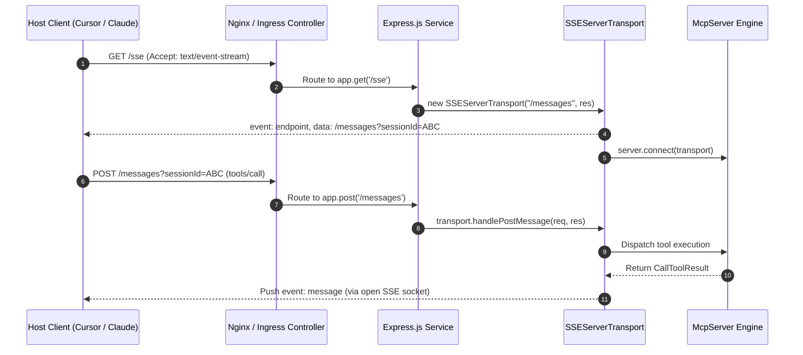

# Stdio and Express SSE Transports in TypeScript

> "Running MCP over stdio gives you zero-config local performance. Running MCP over Express and SSE gives you an elastic cloud microservice accessible by hundreds of distributed AI agents simultaneously."

---


### Step 1: Why Do We Need This?

#### The Real Problem

While `StdioServerTransport` is ideal for local CLI tools, enterprise deployments require network reachability:
- A shared enterprise knowledge base cannot be installed as a local subprocess on every developer's laptop.
- Cloud agents running in AWS Lambda, ECS, or GCP Cloud Run cannot spawn local processes on distant developer machines.
- Web-based AI chat frontends and browser agents need to communicate over standard HTTP/HTTPS protocols without direct operating system pipe access.

#### Why Express and SSEServerTransport Solve It

The TypeScript SDK provides **`SSEServerTransport`**, allowing you to host MCP servers inside standard Node.js web frameworks like **Express** or **Fastify**:
- **Standard HTTP Infrastructure:** Operates over ports 80/443 with TLS/HTTPS, working cleanly through firewalls, API gateways, and corporate proxies.
- **Persistent Downstream Push:** Utilizes the W3C Server-Sent Events specification (`text/event-stream`) for pushing server responses and notifications.
- **RESTful Upstream Commands:** Clients transmit JSON-RPC requests via standard HTTP `POST` requests to a designated session endpoint.

---

### Step 2: What Is It?

#### Simple Explanation: The Live Television Broadcast with Call-In Line

Think of `SSEServerTransport` like a **live television talk show**:
- The **SSE channel (`GET /sse`)** is the TV broadcast signal. The client tunes in and continuously receives pictures, audio, and news tickers (server events) in real-time.
- The **Message endpoint (`POST /messages`)** is the viewer telephone line. When the viewer wants to ask a question, they call in with their viewer ID. The show host answers on the live TV broadcast!

#### Core Components of an SSE Server

| Component | Route / Method | Responsibility |
| :--- | :--- | :--- |
| **SSE Stream Route** | `GET /sse` | Opens the long-lived HTTP `text/event-stream` and initializes the session. |
| **Postback Route** | `POST /messages` | Receives client JSON-RPC requests for an active session. |
| **`SSEServerTransport`** | Class | Bridges the Express `Request` and `Response` streams to the `McpServer`. |
| **Session Map** | In-Memory / Redis | Tracks active `SSEServerTransport` instances indexed by `sessionId`. |

---

### Step 3: Real-World Example

#### The Cloud Enterprise Jira & Sprint Planning Gateway

An enterprise hosts a shared TypeScript MCP server on AWS ECS:
1. When developers open Cursor or Claude Desktop, their client connects to `https://mcp.internal.corp/sse`.
2. The server authenticates their corporate JWT bearer token and issues a unique session identifier.
3. Multiple engineers interact with the same central MCP server simultaneously.
4. When Jira tickets are updated or sprint burndown rates shift, the server pushes real-time resource updates to all active developer sessions.

---

### Step 4: How Does It Work?

```text
Client (Host)                                         Express Web Server
   │                                                         │
   │ ── 1. GET /sse (Accept: text/event-stream) ───────────> │
   │                                                         │ [Create new SSEServerTransport]
   │                                                         │ [Store transport in session Map]
   │                                                         │ [Connect transport to McpServer]
   │ <─ 2. HTTP 200 (event: endpoint, data: "/messages?id=1")│
   │                                                         │
   │ ── 3. POST /messages?id=1 (tools/call: get_sprint) ───> │
   │                                                         │ [Route to transport.handlePostMessage]
   │ <─ 4. HTTP 202 Accepted ────────────────────────────────│
   │                                                         │
   │ <─ 5. SSE Push (event: message, data: Result) ──────────│
```

1. **Client Handshake:** Client connects via `GET /sse`.
2. **Session Initialization:** Express instantiates `new SSEServerTransport("/messages", res)` and connects it to the `McpServer`.
3. **Endpoint Event:** The server emits an `endpoint` SSE event instructing the client where to send upstream messages (`/messages?sessionId=<uuid>`).
4. **Upstream Request:** When the client sends a tool call, it issues an HTTP `POST` to `/messages?sessionId=<uuid>`.
5. **Execution & Push:** Express routes the payload to `transport.handlePostMessage(req, res)`, which executes the tool and pushes the response over the open SSE connection.

---

### Step 5: Code Example: Production Express SSE Server

Here is a complete, runnable Express.js TypeScript server exposing tools over SSE:

```typescript
// sse-server.ts
import express, { Request, Response } from "express";
import { McpServer } from "@modelcontextprotocol/sdk/server/mcp.js";
import { SSEServerTransport } from "@modelcontextprotocol/sdk/server/sse.js";
import { z } from "zod";

const app = express();
const PORT = process.env.PORT || 3001;

// 1. Initialize MCP Server Core
const server = new McpServer({
  name: "cloud-metrics-hub",
  version: "1.0.0"
});

// Register sample tool
server.tool(
  "calculate_carbon_footprint",
  "Calculates estimated cloud carbon emissions based on server wattage and runtime.",
  {
    wattageHours: z.number().positive().describe("Total watt-hours consumed"),
    region: z.enum(["us-east-1", "eu-central-1", "ap-southeast-1"]).describe("AWS hosting region")
  },
  async ({ wattageHours, region }) => {
    const intensityMap: Record<string, number> = {
      "us-east-1": 0.415,
      "eu-central-1": 0.285,
      "ap-southeast-1": 0.520
    };
    const carbonKg = (wattageHours / 1000) * intensityMap[region];
    return {
      content: [
        {
          type: "text",
          text: `Estimated carbon footprint for ${region}: ${carbonKg.toFixed(4)} kg CO2e.`
        }
      ]
    };
  }
);

// 2. Track Active Client Transports by Session ID
const activeTransports = new Map<string, SSEServerTransport>();

// 3. SSE STREAM ENDPOINT (Downstream Server -> Client)
app.get("/sse", async (req: Request, res: Response) => {
  console.log("[SSE]: Incoming client connection request.");

  // CRITICAL: Disable Nginx/proxy buffering
  res.setHeader("X-Accel-Buffering", "no");
  res.setHeader("Content-Type", "text/event-stream");
  res.setHeader("Cache-Control", "no-cache");
  res.setHeader("Connection", "keep-alive");

  // Create transport with the relative message postback path
  const transport = new SSEServerTransport("/messages", res);
  const sessionId = transport.sessionId;
  activeTransports.set(sessionId, transport);

  console.log(`[SSE]: Established session: ${sessionId}`);

  // Clean up when client disconnects
  req.on("close", () => {
    console.log(`[SSE]: Client disconnected. Terminating session: ${sessionId}`);
    activeTransports.delete(sessionId);
  });

  // Connect transport to the MCP server engine
  await server.connect(transport);
});

// 4. MESSAGE POSTBACK ENDPOINT (Upstream Client -> Server)
app.post("/messages", async (req: Request, res: Response) => {
  const sessionId = req.query.sessionId as string;
  if (!sessionId) {
    res.status(400).send("Bad Request: Missing 'sessionId' query parameter.");
    return;
  }

  const transport = activeTransports.get(sessionId);
  if (!transport) {
    res.status(404).send(`Session '${sessionId}' not found or expired.`);
    return;
  }

  // Delegate JSON-RPC parsing and execution to transport handler
  await transport.handlePostMessage(req, res);
});

// Start Express Listener
app.listen(PORT, () => {
  console.log(`Enterprise MCP SSE Gateway running at http://localhost:${PORT}/sse`);
});
```

---

### Step 6: How Is It Used in Production?

#### Production Patterns & Edge Cases

| Scenario | Production Challenge | Recommended Solution |
| :--- | :--- | :--- |
| **Nginx / Cloudflare Buffering** | Proxy holds SSE stream in buffer, so client receives no events until connection closes. | Set header `X-Accel-Buffering: no` and disable proxy response buffering in reverse proxy configs. |
| **Cross-Origin Resource Sharing (CORS)** | Web-based AI hosts fail to connect due to browser CORS policies. | Install `cors` package: `app.use(cors({ origin: "*", methods: ["GET", "POST"] }))`. |
| **Horizontal Auto-Scaling** | Client connects to Pod A for `/sse`, but its `/messages` POST hits Pod B. | Enable Sticky Sessions (Cookie / IP hash) on the load balancer, or store session states in Redis Pub/Sub. |
| **TCP Zombie Connections** | Network dropped silently; server leaves thousands of open SSE sockets. | Send a periodic SSE comment ping (`: keepalive\n\n`) every 15 seconds; terminate dead sockets. |

---

### Step 7: Quick Revision

- `SSEServerTransport` enables remote HTTP-based MCP servers over **Server-Sent Events**.
- The architecture requires two routes: a **`GET /sse`** stream route and a **`POST /messages`** postback route.
- Each connected client is identified by a unique **`sessionId`** generated by the transport.
- Always set **`X-Accel-Buffering: no`** to prevent reverse proxies from buffering SSE chunks.
- In multi-pod Kubernetes clusters, configure **sticky sessions** on your ingress to guarantee POST requests route to the pod holding the client's SSE socket.

---

### Step 8: Final Flow Diagram



---

### Step 9: Quiz

1. What HTTP header must be sent by the server to prevent Nginx or Cloudflare from buffering Server-Sent Events?
   - A) `Transfer-Encoding: chunked`
   - B) `X-Accel-Buffering: no`
   - C) `Content-Security-Policy: default-src`
   - D) `Access-Control-Max-Age: 3600`

2. In an Express MCP server, how does the client transmit upstream tool call requests to the server?
   - A) Via WebRTC data channels
   - B) By issuing an HTTP POST request to the `/messages` route containing its `sessionId`
   - C) By writing directly to the server's hard drive
   - D) Via email attachment

3. Why do multi-pod Kubernetes deployments of SSE MCP servers require sticky sessions on the ingress load balancer?
   - A) To increase the speed of light
   - B) Because the client's HTTP POST requests must land on the exact pod holding that client's open SSE socket
   - C) Because Kubernetes does not support Docker
   - D) To comply with GDPR

4. What happens when a user closes their laptop while connected to an SSE MCP server?
   - A) The entire server crashes
   - B) The Express `req.on("close")` event fires, allowing the server to delete the session and free memory
   - C) The server charges the user's credit card
   - D) The client reboots

*Submit your answers (e.g. 1-B, 2-B, 3-B, 4-B) to verify your score!*
