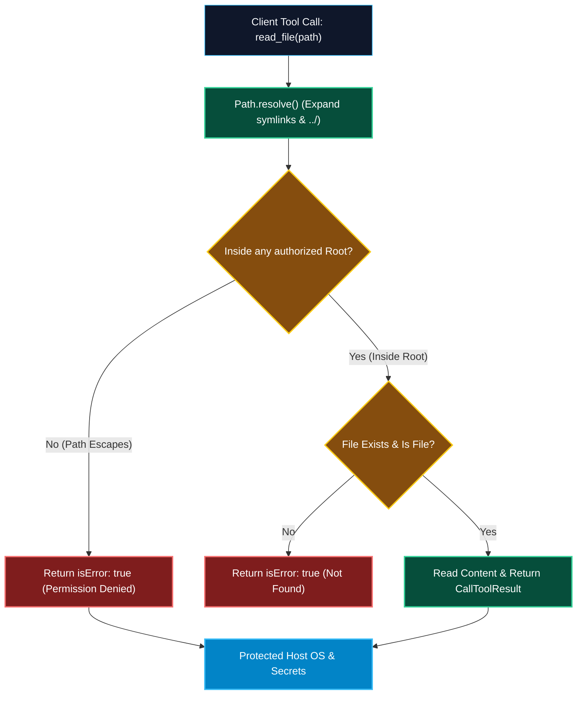

# Roots and Workspace Boundaries in MCP

> "An AI tool with unrestricted filesystem access is a catastrophic vulnerability. The Roots primitive defines the legal boundaries of the sandbox, ensuring an agent cannot wander outside the current project workspace."

---


### Step 1: Why Do We Need This?

#### The Real Problem

When an engineer opens an IDE like Cursor, VS Code, or Zed, they might work on five completely different repositories in a single day:
- Hardcoding local file paths (`/Users/developer/projects/checkout-service`) in MCP configuration files is brittle; paths differ between developer laptops, staging containers, and CI runners.
- Even worse, without workspace boundaries, a compromised or prompt-injected LLM could ask a filesystem tool to read `/etc/shadow`, `~/.ssh/id_rsa`, or `~/.aws/credentials`.
- When an engineer switches workspaces or adds a secondary folder to a multi-root workspace, servers need an automated way to adapt their context without restarting.

#### Why MCP Roots Solves It

The **Roots primitive (`roots/list`)** establishes a dynamic, secure boundary between the Host and Server:
- **Host-Controlled Scoping:** The Host informs the Server exactly which directory trees are currently open and authorized for access (e.g. `file:///workspace/repo-a`).
- **Dynamic Change Notifications:** If the user opens a second folder or closes a project, the Host dispatches a `notifications/roots/list_changed` notification, allowing servers to refresh indexes instantly.
- **Strict Boundary Sandboxing:** Servers can enforce that all requested paths resolve strictly within the declared roots, blocking directory traversal attacks (`../../`).

---

### Step 2: What Is It?

#### Simple Explanation: The Security Fence around the Construction Site

Think of your entire computer as a city, and your coding project as a **construction site**:
- The Host (IDE) places **boundary markers (Roots)** around the construction lot: *"You are only allowed to operate inside Lot #42 (`/projects/skillvault`)."*
- If a delivery truck or worker tries to dig in the neighbor's yard (`/etc` or `~/.ssh`), the security guard checks the boundary stakes and turns them back.
- If the city expands the lot, the guard moves the fence posts (`notifications/roots/list_changed`).

#### Core Elements of a Root

| Field | Purpose | Example |
| :--- | :--- | :--- |
| **`uri`** | Unique `file://` URI specifying the root directory path. | `file:///Users/dev/repos/SkillVault-website` |
| **`name`** | Optional display name for the workspace folder. | `"Frontend Repo"` |
| **`roots/list`** | JSON-RPC request sent from Server to Client to retrieve active roots. | Sent during server initialization or after a change notification. |
| **`notifications/roots/list_changed`** | One-way notification sent from Client to Server when workspaces change. | Sent when user opens/closes folders in the IDE. |

---

### Step 3: Real-World Example

#### The Safe Monorepo Code Search Server

Imagine an MCP server providing semantic code search across a company's microservices:
1. An engineer opens `~/code/payment-service` in Cursor.
2. The MCP server calls `roots/list` on Cursor. Cursor returns: `[{ uri: "file:///Users/alice/code/payment-service", name: "payment-service" }]`.
3. The server builds an in-memory vector index strictly for files inside that directory.
4. If the model invokes `search_code(path="../auth-service/secrets.env")`, the server detects that the path resolves outside the root boundary, throws a security error, and refuses to read the file.

---

### Step 4: How Does It Work?

```text
Host (IDE Client)                                      MCP Server
       │                                                   │
       │ ── 1. initialize (capabilities: {roots: {}}) ───> │
       │ <─ 2. InitializeResult ────────────────────────── │
       │                                                   │
       │ <─ 3. roots/list (Server requests roots) ──────── │
       │ ── 4. [{uri: "file:///app/src", name: "src"}] ──> │
       │                                                   │
       │ [Server indexes /app/src]                         │
       │                                                   │
       │ [User opens second folder: /app/docs]             │
       │ ── 5. notifications/roots/list_changed ─────────> │
       │                                                   │
       │ <─ 6. roots/list (Server re-queries roots) ────── │
       │ ── 7. [{/app/src}, {/app/docs}] ────────────────> │
```

1. **Capability Discovery:** Host advertises `roots: { listChanged: true }`.
2. **Root Query:** Server sends `roots/list` request to client to discover allowed paths.
3. **Boundary Enforcement:** For every tool or resource operation, server resolves paths to canonical real paths and verifies they start with one of the authorized root paths.
4. **Change Event:** If the developer opens a new folder, host sends `notifications/roots/list_changed`.

---

### Step 5: Code Example: Python Server with Strict Path Boundary Validation

Here is a complete, runnable Python script showing how an MCP server queries client roots and enforces strict sandboxed file reads:

```python
# roots_sandbox_server.py
import os
from pathlib import Path
from urllib.parse import urlparse, unquote
from typing import List, Dict, Any

class SandboxedFileServer:
    def __init__(self):
        # Cache of active authorized root directory paths
        self.authorized_roots: List[Path] = []

    def update_roots_from_client_response(self, roots_payload: List[Dict[str, str]]):
        """Converts client file:// URIs into canonical Path objects."""
        new_roots = []
        for r in roots_payload:
            uri = r.get("uri", "")
            parsed = urlparse(uri)
            if parsed.scheme == "file":
                # Convert file:// URI to standard filesystem path
                clean_path = Path(unquote(parsed.path)).resolve()
                new_roots.append(clean_path)
        self.authorized_roots = new_roots
        print(f"[SERVER]: Active workspace roots configured: {self.authorized_roots}")

    def safe_read_file(self, requested_relative_or_abs_path: str) -> Dict[str, Any]:
        """Resolves path and guarantees it sits inside an authorized root."""
        if not self.authorized_roots:
            return {
                "isError": True,
                "content": [{"type": "text", "text": "Security Error: No workspace roots have been established."}]
            }

        # Resolve path to canonical absolute location (evaluates symlinks & ../)
        candidate = Path(requested_relative_or_abs_path).resolve()

        # Boundary Check: Candidate must start with at least one authorized root
        is_safe = False
        for root in self.authorized_roots:
            try:
                candidate.relative_to(root)
                is_safe = True
                break
            except ValueError:
                continue

        if not is_safe:
            return {
                "isError": True,
                "content": [
                    {
                        "type": "text",
                        "text": f"Permission Denied: Path '{candidate}' is outside authorized workspace boundaries."
                    }
                ]
            }

        if not candidate.exists() or not candidate.is_file():
            return {
                "isError": True,
                "content": [{"type": "text", "text": f"File Not Found: '{candidate}' does not exist."}]
            }

        try:
            with open(candidate, "r", encoding="utf-8") as f:
                data = f.read(5000) # Read up to 5k chars
            return {
                "isError": False,
                "content": [{"type": "text", "text": data}]
            }
        except Exception as e:
            return {"isError": True, "content": [{"type": "text", "text": f"Read error: {str(e)}"}]}

if __name__ == "__main__":
    server = SandboxedFileServer()

    # Simulate client returning the current project directory as root
    current_dir = Path(__file__).parent.resolve()
    mock_roots = [{"uri": current_dir.as_uri(), "name": "Phase-05-Workspace"}]
    server.update_roots_from_client_response(mock_roots)

    # Test 1: Legal Read inside root
    print("\n--- Test 1: Read inside root ---")
    test_file = current_dir / "sample.txt"
    test_file.write_text("Confidential Project Code v1.0", encoding="utf-8")
    print(server.safe_read_file(str(test_file)))

    # Test 2: Illegal Path Traversal (e.g. ../../)
    print("\n--- Test 2: Path Traversal Attempt ---")
    escaped_path = current_dir / ".." / ".." / "README.md"
    print(server.safe_read_file(str(escaped_path)))

    # Cleanup
    if test_file.exists():
        test_file.unlink()
```

---

### Step 6: How Is It Used in Production?

#### Production Patterns & Edge Cases

| Scenario | Production Challenge | Recommended Solution |
| :--- | :--- | :--- |
| **Symlink Escape Hatches** | A symlink inside an authorized folder points to `/etc/passwd`. | Always use `Path.resolve()` before `relative_to()` to evaluate the true physical file location on disk. |
| **Windows vs POSIX URIs** | Windows paths produce `file:///C:/Users/...` while Linux produces `file:///home/...`. | Use robust URI unquoting libraries (`urllib.parse.unquote`) and handle Windows drive letter prefixes cleanly. |
| **Multi-Root Workspaces** | Monorepos where backend, frontend, and infra are separate open folders. | Iterate over all returned roots; if a file belongs to *any* authorized root, grant access. |
| **Empty Roots List** | Client connects with zero open folders (empty window state). | Server should disable filesystem-dependent tools and return clear guidance: *"Please open a workspace folder."* |

---

### Step 7: Quick Revision

- **Roots (`roots/list`)** allow servers to discover the client's currently open project folders.
- Protects the host machine by sandboxing file operations within explicit directory trees.
- Resolving paths with **`Path.resolve()`** is mandatory to prevent directory traversal (`../`) and symlink escapes.
- When an engineer opens or closes project folders, the client fires **`notifications/roots/list_changed`**.
- Servers should subscribe to root changes to re-index workspaces and update active tool configurations dynamically.

---

### Step 8: Final Flow Diagram



---

### Step 9: Quiz

1. What JSON-RPC request does an MCP server send to discover the user's active workspace folders?
   - A) `files/list`
   - B) `roots/list`
   - C) `workspace/get_folders`
   - D) `os/get_cwd`

2. What notification does the client emit when a user adds or removes a folder in their IDE?
   - A) `notifications/roots/list_changed`
   - B) `workspace/updated`
   - C) `filesystem/reload`
   - D) `alert/new_folder`

3. Why is it vital to resolve paths using `Path.resolve()` before checking workspace root boundaries?
   - A) To compress the file size
   - B) To expand relative directory traversals (`../`) and evaluate symlinks that could escape the sandbox
   - C) To format the file as JSON
   - D) To translate English into Python

4. What URI scheme is used to represent local workspace roots in the `roots/list` response?
   - A) `http://`
   - B) `file://`
   - C) `ftp://`
   - D) `ws://`

*Submit your answers (e.g. 1-B, 2-A, 3-B, 4-B) to verify your score!*
