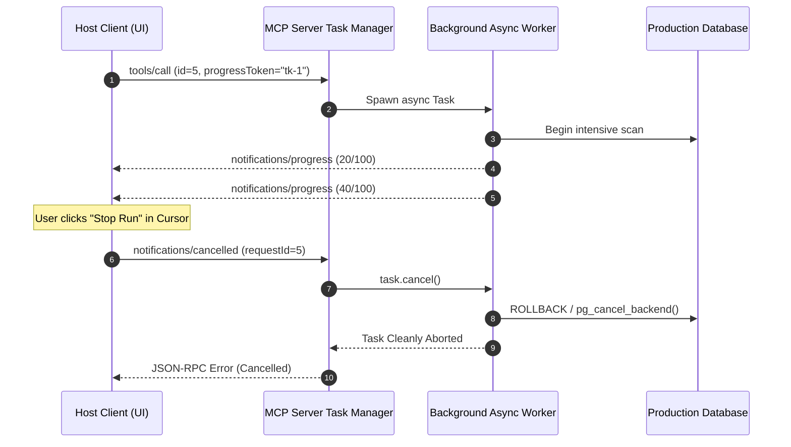

# Progress Tokens and Task Cancellation in MCP

> "A tool call that takes 60 seconds with zero feedback feels like a crashed application. A tool call that streams a 0-to-100% progress bar and obeys the 'Cancel' button feels like enterprise software."

---


### Step 1: Why Do We Need This?

#### The Real Problem

In enterprise environments, AI agent tools do not finish in 100 milliseconds:
- An MCP tool running an end-to-end integration test suite takes 45 seconds.
- An analytical tool scanning 10 million rows in PostgreSQL takes 2 minutes.
- If the server produces zero output during this period, the user assumes Cursor or Claude has frozen and clicks the "Stop" button.
- **The Resource Leak Disaster:** Without a standardized cancellation protocol, the client terminates its UI spinner, but the server keeps churning in the background—burning database connection pools, CPU cycles, and external API credits.

#### Why Progress Tokens & Cancellation Solve It

MCP introduces two complementary protocol features:
1. **Progress Tokens (`notifications/progress`):** When the client initiates a slow request, it passes a `progressToken`. The server emits incremental updates (`progress: 40, total: 100`) that drive smooth progress bars in host UIs.
2. **Cooperative Cancellation (`notifications/cancelled`):** If the human user clicks "Stop", the host dispatches a cancellation notification with the originating `requestId`. The server catches this signal, aborts the in-flight database query or HTTP request, and frees resources immediately.

---

### Step 2: What Is It?

#### Simple Explanation: The Pizza Tracker and Order Cancellation

Think of an asynchronous long-running task like **ordering a pizza delivery**:
- The pizza app gives you a tracking code (`progressToken`).
- As the kitchen works, the app notifies you: *"Dough prepped (25%)"*, *"Baking in oven (60%)"*, *"Out for delivery (90%)"*.
- If you suddenly realize you ordered to the wrong address and hit "Cancel Order", the restaurant receives the cancellation notice (`notifications/cancelled`), pulls the pizza out of the oven, and does not charge your card.

#### Core Parameters Table

| Protocol Message | Key Fields | Purpose |
| :--- | :--- | :--- |
| **Request with Progress** | `params._meta.progressToken` | Client supplies a string or integer token to identify progress updates. |
| **`notifications/progress`** | `progressToken`, `progress`, `total` | Server streams numeric completion status (e.g. `25` out of `100`). |
| **`notifications/cancelled`** | `requestId`, `reason` | Client signals that the specified in-flight request should be aborted immediately. |

---

### Step 3: Real-World Example

#### The Monorepo Code Migration Tool

An engineering team uses an MCP tool to migrate 500 files from CommonJS to ESM:
1. Claude calls `migrate_repo_to_esm()`. The host passes `progressToken: "mig-77"`.
2. Every 50 files migrated, the server emits `notifications/progress`:
   - `progress: 50, total: 500 (10%)`
   - `progress: 150, total: 500 (30%)`
3. The developer's Cursor UI displays: *Migrating repository... [████░░░░░░] 30%*.
4. At 35%, the developer realizes they forgot to checkout a new Git branch and clicks the "Stop Generating" button in Cursor.
5. Cursor sends `notifications/cancelled { requestId: 104 }`.
6. The server catches the cancellation, stops file writes, discards temporary buffers, and terminates cleanly.

---

### Step 4: How Does It Work?

```text
Host Application                                       MCP Server
       │                                                    │
       │ ── 1. tools/call {id: 42, _meta: {progressToken}} >│
       │                                                    │ [Spawns async task]
       │ <─ 2. notifications/progress {progress: 25/100} ── │
       │ <─ 3. notifications/progress {progress: 50/100} ── │
       │                                                    │
       │ [User clicks "Cancel" in Host UI]                  │
       │ ── 4. notifications/cancelled {requestId: 42} ───> │
       │                                                    │ [Cancels async task]
       │                                                    │ [Rolls back DB transaction]
       │                                                    │
       │ <─ 5. Error Response (code: -32000, "Cancelled") ──│
```

1. **Token Attachment:** The client attaches `_meta: { progressToken: "token-abc" }` to any standard request.
2. **Intermediate Push:** The server emits one-way `notifications/progress` events back to the client at key intervals.
3. **Cancellation Interrupt:** When cancelled, client sends `notifications/cancelled` containing the original `requestId`.
4. **Cooperative Cleanup:** The server task checks its cancellation token (or catches `asyncio.CancelledError`), aborts underlying network sockets, and terminates.

---

### Step 5: Code Example: Python Cooperative Cancellation & Progress Server

Here is a complete, runnable Python script demonstrating progress streaming and cancellation handling:

```python
# progress_cancellation_demo.py
import asyncio
from typing import Dict, Any, Optional

class LongRunningTaskManager:
    def __init__(self):
        # Maps active requestId -> asyncio.Task
        self.active_tasks: Dict[int, asyncio.Task] = {}

    def handle_cancelled_notification(self, params: Dict[str, Any]):
        """Called when client dispatches notifications/cancelled."""
        request_id = params.get("requestId")
        reason = params.get("reason", "User requested abort.")
        print(f"\n[ALERT]: Received cancellation for request_id: {request_id} (Reason: {reason})")

        task = self.active_tasks.get(request_id)
        if task and not task.done():
            # Trigger cooperative cancellation of Python async task
            task.cancel()

    async def execute_heavy_migration(self, request_id: int, progress_token: Optional[str]) -> str:
        """Simulates a multi-step job streaming progress and observing cancellation."""
        total_steps = 5
        print(f"[START]: Running job for request {request_id} (ProgressToken: {progress_token})...")

        for step in range(1, total_steps + 1):
            try:
                # Cooperative yield / sleep simulating real work
                await asyncio.sleep(1.0)
            except asyncio.CancelledError:
                print(f"[CLEANUP]: Request {request_id} was successfully aborted mid-flight!")
                # Perform database transaction rollback or temp file cleanup here
                raise

            # Emit progress update if client provided a token
            if progress_token:
                progress_percentage = (step / total_steps) * 100
                print(f"[PROGRESS PUSH]: Token '{progress_token}' -> {progress_percentage:.0f}% ({step}/{total_steps})")

        return f"Successfully completed all {total_steps} steps."

    async def dispatch_request(self, request_id: int, progress_token: Optional[str]):
        """Dispatches tool call wrapped in a tracked asyncio task."""
        coro = self.execute_heavy_migration(request_id, progress_token)
        task = asyncio.create_task(coro)
        self.active_tasks[request_id] = task

        try:
            result = await task
            print(f"[SUCCESS]: Request {request_id} finished: {result}")
        except asyncio.CancelledError:
            print(f"[TERMINATED]: Request {request_id} halted cleanly without resource leaks.")
        finally:
            self.active_tasks.pop(request_id, None)

async def main():
    manager = LongRunningTaskManager()

    # Scenario: Client launches long task, but cancels it after 2.5 seconds
    task_future = asyncio.create_task(manager.dispatch_request(request_id=101, progress_token="prog-tok-99"))

    # Let job run for 2.5 seconds (reaches ~40-50%)
    await asyncio.sleep(2.5)

    # Simulate client sending notifications/cancelled
    manager.handle_cancelled_notification({"requestId": 101, "reason": "User stopped agent run"})

    # Wait for task to cleanly finalize
    await task_future

if __name__ == "__main__":
    asyncio.run(main())
```

---

### Step 6: How Is It Used in Production?

#### Production Patterns & Edge Cases

| Scenario | Production Challenge | Recommended Solution |
| :--- | :--- | :--- |
| **PostgreSQL Long Query Cancellation** | Python async task is cancelled, but PostgreSQL query keeps executing on the DB server. | Register a cancellation hook that issues `SELECT pg_cancel_backend(pid)` using the query PID. |
| **Progress Notification Throttling** | Emitting 10,000 progress events per second overwhelms the client IPC channel. | Throttle progress notifications using a time debouncer (e.g., emit at most once every 250ms). |
| **Zombie Tasks after Client Crash** | Client crashes or disconnects without sending `notifications/cancelled`. | Tie request tasks to the transport connection lifecycle; if the client stream closes (EOF), cancel all active tasks. |
| **Non-Interruptible Sync C Code** | Python tool is stuck inside a blocking C extension (e.g. image processing). | Run blocking CPU work in dedicated worker processes (`multiprocessing` or `concurrent.futures.ProcessPoolExecutor`) that can be terminated via `SIGKILL`. |

---

### Step 7: Quick Revision

- Clients request progress updates by attaching **`_meta: { progressToken: ... }`** to request parameters.
- Servers push updates via **`notifications/progress`** with `progress` and `total` counters.
- When an operator clicks "Cancel", the host sends **`notifications/cancelled`** containing the target **`requestId`**.
- Servers must implement **cooperative cancellation** (listening for `asyncio.CancelledError`) to terminate external queries and prevent zombie resource leaks.
- Always throttle progress updates to avoid saturating IPC channels.

---

### Step 8: Final Flow Diagram



---

### Step 9: Quiz

1. How does an MCP client signal to a server that it wishes to receive progress updates for a slow tool call?
   - A) By calling `progress/start`
   - B) By supplying a `progressToken` inside the request's `_meta` parameter object
   - C) By sending an email
   - D) By opening a second WebSocket

2. What notification does a host application dispatch when a human user cancels an ongoing tool execution?
   - A) `stop/immediately`
   - B) `notifications/cancelled` with the corresponding `requestId`
   - C) `process/kill`
   - D) `alert/abort`

3. Why is cooperative cancellation essential for database-intensive MCP servers?
   - A) To prevent the database from continuing to run expensive queries and locking tables after the client has walked away
   - B) Because Python cannot run without cancellation
   - C) To make queries run 10x faster
   - D) To delete old backup files

4. What notification method does the server use to stream numeric progress values to the host?
   - A) `notifications/progress`
   - B) `tools/progress`
   - C) `sampling/progress`
   - D) `stream/percent`

*Submit your answers (e.g. 1-B, 2-B, 3-A, 4-A) to verify your score!*
