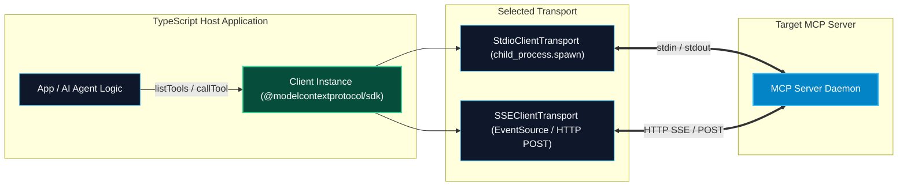

# Building Custom MCP Clients in TypeScript

> "Whether you are building a custom Electron desktop tool, a Next.js agentic dashboard, or a Node.js automation bot, the TypeScript MCP Client gives you programmatic, type-safe control over any MCP server on the planet."

---


### Step 1: Why Do We Need This?

#### The Real Problem

Modern AI applications are increasingly built on TypeScript and web technologies:
- Next.js web applications using the Vercel AI SDK want to give their web chat interface access to enterprise databases via MCP.
- Electron and Tauri desktop applications want to embed local filesystem and terminal MCP tools into their user interface.
- CLI automation tools written in Node.js need to orchestrate multiple MCP servers to execute CI/CD verification pipelines.
- You need a native, asynchronous TypeScript client that connects to both local `stdio` processes and remote `SSE` endpoints.

#### Why the TypeScript Client SDK Solves It

The `@modelcontextprotocol/sdk` package includes a complete, production-grade **`Client`** implementation:
- **`Client` Class:** Manages the entire JSON-RPC state machine, capability negotiation, and notification events.
- **Dual Transports:** Includes both **`StdioClientTransport`** (spawns child processes using Node.js `child_process`) and **`SSEClientTransport`** (uses WHATWG standard EventSource/Fetch for remote endpoints).
- **TypeScript Type Safety:** Full IntelliSense and type checking for tool discovery, arguments, and result payloads.

---

### Step 2: What Is It?

#### Simple Explanation: The Universal Adapter in Code

Think of the `Client` class like a **universal power adapter in your JavaScript code**:
- You create the client: `new Client({ name: "my-app", version: "1.0" })`.
- You plug in the appropriate cord:
  - Plug into a local subprocess: `new StdioClientTransport(...)`
  - Plug into a cloud server: `new SSEClientTransport(...)`
- Call `await client.connect(transport)`. The client powers on, shakes hands with the server, and immediately provides you with a list of callable tools and readable resources.

#### Core TypeScript Client Classes

| Class | Import Path | Responsibility |
| :--- | :--- | :--- |
| **`Client`** | `@modelcontextprotocol/sdk/client/index.js` | Core protocol engine and session coordinator. |
| **`StdioClientTransport`** | `@modelcontextprotocol/sdk/client/stdio.js` | Spawns and manages a local child process over stdio. |
| **`SSEClientTransport`** | `@modelcontextprotocol/sdk/client/sse.js` | Connects to a remote HTTP/SSE MCP server endpoint. |

---

### Step 3: Real-World Example

#### The Autonomous Pull Request Auditor in Node.js

A GitHub Actions workflow script written in TypeScript:
1. Spawns an internal Security Scanner MCP server using `StdioClientTransport`.
2. Connects and verifies protocol capabilities.
3. Calls `client.listTools()` to verify available security scanners.
4. Calls `client.callTool({ name: "scan_dependencies", arguments: { lockfile: "package-lock.json" } })`.
5. If critical vulnerabilities are returned, the script posts a comment to the GitHub PR and exits with code 1.

---

### Step 4: How Does It Work?

```text
1. Instantiate Client & Transport:
   const client = new Client({ name: "DevOpsRunner", version: "1.0.0" }, { capabilities: {} });
   const transport = new StdioClientTransport({ command: "node", args: ["./server.js"] });

2. Establish Connection & Handshake:
   await client.connect(transport); 
   // SDK automatically sends "initialize" and "notifications/initialized"

3. Query Available Capabilities:
   const { tools } = await client.listTools();
   const { resources } = await client.listResources();

4. Invoke Remote Action:
   const result = await client.callTool({ name: "calc", arguments: { a: 5, b: 10 } });

5. Disconnect:
   await client.close();
```

---

### Step 5: Code Example: Complete Runnable TypeScript MCP Client

Here is a complete, runnable TypeScript client script demonstrating connection, discovery, and execution:

```typescript
// custom-client.ts
import { Client } from "@modelcontextprotocol/sdk/client/index.js";
import { StdioClientTransport } from "@modelcontextprotocol/sdk/client/stdio.js";

async function main() {
  console.log("[CLIENT]: Initializing TypeScript MCP Client...");

  // 1. Create Client Instance with Metadata and Capabilities
  const client = new Client(
    {
      name: "SkillVault-Custom-Runner",
      version: "1.0.0"
    },
    {
      capabilities: {
        roots: { listChanged: true },
        sampling: {}
      }
    }
  );

  // 2. Define Transport (Using Stdio to launch a SQLite server as an example)
  const transport = new StdioClientTransport({
    command: "npx",
    args: ["-y", "@modelcontextprotocol/server-sqlite", "--db-path", ":memory:"]
  });

  // 3. Connect to Transport (Automatically executes protocol handshake)
  console.log("[CLIENT]: Connecting to server via stdio transport...");
  await client.connect(transport);
  console.log("[CLIENT]: Successfully connected and initialized!");

  // 4. Query Available Tools
  console.log("\n--- Querying Tools Catalog ---");
  const toolsResult = await client.listTools();
  console.log(`Discovered ${toolsResult.tools.length} tools on server:`);
  for (const t of toolsResult.tools) {
    console.log(`- [${t.name}]: ${t.description}`);
  }

  // 5. Execute Tool: Create a Products Table
  console.log("\n--- Calling Tool: 'read_query' to create table ---");
  const createTableResult = await client.callTool({
    name: "read_query",
    arguments: {
      query: "CREATE TABLE inventory (sku TEXT PRIMARY KEY, item_name TEXT, stock INT);"
    }
  });

  console.log("Create Table Status (isError):", createTableResult.isError);
  console.log("Create Table Output:", createTableResult.content);

  // 6. Insert and Query Records
  console.log("\n--- Inserting & Querying Records ---");
  await client.callTool({
    name: "read_query",
    arguments: {
      query: "INSERT INTO inventory VALUES ('SKU-9901', 'High-Gain Antigravity Coil', 42);"
    }
  });

  const queryResult = await client.callTool({
    name: "read_query",
    arguments: {
      query: "SELECT sku, item_name, stock FROM inventory WHERE stock > 10;"
    }
  });

  console.log("Query Results:");
  for (const item of queryResult.content) {
    if (item.type === "text") {
      console.log(item.text);
    }
  }

  // 7. Clean Disconnect
  console.log("\n[CLIENT]: Disconnecting transport and terminating process...");
  await client.close();
  console.log("[CLIENT]: Finished cleanly.");
}

main().catch((err) => {
  console.error("Client fatal error:", err);
  process.exit(1);
});
```

---

### Step 6: How Is It Used in Production?

#### Production Patterns & Edge Cases

| Scenario | Production Challenge | Recommended Solution |
| :--- | :--- | :--- |
| **Notification Listening** | Server emits resource updates; client must react in real-time. | Register notification listeners: `client.setNotificationHandler(schema, (notification) => ...)`. |
| **SSE Reconnections** | Remote network connection blips, dropping the SSE stream. | Wrap `SSEClientTransport` in an automatic reconnect policy with exponential backoff. |
| **Integration with Vercel AI SDK**| Converting MCP tool definitions into Vercel AI SDK `tool()` format. | Map `tool.inputSchema` to Zod using `json-schema-to-zod` or pass JSON schema directly to model adapters. |
| **Long-Running Process Leaks**| Node client exits abruptly, leaving orphaned child processes running. | Hook into process termination: `process.on('SIGINT', () => client.close())`. |

---

### Step 7: Quick Revision

- Use **`@modelcontextprotocol/sdk/client`** to build custom Node.js and TypeScript MCP clients.
- The **`Client`** class handles JSON-RPC handshakes, versioning, and correlation identifiers automatically.
- Use **`StdioClientTransport`** for local child processes and **`SSEClientTransport`** for remote HTTP services.
- Call **`client.listTools()`** to discover capabilities and **`client.callTool({ name, arguments })`** to execute actions.
- Always call **`await client.close()`** to release OS file handles, close sockets, and terminate child processes cleanly.

---

### Step 8: Final Flow Diagram



---

### Step 9: Quiz

1. What class in `@modelcontextprotocol/sdk` represents the core client-side protocol engine in TypeScript?
   - A) `AgentMaster`
   - B) `Client`
   - C) `SessionHub`
   - D) `SocketConnector`

2. What transport class is used when your TypeScript client needs to spawn a local CLI tool as a child process?
   - A) `WebSocketClientTransport`
   - B) `StdioClientTransport`
   - C) `SSHClientTransport`
   - D) `LocalHostTransport`

3. When does the client execute the `initialize` JSON-RPC handshake?
   - A) It never executes it
   - B) Automatically when you call `await client.connect(transport)`
   - C) Only when prompted by the user
   - D) After the first tool execution finishes

4. How do you cleanly terminate a TypeScript client session and kill spawned child processes?
   - A) `client.destroy()`
   - B) `await client.close()`
   - C) `process.abort()`
   - D) Turning off your laptop

*Submit your answers (e.g. 1-B, 2-B, 3-B, 4-B) to verify your score!*
