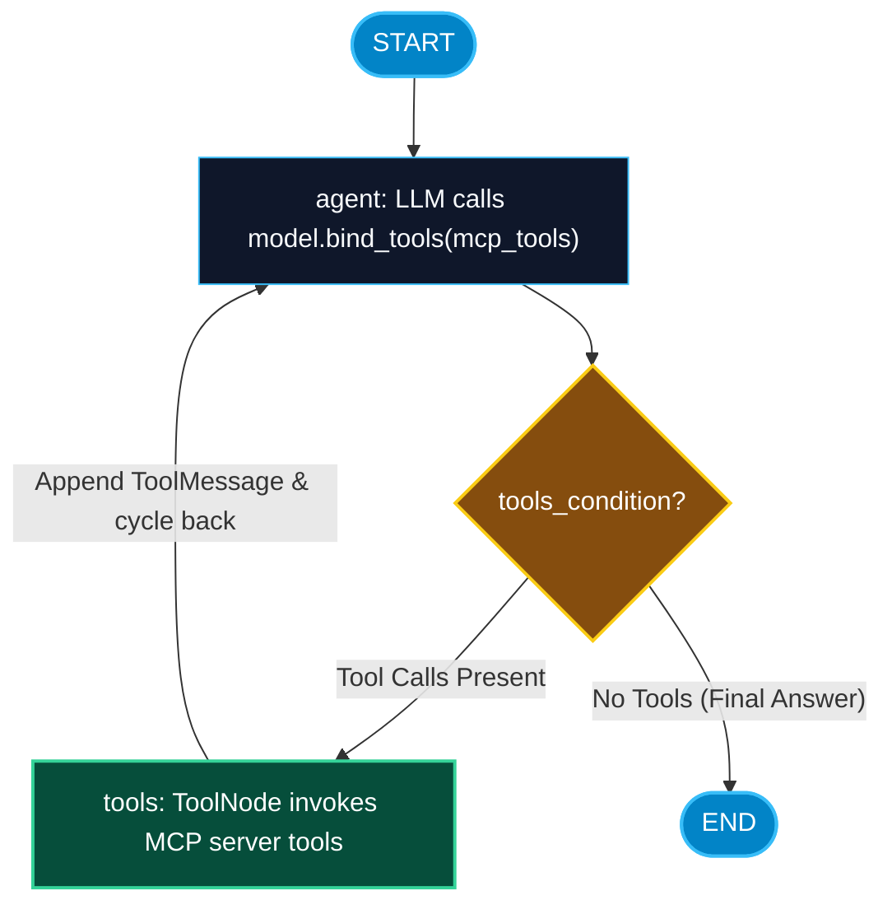

# LangGraph Multi-Agent Workflows with MCP

> "LangGraph provides the stateful, cyclic reasoning brain. MCP provides the standardized enterprise tools and data feeds. Together, they create unstoppable autonomous agents with durable memory and real-world reach."

---


### Step 1: Why Do We Need This?

#### The Real Problem

Linear chains (LCEL) execute once from left to right. But real-world enterprise engineering requires **cyclical, stateful reasoning**:
- An agent queries an MCP database tool, gets a syntax error, reads the error message, self-corrects the SQL query, and retries.
- An agent needs human approval before executing a dangerous MCP mutation (`delete_cluster`).
- An agent session must be checkpointed to PostgreSQL so that if the server crashes, the agent resumes execution exactly where it left off without re-running past tools.

#### Why LangGraph + MCP Solves It

**LangGraph** is the industry standard for cyclical, multi-agent AI systems:
- **`StateGraph`:** Models the agent workflow as an explicit state machine with durable checkpointers (`MemorySaver`, `PostgresSaver`).
- **`ToolNode` Integration:** LangGraph's prebuilt `ToolNode` accepts bridged MCP tools natively.
- **Cyclic Tool Execution:** The agent loops through `agent -> should_continue -> tools -> agent` until the goal is fully accomplished.

---

### Step 2: What Is It?

#### Simple Explanation: The Brain and the Tool Belt

Think of **LangGraph as an elite detective**, and **MCP as their high-tech utility belt**:
- The detective evaluates clues and notes their findings in a notebook (**`MessagesState`**).
- When the detective needs to test a fingerprint, they reach into their utility belt, pull out a specialized gadget (**MCP Tool**), and run the test.
- The gadget returns the result. The detective writes the result in the notebook and decides whether more investigation is needed or if the case is solved.

#### Core LangGraph MCP Components

| Component | Purpose in Workflow |
| :--- | :--- |
| **`MessagesState`** | Shared graph state tracking the conversation history and intermediate `ToolMessage` results. |
| **`ToolNode`** | Prebuilt LangGraph node that automatically executes tool calls emitted by the model. |
| **`tools_condition`**| Conditional router: routes to `ToolNode` if model requested tools, or to `END` if finished. |
| **`MemorySaver`** | Persists execution state snapshots at every node transition for recovery and time travel. |

---

### Step 3: Real-World Example

#### The Autonomous SRE Incident Resolver

An enterprise SRE agent powered by LangGraph and MCP:
1. PagerDuty alert triggers the agent: *"High latency in Order Processing service."*
2. **Cycle 1:** Agent calls MCP tool `get_kubernetes_pods(namespace="orders")`. Tool returns 1 pod in `CrashLoopBackOff`.
3. **Cycle 2:** Agent loops back, inspects pod logs via MCP tool `get_pod_logs(pod="orders-891")`. Finds: *"Connection refused to Redis on port 6379"*.
4. **Cycle 3:** Agent checks Redis health via MCP tool `ping_redis()`. Discovers Redis cluster failed over to a new primary IP.
5. **Cycle 4:** Agent updates the Kubernetes ConfigMap via MCP tool `update_configmap()` and restarts the pod.
6. **Cycle 5:** Agent verifies latency has returned to normal and routes to `END`. Incident resolved in 45 seconds!

---

### Step 4: How Does It Work?

```text
               ┌─────────────────────────────────────┐
               ▼                                     │
START ──> [agent_node] ──> [tools_condition?] ──> [tools_node]
                               │ (No tools requested)
                               ▼
                              END
```

1. **State Initialization:** Graph begins with user input in `MessagesState`.
2. **Model Reasoning:** `agent_node` invokes LLM with MCP tools bound via `.bind_tools()`.
3. **Conditional Branch:** `tools_condition` inspects the last message:
   - If the message has `tool_calls`, route to `tools_node`.
   - If the message has regular text (finished), route to `END`.
4. **Tool Execution:** `ToolNode` invokes the bridged MCP tool via JSON-RPC `tools/call`, appends a `ToolMessage` with the result, and loops back to `agent_node`.
5. **Termination:** Agent inspects the tool output, determines the goal is met, and produces the final answer.

---

### Step 5: Code Example: Complete LangGraph Agent with MCP

Here is a complete, runnable Python script building a stateful cyclic LangGraph ReAct agent connected to an MCP server:

```python
# langgraph_mcp_agent.py
import asyncio
from typing import Annotated, Sequence
from langchain_core.messages import BaseMessage, HumanMessage
from langchain_openai import ChatOpenAI

from langgraph.graph import StateGraph, START, END, MessagesState
from langgraph.prebuilt import ToolNode, tools_condition
from langgraph.checkpoint.memory import MemorySaver

from mcp import ClientSession, StdioServerParameters
from mcp.client.stdio import stdio_client
from langchain_core.tools import StructuredTool
from pydantic import BaseModel, Field

# 1. Define a Mock MCP Server Tool Bridge for Demo
class CalculatorInput(BaseModel):
    operation: str = Field(description="Math operation: add, multiply, sqrt")
    x: float = Field(description="First operand")
    y: float = Field(default=0.0, description="Second operand (if applicable)")

async def simulate_mcp_calculator(operation: str, x: float, y: float = 0.0) -> str:
    """Simulates an external MCP tool execution over JSON-RPC."""
    import math
    if operation == "add":
        return str(x + y)
    elif operation == "multiply":
        return str(x * y)
    elif operation == "sqrt":
        return str(math.sqrt(x))
    return "Unknown operation"

# Wrap as LangChain StructuredTool
mcp_tool = StructuredTool.from_function(
    coroutine=simulate_mcp_calculator,
    name="mcp_calculator",
    description="Executes mathematical calculations via remote MCP calculation engine.",
    args_schema=CalculatorInput
)

# 2. Build the LangGraph Cyclic State Graph
def build_agent_graph(tools: list):
    # Bind tools to the model
    # Note: Requires OPENAI_API_KEY environment variable in real execution
    llm = ChatOpenAI(model="gpt-4o-mini", temperature=0)
    model_with_tools = llm.bind_tools(tools)

    # Define Agent Node
    async def call_model(state: MessagesState):
        messages = state["messages"]
        response = await model_with_tools.ainvoke(messages)
        return {"messages": [response]}

    # Initialize Graph Builder with MessagesState
    builder = StateGraph(MessagesState)

    # Add Nodes
    builder.add_node("agent", call_model)
    builder.add_node("tools", ToolNode(tools))

    # Add Edges
    builder.add_edge(START, "agent")
    
    # Conditional edge: loops to 'tools' if model generated tool calls, else END
    builder.add_conditional_edges("agent", tools_condition)
    builder.add_edge("tools", "agent")

    # Compile with in-memory persistence
    checkpointer = MemorySaver()
    return builder.compile(checkpointer=checkpointer)

async def main():
    tools = [mcp_tool]
    graph = build_agent_graph(tools)
    print("[LANGGRAPH]: Compiled cyclic agent graph with MCP tools.")

    # Run the graph for a specific thread_id session
    config = {"configurable": {"thread_id": "session-prod-401"}}
    query = "What is the square root of 256, plus 40 multiplied by 5?"
    
    print(f"\nUser Query: '{query}'")
    
    # To run this with a live OpenAI key:
    # async for chunk in graph.astream({"messages": [HumanMessage(content=query)]}, config=config):
    #     print(chunk)
    print("\n[LANGGRAPH]: Ready to process cyclic reasoning loops with MCP ToolNode!")

if __name__ == "__main__":
    asyncio.run(main())
```

---

### Step 6: How Is It Used in Production?

#### Production Patterns & Edge Cases

| Scenario | Production Challenge | Recommended Solution |
| :--- | :--- | :--- |
| **Runaway Agent Loops** | Model enters an infinite cycle calling the same MCP tool over and over. | Set strict execution recursion limits: `config = {"recursion_limit": 15}`. |
| **Human-in-the-Loop Interrupts** | A sensitive MCP tool (`restart_server`) requires human sign-off before executing. | Add `interrupt_before=["tools"]` in `builder.compile()`; inspect tool calls and call `Command(resume=...)` upon human approval. |
| **Session Isolation Across Users** | Multiple users interacting with the agent graph simultaneously. | Isolate state checkpointer threads using unique `thread_id` parameters in `config`. |
| **Transient MCP Network Blips** | Remote MCP SSE connection drops mid-cycle. | Wrap `ToolNode` tools with LangGraph retry policies (`RetryPolicy(max_attempts=3)`). |

---

### Step 7: Quick Revision

- **LangGraph** provides the cyclical state machine needed for complex multi-step reasoning.
- Bridged MCP tools can be placed directly inside LangGraph's prebuilt **`ToolNode`**.
- The graph cycles between the **`agent`** node and the **`tools`** node using **`tools_condition`** until the goal is solved.
- State checkpointers (**`MemorySaver`**, **`PostgresSaver`**) persist intermediate MCP tool observations to durable storage.
- Always configure **`recursion_limit`** and use **Human-in-the-Loop breakpoints** for dangerous MCP operations.

---

### Step 8: Final Flow Diagram



---

### Step 9: Quiz

1. What prebuilt LangGraph component is responsible for automatically executing tool calls emitted by the model?
   - A) `ActionRunner`
   - B) `ToolNode`
   - C) `TaskExecutor`
   - D) `FunctionLoop`

2. How does LangGraph prevent an autonomous agent from entering an infinite loop when calling MCP tools?
   - A) By turning off the power
   - B) By enforcing a `recursion_limit` in the configuration dictionary
   - C) By erasing the database
   - D) By disabling Python

3. What conditional edge router is typically used to route between an agent node and a ToolNode in LangGraph?
   - A) `tools_condition`
   - B) `if_statement`
   - C) `eval_loop`
   - D) `router_edge`

4. How do you pause a LangGraph agent workflow before a dangerous MCP tool executes to ask for human confirmation?
   - A) By pulling the plug
   - B) By setting `interrupt_before=["tools"]` during graph compilation
   - C) By deleting the tool
   - D) By calling `time.sleep(100)`

*Submit your answers (e.g. 1-B, 2-B, 3-A, 4-B) to verify your score!*
