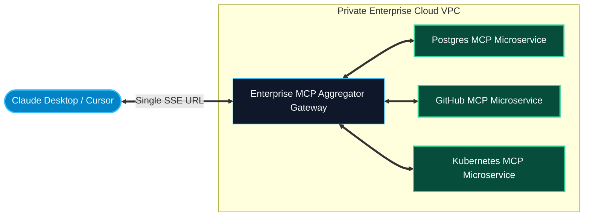

# MCP Reverse Proxies and Aggregators

> "Configuring 20 individual MCP servers on every developer's machine is an operational nightmare. An MCP Aggregator Gateway unifies your entire fleet of backend tools into a single, secure, authenticated endpoint."

---


### Step 1: Why Do We Need This?

#### The Real Problem

As enterprise adoption scales from 1 server to 30 servers:
- **Client Configuration Bloat:** Every developer must maintain a 400-line `claude_desktop_config.json` file on their laptop containing dozens of server commands and private secrets.
- **Client Resource Drain:** Spawning 25 child processes in Node.js or Python on a MacBook drains battery, consumes gigabytes of RAM, and slows down IDE startup.
- **Zero Centralized Governance:** Security teams have no visibility into what tools are installed or what sensitive data is being transmitted.
- **Firewall & VPC Obstacles:** Developers cannot reach internal microservices living inside a private AWS VPC without complex VPN tunneling.

#### Why MCP Aggregators Solve It

The **MCP Reverse Proxy & Aggregator Gateway** sits between hosts and backend tools:
1. **Single Entrypoint:** Hosts connect to a single SSE URL: `https://mcp-gateway.company.com/sse`.
2. **Unified Tool Catalog:** The gateway aggregates tools, resources, and prompts from 20+ backend microservices, prefixing them with clean namespaces (`db__query`, `git__commit`).
3. **Centralized Policy Enforcement:** Auth, rate limiting, DLP (Data Loss Prevention), and audit logging are enforced in one place.

---

### Step 2: What Is It?

#### Simple Explanation: The Corporate Switchboard Operator

Think of the MCP Gateway like a **central corporate switchboard**:
- In the old days, callers needed a separate direct telephone wire to every person in the building (20 separate lines).
- With a switchboard (**The Gateway**), outside callers dial one main number.
- The operator answers, asks who you want to reach, routes your call to the right extension (Postgres, GitHub, Slack), and connects you instantly.

#### Core Gateway Architectural Roles

| Role | Upstream Facing (Client) | Downstream Facing (Servers) |
| :--- | :--- | :--- |
| **Identity** | Acts as an **MCP Server** to Claude / Cursor. | Acts as an **MCP Client** to downstream tools. |
| **Catalog** | Merges tool lists into a single consolidated catalog. | Discovers capabilities across multiple child servers. |
| **Routing** | Strips namespace prefixes and forwards `tools/call`. | Forwards results back to the client. |

---

### Step 3: Real-World Example

#### The Enterprise Developer Gateway at Scale

A tech enterprise with 2,000 software engineers deploys an MCP Gateway on AWS ECS:
1. Developers add a single line to Cursor:
   ```json
   { "url": "https://mcp.internal.corp/sse" }
   ```
2. The Gateway authenticates the developer's corporate SSO identity.
3. Behind the scenes, the gateway maintains connections to:
   - AWS RDS Aurora (Database MCP)
   - Enterprise GitHub (DevOps MCP)
   - Datadog (Monitoring MCP)
   - Jira Cloud (Project Tracking MCP)
4. When the developer asks: *"Why did deployment 42 fail?"*, the gateway routes queries seamlessly across Datadog, GitHub, and Jira.

---

### Step 4: How Does It Work?

```text
Host (Cursor)                                         MCP Gateway Router                                  Downstream Servers
     │                                                        │                                                   │
     │ ── 1. tools/list ────────────────────────────────────> │                                                   │
     │                                                        │ ── tools/list ──────────────────────────────────> │ Server A (DB)
     │                                                        │ ── tools/list ──────────────────────────────────> │ Server B (Git)
     │                                                        │ <─ [db_query] ─────────────────────────────────── │
     │                                                        │ <─ [git_diff] ─────────────────────────────────── │
     │                                                        │ [Prefix namespaces: db__query, git__diff]         │
     │ <─ 2. [{name: "db__query"}, {name: "git__diff"}] ──────│                                                   │
     │                                                        │                                                   │
     │ ── 3. tools/call {name: "db__query", args} ──────────> │                                                   │
     │                                                        │ [Route prefix 'db__' -> Forward to Server A]      │
     │                                                        │ ── tools/call {name: "query", args} ────────────> │ Server A
     │                                                        │ <─ CallToolResult ─────────────────────────────── │
     │ <─ 4. Forward CallToolResult to Host ──────────────────│                                                   │
```

---

### Step 5: Code Example: Python Async MCP Aggregator Gateway

Here is a complete, runnable Python gateway demonstrating how to aggregate multiple downstream toolsets and route calls based on namespace:

```python
# mcp_aggregator_gateway.py
import asyncio
from typing import Dict, Any, List

class DownstreamServerMock:
    def __init__(self, name: str, tools: List[str]):
        self.name = name
        self.tools = tools

    async def list_tools(self) -> List[Dict[str, Any]]:
        return [
            {"name": t, "description": f"Tool '{t}' provided by {self.name} server."}
            for t in self.tools
        ]

    async def call_tool(self, tool_name: str, args: Dict[str, Any]) -> str:
        return f"Executed '{tool_name}' on [{self.name}] with args: {args}"

class MCPAggregatorGateway:
    def __init__(self):
        # Maps namespace prefix -> downstream server client
        self.downstream_services: Dict[str, DownstreamServerMock] = {}

    def register_downstream(self, namespace: str, server: DownstreamServerMock):
        self.downstream_services[namespace] = server
        print(f"[GATEWAY]: Registered service '{server.name}' under namespace '{namespace}__'")

    async def get_aggregated_tools(self) -> List[Dict[str, Any]]:
        """Merges all downstream tools with clean namespace prefixes."""
        aggregated = []
        for ns, server in self.downstream_services.items():
            child_tools = await server.list_tools()
            for ct in child_tools:
                aggregated.append({
                    "name": f"{ns}__{ct['name']}",
                    "description": f"[{server.name.upper()}]: {ct['description']}"
                })
        return aggregated

    async def dispatch_tool_call(self, namespaced_tool_name: str, arguments: Dict[str, Any]) -> str:
        """Parses namespace prefix and forwards call to target backend server."""
        if "__" not in namespaced_tool_name:
            raise ValueError(f"Invalid namespaced tool: '{namespaced_tool_name}'. Expected format: 'namespace__tool_name'")

        namespace, actual_tool_name = namespaced_tool_name.split("__", 1)
        target_server = self.downstream_services.get(namespace)
        if not target_server:
            raise ValueError(f"Unknown downstream service namespace: '{namespace}'")

        print(f"[GATEWAY ROUTE]: Routing '{namespaced_tool_name}' -> '{actual_tool_name}' on {target_server.name}")
        return await target_server.call_tool(actual_tool_name, arguments)

async def main():
    gateway = MCPAggregatorGateway()

    # Register 3 microservices
    gateway.register_downstream("db", DownstreamServerMock("Postgres-Cluster", ["query", "explain_plan"]))
    gateway.register_downstream("gh", DownstreamServerMock("GitHub-Enterprise", ["open_pr", "merge_pr"]))
    gateway.register_downstream("k8s", DownstreamServerMock("Kubernetes-Prod", ["restart_pod", "get_logs"]))

    # 1. Fetch Aggregated Catalog
    print("\n--- Aggregated Tool Catalog ---")
    catalog = await gateway.get_aggregated_tools()
    for tool in catalog:
        print(f"- {tool['name']}: {tool['description']}")

    # 2. Dispatch Tool Calls
    print("\n--- Dispatching Routed Calls ---")
    res1 = await gateway.dispatch_tool_call("db__query", {"sql": "SELECT COUNT(*) FROM users;"})
    print("Result 1:", res1)

    res2 = await gateway.dispatch_tool_call("k8s__restart_pod", {"pod": "auth-svc-801"})
    print("Result 2:", res2)

if __name__ == "__main__":
    asyncio.run(main())
```

---

### Step 6: How Is It Used in Production?

#### Production Patterns & Edge Cases

| Scenario | Production Challenge | Recommended Solution |
| :--- | :--- | :--- |
| **Downstream Outages & Timeouts**| One downstream server freezes, causing the gateway's `tools/list` to hang. | Use a Circuit Breaker pattern with strict timeouts (`asyncio.gather(*calls, return_exceptions=True)`). |
| **Service Auto-Discovery** | New microservice MCP servers spin up dynamically in Kubernetes. | Integrate gateway with Consul, etcd, or Kubernetes DNS to auto-register new server endpoints. |
| **Global Audit Logging** | Maintaining compliance across 50 backend tools. | Gateway generates unified OpenTelemetry traces and structured JSON audit events for every routed tool execution. |
| **Token-Saving Catalog Filtering**| Aggregating 20 servers yields 150 tools, exceeding client context limits. | Combine gateway aggregation with Dynamic Semantic Tool Retrieval to return only relevant tools to the client. |

---

### Step 7: Quick Revision

- An **MCP Aggregator Gateway** acts as a reverse proxy, combining multiple downstream servers into a single endpoint.
- Clients connect once to the gateway, eliminating configuration bloat and multiple local subprocesses.
- Tools are organized using **namespaces** (e.g. `db__query`, `gh__create_pr`) to prevent naming conflicts.
- Centralizes authentication, policy enforcement, rate limiting, and audit logging for security compliance.
- Implement **circuit breakers** so an outage in one downstream service does not take down the entire gateway.

---

### Step 8: Final Flow Diagram



---

### Step 9: Quiz

1. What is the primary benefit of deploying an MCP Aggregator Gateway in an enterprise?
   - A) It removes the need for Python
   - B) It consolidates multiple backend MCP servers into a single authenticated URL, eliminating client-side config bloat
   - C) It makes databases redundant
   - D) It bypasses security audits

2. How does an MCP gateway prevent naming collisions when multiple backend servers export a tool named `search`?
   - A) It deletes one of the tools
   - B) It prefixes tool names with a namespace identifier (e.g. `db__search` vs `slack__search`)
   - C) It renames them to random numbers
   - D) It asks the model to vote

3. What pattern should the gateway use to prevent a single slow downstream server from hanging the entire catalog query?
   - A) Infinite sleep loop
   - B) Circuit Breaker with per-service timeouts
   - C) Rebooting the gateway
   - D) Disabling the network

4. In an aggregator architecture, what role does the gateway play relative to the host application?
   - A) It acts as an MCP Server
   - B) It acts as an operating system kernel
   - C) It acts as a database
   - D) It acts as a CSS stylesheet

*Submit your answers (e.g. 1-B, 2-B, 3-B, 4-A) to verify your score!*
