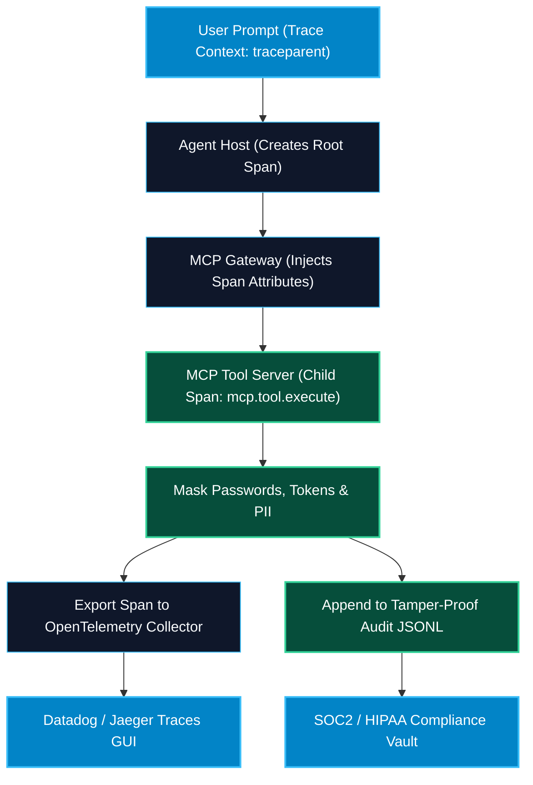

# Observability, OpenTelemetry, and Audit Logging in MCP

> "An AI agent operating without distributed tracing and immutable audit logs is an unguided missile in your enterprise architecture. Observability turns black-box agent tool calls into transparent, debuggable software engineering."

---


### Step 1: Why Do We Need This?

#### The Real Problem

When an autonomous agent interacts with enterprise systems, debugging failures without telemetry is nearly impossible:
- Why did a user's prompt take 14 seconds to complete? Was the LLM slow, was the MCP gateway congested, or was the database query stuck in a table lock?
- A customer data deletion tool was invoked. *Who* triggered it? *Which* prompt instructed the model? *What* exact arguments were supplied?
- Traditional REST API monitors do not understand JSON-RPC 2.0 payloads, MCP resource subscriptions, or cyclical agent reasoning loops.

#### Why OpenTelemetry & Audit Logging Solve It

Instrumenting MCP with **OpenTelemetry (OTel)** and **Structured Audit Logging** provides complete transparency:
1. **Distributed Tracing:** Generates a unified `trace_id` that tracks a request from the user's chat prompt, through the LangGraph agent, across the MCP Gateway, into the database server, and back.
2. **Span Metrics:** Measures granular latencies for every phase: serialization, network transport, parameter validation, and execution.
3. **Compliance Audit Trails:** Emits structured JSON events recording user identity, tool name, masked parameters, and execution outcome for SOC2, ISO 27001, and HIPAA compliance.

---

### Step 2: What Is It?

#### Simple Explanation: The Aircraft Black Box Flight Recorder

Think of an autonomous AI system like an **airliner on autopilot**:
- When everything flies smoothly, you monitor air speed and altitude gauges (**Metrics**).
- If the autopilot makes an unexpected turn (invokes an unexpected tool), the flight recorder (**OpenTelemetry Traces**) records the exact sensor inputs, pilot instructions, and rudder movements millisecond by millisecond.
- If an investigation is needed, the black box provides an tamper-proof, time-stamped log (**Audit Trail**) of exactly what occurred.

#### The Three Pillars of MCP Observability

| Pillar | What It Tracks | Technology |
| :--- | :--- | :--- |
| **Distributed Traces** | Request journey and latency across host, gateway, and tools. | OpenTelemetry Spans (`traceparent`, Jaeger, Datadog). |
| **Metrics** | Aggregated operational vitals (tool call rates, error percentages). | Prometheus, Grafana, CloudWatch. |
| **Structured Audit Logs** | Tamper-proof records of security-sensitive mutations. | JSON Lines (`jsonl`), AWS CloudTrail, Splunk. |

---

### Step 3: Real-World Example

#### Debugging a Slow Production Agent Flow

An engineer in Cursor prompts: *"Analyze our top 10 churned customers this quarter."*
- Total response time: 8.4 seconds.
- The engineer opens the Datadog APM trace:
  - `host.reasoning_turn_1`: 1.2s (Claude 3.5 Sonnet)
  - `mcp.gateway.dispatch`: 4ms
  - `mcp.tool.execute_query` (PostgreSQL): **6.9s** 🚨
  - `host.reasoning_turn_2`: 0.3s
- **Diagnosis:** The trace immediately reveals that the slowdown was not the LLM or MCP protocol; the database query was performing a full table scan on unindexed customer rows!

---

### Step 4: How Does It Work?

```text
Host / Agent Client (Injects Trace Context: traceparent)
       │
       ▼
[MCP Gateway] ────────────────── Span 1: mcp.gateway.route
       │                         - Attributes: user_id, tenant_id
       │
       ▼
[Target MCP Server] ──────────── Span 2: mcp.server.execute_tool
       │                         - Attributes: mcp.tool.name, mcp.tool.is_error
       │
       ▼
[PostgreSQL Database] ────────── Span 3: db.query
                                 - Attributes: db.system="postgresql"
                                 - Metrics: duration_ms=42.1
```

1. **Context Propagation:** The client attaches W3C Trace Context (`traceparent` header or `_meta.traceparent`) to the JSON-RPC request.
2. **Span Creation:** The server extracts the context and starts an active OpenTelemetry child span (`mcp.tool_call`).
3. **Attribute Recording:** Relevant metadata is attached to the span: `mcp.tool.name`, `mcp.protocol.version`, `user.id`.
4. **Audit Log Emission:** On completion, a structured JSON audit event is written to the audit log stream.

---

### Step 5: Code Example: Python OpenTelemetry & Audit Middleware

Here is a complete, runnable Python script demonstrating OpenTelemetry span instrumentation and structured audit logging for an MCP tool server:

```python
# otel_audit_server.py
import time
import json
from typing import Dict, Any

# Mock OpenTelemetry Tracer implementation for standalone demonstration
class MockSpan:
    def __init__(self, name: str, trace_id: str):
        self.name = name
        self.trace_id = trace_id
        self.attributes = {}
        self.start_time = time.time()
        self.duration_ms = 0.0

    def set_attribute(self, key: str, value: Any):
        self.attributes[key] = value

    def end(self):
        self.duration_ms = round((time.time() - self.start_time) * 1000, 2)
        print(f"[OTEL TRACE]: Span '{self.name}' ended | TraceID: {self.trace_id} | Duration: {self.duration_ms}ms")
        print(f"              Attributes: {self.attributes}")

class MockTracer:
    def start_span(self, name: str, trace_id: str) -> MockSpan:
        return MockSpan(name, trace_id)

tracer = MockTracer()

class ObservableMCPServer:
    def __init__(self):
        self.audit_log_file = "mcp_audit.log"

    def _mask_sensitive_data(self, data: Dict[str, Any]) -> Dict[str, Any]:
        """Sanitizes passwords, tokens, and PII from audit records."""
        sanitized = data.copy()
        for k in sanitized:
            if any(secret_term in k.lower() for secret_term in ["password", "secret", "token", "key"]):
                sanitized[k] = "********"
        return sanitized

    def _write_audit_log(self, audit_event: Dict[str, Any]):
        """Writes structured JSON-lines record for security compliance."""
        json_line = json.dumps(audit_event)
        print(f"[AUDIT EVENT]: {json_line}")

    def execute_tool_with_telemetry(
        self, 
        tool_name: str, 
        arguments: Dict[str, Any], 
        user_id: str, 
        trace_id: str
    ) -> Dict[str, Any]:
        """Executes tool surrounded by OpenTelemetry spans and compliance auditing."""
        span = tracer.start_span(f"mcp.tool.{tool_name}", trace_id)
        span.set_attribute("mcp.tool.name", tool_name)
        span.set_attribute("user.id", user_id)
        span.set_attribute("rpc.system", "mcp")

        start_time = time.time()
        is_error = False
        result_message = ""

        try:
            # Simulate tool execution
            if tool_name == "delete_customer_records":
                time.sleep(0.05) # 50ms work
                result_message = f"Purged customer record {arguments.get('customer_id')}"
            else:
                raise ValueError(f"Unknown tool '{tool_name}'")

            span.set_attribute("mcp.is_error", False)
            return {"isError": False, "content": [{"type": "text", "text": result_message}]}

        except Exception as err:
            is_error = True
            result_message = str(err)
            span.set_attribute("mcp.is_error", True)
            span.set_attribute("error.message", str(err))
            return {"isError": True, "content": [{"type": "text", "text": result_message}]}

        finally:
            span.end()
            # Generate immutable audit event
            audit_record = {
                "timestamp": time.time(),
                "trace_id": trace_id,
                "user_id": user_id,
                "tool_name": tool_name,
                "arguments": self._mask_sensitive_data(arguments),
                "is_error": is_error,
                "duration_ms": round((time.time() - start_time) * 1000, 2)
            }
            self._write_audit_log(audit_record)

if __name__ == "__main__":
    server = ObservableMCPServer()

    print("--- 1. Executing Tool with Distributed Trace & Audit ---")
    res = server.execute_tool_with_telemetry(
        tool_name="delete_customer_records",
        arguments={"customer_id": "CUST-9821", "api_token": "sk-secret-9941"},
        user_id="operator_alice",
        trace_id="4bf92f3577b34da6a3ce929d0e0e4736"
    )
```

---

### Step 6: How Is It Used in Production?

#### Production Patterns & Edge Cases

| Scenario | Production Challenge | Recommended Solution |
| :--- | :--- | :--- |
| **High Trace Ingestion Costs** | 100 agents generating 100k spans/day creates huge Datadog bills. | Implement OpenTelemetry **Head-based or Tail-based sampling**: retain 100% of error traces and 5% of successful traces. |
| **Accidental PII Ingestion** | Prompt arguments contain customer credit cards or social security numbers. | Run regex PII scrubbing on all argument dictionaries before adding them as OTel span attributes. |
| **Trace Context Over Stdio Pipes**| Passing distributed trace IDs through standard input/output subprocesses. | Inject traceparent into request parameters: `_meta: { "traceparent": "00-4bf92...-01" }`. |
| **Immutable Audit Storage** | Compliance auditors require proof that audit logs were not modified. | Ship structured JSON logs directly to Amazon S3 Object Lock (WORM: Write Once Read Many) or Google Cloud Storage retention buckets. |

---

### Step 7: Quick Revision

- Never deploy enterprise MCP servers without **OpenTelemetry distributed tracing** and **structured audit logging**.
- Use **`traceparent`** context propagation to link user prompts, agent loops, gateway routing, and database queries.
- Attach standard attributes to spans: `mcp.tool.name`, `user.id`, `mcp.is_error`.
- Always **mask sensitive credentials and PII** before serializing tool arguments into audit logs or span attributes.
- Use **sampling policies** to control telemetry storage costs while preserving 100% of error and security traces.

---

### Step 8: Final Flow Diagram



---

### Step 9: Quiz

1. What industry standard is used to propagate distributed trace IDs across microservices and MCP servers?
   - A) SOAP Headers
   - B) W3C Trace Context (`traceparent`) / OpenTelemetry
   - C) Cookie headers
   - D) HTML meta tags

2. Why must sensitive parameters (like API keys or passwords) be masked before recording audit logs?
   - A) To save memory
   - B) To comply with data privacy regulations (GDPR, SOC2, HIPAA) and prevent credential leakage in log aggregation systems
   - C) Because JSON does not allow passwords
   - D) To make logs look cleaner

3. What OpenTelemetry sampling strategy retains 100% of failed requests while only saving a small fraction of successful requests?
   - A) Random Coin Flip
   - B) Tail-Based Sampling
   - C) FIFO Queue
   - D) Round Robin

4. How is trace context typically transmitted across an MCP stdio pipe?
   - A) By shouting at the monitor
   - B) Encapsulated inside the request's `_meta.traceparent` dictionary
   - C) Written to a floppy disk
   - D) It cannot be transmitted

*Submit your answers (e.g. 1-B, 2-B, 3-B, 4-B) to verify your score!*
